# Manual del sistema Prime IQ

*Documento de traspaso · Market Scan*

Cómo está construido, dónde corre y cómo se opera el back office de Prime IQ: el backoffice de Market Scan, el CRM en Strapi, el sistema de integraciones en n8n y las bases de datos que los conectan. Las credenciales aparecen enmascaradas (`xxx****`).

| Fecha | Admin | Strapi | n8n | Preparado por |
|---|---|---|---|---|
| 08 oct 2026 | v1.27.3 | 5.30.0 | 9 workflows | devroot.studio |

## Lo que hay detrás de Market Scan

*El sistema en cifras · 8 oct 2026*

| Cifra | Qué | Detalle |
|---|---|---|
| 238,177 | unidades inmobiliarias gestionadas en el CRM | 1,693 bloques · 1,115 proyectos · 537 desarrolladoras |
| 62,471 | líneas de código en el backoffice | 249 archivos TypeScript · 32 pantallas · 11 APIs propias |
| 317 | nodos de automatización | 9 integraciones en n8n |
| 87 | tablas en MySQL | 719 columnas · 29 modelos de datos |
| 3 · 2 | dominios y países | vivienda, oficinas, industrial · GT y SV |
| 18 · 7 | bancos y monedas | financiamiento y tipos de cambio |
| 1,313 | textos en español e inglés | interfaz bilingüe |
| 501 | commits de desarrollo | 51 versiones publicadas del backoffice |
| 85 · 18 | amenidades y servicios | catálogos que viajan al warehouse |
| 8 · 7 | secuencias y escenarios de prueba | documentados en este manual |

---

## Resumen ejecutivo

*01 · Visión general*

Prime IQ recolecta y mantiene datos de mercado inmobiliario (proyectos, bloques y unidades) en Guatemala y El Salvador. Este sistema es la herramienta interna donde el equipo captura, corrige y publica esos datos.

**Backoffice · dashboard de Market Scan — admin.primeiqlatam.com**

Aplicación Next.js en Vercel. El equipo edita proyectos, bloques y unidades (en una hoja tipo Excel), perfiles de tipo de cambio y catálogos. También lanza sincronizaciones y conversa con el Copilot.

**CRM — Strapi v5**

Fuente de verdad de los datos. Corre en AWS App Runner y guarda en MySQL (AWS RDS). Maneja usuarios, roles y permisos.

**Sistema de integraciones — n8n.primeiqlatam.com**

Sincroniza Strapi con el warehouse MySQL que alimenta los tableros, recalcula contadores de bloque, obtiene el tipo de cambio de Banguat y ejecuta el Copilot de IA.

**Warehouse legado — MySQL de tableros**

Base histórica (`housing_*`, `office_*`, `industrial_*`) que consumen los tableros. Hoy recibe los datos desde Strapi (push), y también puede devolverlos (pull).

> **Nombres que usa este documento** **Backoffice**: el dashboard administrativo de Market Scan (repo `market-scan-back-office`, también llamado "admin"). **CRM**: Strapi, donde viven los datos, los usuarios y los permisos. **Sistema de integraciones**: n8n, que corre en Docker sobre Coolify.

---

## Cómo creció Market Scan

*02 · Visión general*

Market Scan creció junto con la operación de Prime IQ. En 9 meses de acompañamiento continuo, el sistema se adaptó a nuevos países, nuevos tipos de inmueble y reglas de negocio que cambiaron en el camino. Las etapas van en orden; las marcadas con `Se sumó durante el proyecto` surgieron a medida que la operación lo pidió.

### Hito clave: Liberamos a IT

Enviar y corregir datos en el warehouse de los tableros dependía de scripts manuales que solo podía correr el equipo de IT. Hoy un super admin lo hace desde el backoffice con un clic, con respaldo automático y bitácora de cada bloque.

- **Antes:** Scripts manuales del equipo de IT
- **Hoy:** Un clic en /sync, sin depender de IT

### Hito clave: Datos en lenguaje natural para todo el equipo

El Copilot de IA responde preguntas sobre proyectos, bloques y unidades directo desde el CRM, lee PDF, Excel y audios, y calcula conteos y promedios. Nadie tiene que pedir un reporte a IT ni armar filtros para obtener una respuesta.

- **Antes:** Pedir reportes o buscar en archivos
- **Hoy:** Preguntar en /copilots y recibir la respuesta

### Antes y hoy

| Tema | Antes | Hoy |
|---|---|---|
| Captura de datos | Excel y formularios de Google | Hoja de unidades en el backoffice, con validación y fórmulas en cascada |
| Cálculos | Fórmulas copiadas en cada archivo | Precio sin IVA, por m², cuota, ingreso, tamaños y absorción calculados igual para todos |
| Monedas y medidas | Conversiones a mano en cada hoja | USD y moneda local en dos sentidos; m² o varas² con un clic |
| Países y tipos de inmueble | Guatemala, vivienda | Guatemala y El Salvador; vivienda, oficinas e industrial |
| Envío y corrección de datos | Scripts manuales que corría el equipo de IT para empujar y corregir datos en el warehouse | Un clic desde el backoffice, sin depender de IT: push y pull con respaldos y bitácora de cada corrida |
| Consulta de datos | Buscar en archivos | Copilot de IA que responde sobre proyectos, bloques y unidades |
| Control | Archivos compartidos | Usuarios, roles y permisos; cada cambio registrado |

### Etapas, en orden

1. **Antes: Excel y formularios de Google**  
   La captura de mercado vivía en hojas de cálculo y formularios. Cada archivo tenía sus propias fórmulas, y para empujar o corregir datos en el warehouse que alimenta los tableros hacía falta que el equipo de IT corriera scripts manuales.  
   `Punto de partida`
2. **La base: CRM y modelo de datos**  
   El CRM en Strapi con la jerarquía proyecto → bloque → unidad, catálogos (desarrolladoras, amenidades, servicios, NSE, estados) y usuarios con roles.  
   `CRM`
3. **El backoffice de Market Scan**  
   Login, roles, idiomas español e inglés, formularios de proyectos y bloques con mapa, y módulo de catálogos.  
   `Backoffice`
4. **La hoja de unidades**  
   Una hoja tipo Excel dentro del backoffice: edición masiva, pegado, deshacer, fórmulas en cascada, m² o varas² y guardado en lote.  
   `Backoffice`
5. **Los datos históricos llegan al CRM**  
   Se migraron proyectos, bloques y unidades del warehouse al CRM, con sus catálogos y amenidades.  
   `Datos`
6. **Tipos de cambio y moneda local** · *Se sumó durante el proyecto*  
   Perfiles de tipo de cambio por proyecto con siete monedas, precios locales editables y el tipo de cambio diario de Banguat.  
   `Backoffice` `Integraciones`
7. **Contadores automáticos del bloque**  
   Cada vez que se guardan unidades, n8n recalcula disponibles, totales y promedios del bloque.  
   `Integraciones`
8. **Copilot de IA** · *Hito clave*  
   Un asistente que consulta el CRM, lee PDF, Excel y audios, recuerda la conversación y responde con tablas y tarjetas.  
   → Cualquier persona del equipo consulta los datos en lenguaje natural, sin reportes ni filtros.  
   `IA`
9. **Reglas de tamaño y conciliación de fórmulas** · *Se sumó durante el proyecto*  
   Nuevas reglas para tamaño total, habitable y parqueo. Al abrir un bloque, el sistema compara lo guardado con las fórmulas y marca las diferencias.  
   `Regla de negocio`
10. **El Salvador** · *Se sumó durante el proyecto*  
   Segundo país: filtros por país, y tasa de IVA y parámetros de cuota propios para El Salvador.  
   `Nuevo país`
11. **Promedios y alertas en la hoja** · *Se sumó durante el proyecto*  
   Barra de herramientas agrupada, promedios del bloque y avisos cuando un precio o mantenimiento por m² se sale del rango.  
   `Backoffice`
12. **Sincronización con los tableros en un clic** · *Hito clave* · *Se sumó durante el proyecto*  
   Lo que antes requería scripts manuales del equipo de IT ahora lo hace un super admin desde /sync con un clic: elige el tipo de inmueble y los bloques, y el sistema envía los datos al warehouse con respaldo antes de escribir y bitácora de cada bloque.  
   → Liberamos a IT: el equipo de negocio envía y corrige datos sin pedir ayuda técnica.  
   `Integraciones` `Sin depender de IT`
13. **Pull: corregir el CRM desde el warehouse** · *Hito clave* · *Se sumó durante el proyecto*  
   El camino inverso, también en un clic y sin scripts: trae catálogos, proyectos y bloques con sus unidades, en tres fases ordenadas.  
   → Corregir datos dejó de ser una tarea de IT.  
   `Integraciones` `Sin depender de IT`
14. **Oficinas e industrial** · *Se sumó durante el proyecto*  
   Dos tipos de inmueble nuevos, con sus campos propios, filtros por tipo y sincronización en ambos sentidos.  
   `Nuevo dominio`
15. **Financiamiento por bloque** · *Se sumó durante el proyecto*  
   Enganche, plazos y la tasa de 18 bancos por bloque, visibles en el backoffice y enviados a los tableros.  
   `Regla de negocio`
16. **IVA por operación y medidas industriales** · *Se sumó durante el proyecto*  
   La tasa de IVA pasó a depender de la operación; en industrial, las medidas se calculan solas.  
   `Regla de negocio`
17. **Copilot con estadísticas** · *Hito clave* · *Se sumó durante el proyecto*  
   Conteos, promedios y extremos sobre las unidades, y archivo de conversaciones.  
   → El Copilot pasó de buscar datos a analizarlos.  
   `IA`
18. **Mantenimiento igual en backoffice y tableros** · *Se sumó durante el proyecto*  
   El mantenimiento viaja sin ajustes entre el CRM y el warehouse, y los nombres de bloques y unidades quedan limpios.  
   `Regla de negocio`
19. **Hoy**  
   Tres sistemas en producción, nueve integraciones, dos países, tres tipos de inmueble y 238 mil unidades en el CRM.  
   `Market Scan`

---

## Fichas técnicas

*03 · Visión general*

Una ficha por proyecto que se entrega: nombre, dirección, tecnología, lenguaje, dependencias, repositorio, dónde corre y con qué se conecta. Desde cada ficha se puede saltar a su pieza en el mapa o a sus variables de entorno.

### Backoffice

Dashboard administrativo de Market Scan. El equipo captura y corrige proyectos, bloques y unidades, mantiene catálogos y tipos de cambio, lanza sincronizaciones y consulta el Copilot.

| Campo | Valor |
|---|---|
| Nombre simple | Backoffice |
| Nombre oficial | Market Scan Back Office (paquete `market-scan-back-office`) |
| Estado | En producción |
| Aplicación | https://admin.primeiqlatam.com |
| Tecnología | Next.js 16.0.10 (App Router) · React 19.2 · Tailwind CSS 4 · shadcn/ui (Radix) · Glide Data Grid |
| Lenguaje | TypeScript (TSX) y CSS con Tailwind |
| Runtime | Node.js 24.14.1 (.nvmrc), mínimo 20 · gestor pnpm |
| Versión | 1.27.3 (30 sep 2026) |
| Repositorio | github.com/Admin-PrimeIQ/market-scan-back-office — Rama main. Vercel solo despliega commits de la cuenta Admin-PrimeIQ con correo engteam@primeiqlatam.com. |
| Dónde corre | Vercel (serverless). Despliegue automático al hacer push a main. |
| Datos | No tiene base propia. Lee y escribe en el CRM por su proxy /api/strapi. |
| Autenticación | Login contra el CRM (JWT guardado en el navegador). Roles del CRM; super admin habilita /sync. |
| Idiomas | Español e inglés (cookie locale, next-intl). |
| Pruebas | node --test sobre lib/, Copilot y unidades. |
| Licencia | Privada (UNLICENSED). |
| Depende de | CRM, Block Edit Queue, Sync Writeback API, Copilot 2.2, Chat Sessions API, Banguat Exchange |
| Lo usan | Equipo Prime IQ, Super admin |

**Dependencias principales**

| Paquete | Versión | Para qué |
|---|---|---|
| next | 16.0.10 | framework web |
| react / react-dom | 19.2.0 | interfaz |
| @glideapps/glide-data-grid | 6.0.4-alpha24 | hoja de unidades |
| next-intl | ^4.7.0 | idiomas |
| @n8n/chat | 1.14.0 (con parche) | widget del Copilot |
| tailwindcss | 4.1.9 | estilos |
| @radix-ui/* (shadcn/ui) | varias | componentes |
| react-hook-form + zod | ^7.60 · 3.25.76 | formularios y validación |
| maplibre-gl | ^5.24 | mapas (base CARTO sin llave) |
| recharts | 2.15.4 | gráficas |
| @uiw/react-codemirror | — | visor JSON de sincronización |
| sonner / sileo | — | avisos |
| @vercel/analytics | 1.3.1 | analítica |
| patch-package | — | aplica el parche de @n8n/chat |

**Comandos**

```bash
pnpm install
pnpm dev
pnpm build
pnpm start
```

### CRM

Fuente de verdad de Prime IQ: proyectos, bloques, unidades, catálogos, perfiles de tipo de cambio, usuarios, roles y permisos. Expone la API REST que usan el backoffice y n8n.

| Campo | Valor |
|---|---|
| Nombre simple | CRM |
| Nombre oficial | Prime IQ Data System (Strapi) (paquete `backend`) |
| Estado | En producción |
| API | https://gep8aekqnp.us-east-1.awsapprunner.com/api |
| Panel | https://gep8aekqnp.us-east-1.awsapprunner.com/admin |
| Documentación | https://gep8aekqnp.us-east-1.awsapprunner.com/documentation |
| Tecnología | Strapi 5.30.0 (headless CMS) · REST y GraphQL · MySQL |
| Lenguaje | JavaScript (Node.js); modelos en JSON |
| Runtime | Node.js 20 o 22 |
| Versión | Strapi 5.30.0 |
| Repositorio | github.com/Admin-PrimeIQ/dataSystem — Rama main. Código en backend/. 59 commits. |
| Dónde corre | AWS App Runner, us-east-1. Compila desde GitHub; build y variables en la consola de AWS. |
| Datos | AWS RDS MySQL us-east-2, base strapi (87 tablas). Archivos con el proveedor local de Strapi. |
| Autenticación | Plugin users-permissions: Public, Authenticated, Operator, Supervisor, Administrator, Super Administrator. Panel con usuarios propios. |
| Idiomas | i18n desactivado. |
| Pruebas | 4 migraciones en database/migrations que corren al arrancar. |
| Licencia | Privada. |
| Depende de | MySQL del CRM |
| Lo usan | Backoffice, Block Edit Queue, Resolve Targets, Block Worker, Pull Block Worker, Copilot 2.2 |

**Dependencias principales**

| Paquete | Versión | Para qué |
|---|---|---|
| @strapi/strapi | 5.30.0 | núcleo |
| @strapi/plugin-users-permissions | 5.30.0 | login, roles y permisos |
| @strapi/plugin-documentation | ^5.30.0 | OpenAPI en /documentation |
| @strapi/plugin-graphql | ^5.30.0 | API GraphQL |
| @strapi/provider-email-nodemailer | ^5.33.2 | correo por SMTP |
| mysql2 | ^3.15.1 | driver de MySQL |
| strapi-plugin-config-sync | ^3.1.2 | roles y vistas versionados |
| strapi-plugin-schema-visualizer | ^1.0.5 | diagrama del modelo en el panel |
| slugify | ^1.6.6 | códigos |
| better-sqlite3 | 11.3.0 | solo desarrollo local |
| @webbycrown/advanced-fields | ^1.0.3 | campos adicionales del panel |

**Comandos**

```bash
npm install
npm run develop
npm run build
npm run start
npm run config:dump
npm run config:restore
```

### Integraciones

Sistema de integraciones: sincroniza el CRM con el warehouse que leen los tableros, recalcula contadores de bloque, trae el tipo de cambio de Banguat y ejecuta el Copilot de IA.

| Campo | Valor |
|---|---|
| Nombre simple | Integraciones |
| Nombre oficial | n8n Prime IQ (paquete `n8n-manager`) |
| Estado | En producción |
| n8n | https://n8n.primeiqlatam.com |
| Coolify | https://coolify.primeiqlatam.com |
| Webhooks | https://n8n.primeiqlatam.com/webhook/… |
| Tecnología | n8n autoalojado en Docker · Coolify · Redis · Supabase (Postgres) · AWS S3 · OpenAI |
| Lenguaje | Workflows en JSON; JavaScript en los nodos Code; SQL para MySQL y Postgres; script de publicación en Node.js |
| Runtime | Contenedor Docker de n8n administrado en Coolify. |
| Versión | 9 workflows |
| Repositorio | github.com/Admin-PrimeIQ/n8n-manager — Rama main. Contiene los JSON de los workflows, sql/ con 5 migraciones de Supabase y scripts/n8n-sync.js. |
| Dónde corre | EC2 en AWS us-east-1 administrado con Coolify. El contenedor de n8n tiene entrada y salida a la red pública; Redis corre en la red privada de Docker. |
| Datos | Supabase: sync_runs, sync_run_blocks, chat_sessions y memoria del chat. Redis: progreso, candados y colas. S3: respaldos y tipo de cambio. Escribe en el warehouse MySQL y en el CRM. |
| Autenticación | Webhooks de sincronización con header X-Sync-Key. 7 credenciales guardadas en n8n. |
| Idiomas | — |
| Pruebas | Escenarios de prueba (ver Mapa del sistema). Los workflows de sincronización guardan respaldos en S3 antes de escribir. |
| Licencia | n8n bajo su licencia Sustainable Use; los workflows son de Prime IQ. |
| Depende de | CRM, MySQL warehouse, Supabase, Redis, Amazon S3, OpenAI, banguat.gob.gt |
| Lo usan | Backoffice, Operador técnico |

**Dependencias principales**

| Paquete | Versión | Para qué |
|---|---|---|
| n8n | ver en Coolify | motor de workflows |
| Coolify | — | despliegue de contenedores |
| Redis | — | debounce, candados y progreso |
| Supabase (Postgres) | — | bitácora y memoria |
| AWS S3 | bucket n8n-primeiqlatam | respaldos y tipo de cambio |
| OpenAI | gpt-5-mini · gpt-5.4-mini | Copilot y OCR |
| Nodos n8n | Webhook, Code, MySQL, Postgres, Redis, S3, HTTP, Schedule, Chat Trigger, AI Agent | bloques de los workflows |

**Comandos**

```bash
node scripts/n8n-sync.js pull
node scripts/n8n-sync.js push
node scripts/n8n-sync.js activate
node scripts/n8n-sync.js ids
```

### Comparativo

| Proyecto | Nombre oficial | Dirección | Tecnología | Lenguaje | Repositorio | Dónde corre |
|---|---|---|---|---|---|---|
| **Backoffice** | Market Scan Back Office | [admin.primeiqlatam.com](https://admin.primeiqlatam.com) | Next.js 16.0.10 (App Router) | TypeScript (TSX) y CSS con Tailwind | `github.com/Admin-PrimeIQ/market-scan-back-office` | Vercel (serverless) |
| **CRM** | Prime IQ Data System (Strapi) | [gep8aekqnp.us-east-1.awsapprunner.com/api](https://gep8aekqnp.us-east-1.awsapprunner.com/api) | Strapi 5.30.0 (headless CMS) | JavaScript (Node.js) | `github.com/Admin-PrimeIQ/dataSystem` | AWS App Runner, us-east-1 |
| **Integraciones** | n8n Prime IQ | [n8n.primeiqlatam.com](https://n8n.primeiqlatam.com) | n8n autoalojado en Docker | Workflows en JSON | `github.com/Admin-PrimeIQ/n8n-manager` | EC2 en AWS us-east-1 administrado con Coolify |

---

## Mapa del sistema y conexiones

*04 · Visión general*

Cada pieza dentro de la red donde corre y todas las conexiones encontradas en el código. Los puntos de color son la **ida** (la petición) y los cian la **vuelta** (la respuesta). Toque una pieza, una línea o una zona. **Escenarios** reproduce un recorrido real paso a paso e indica cómo probarlo.

### Diagrama

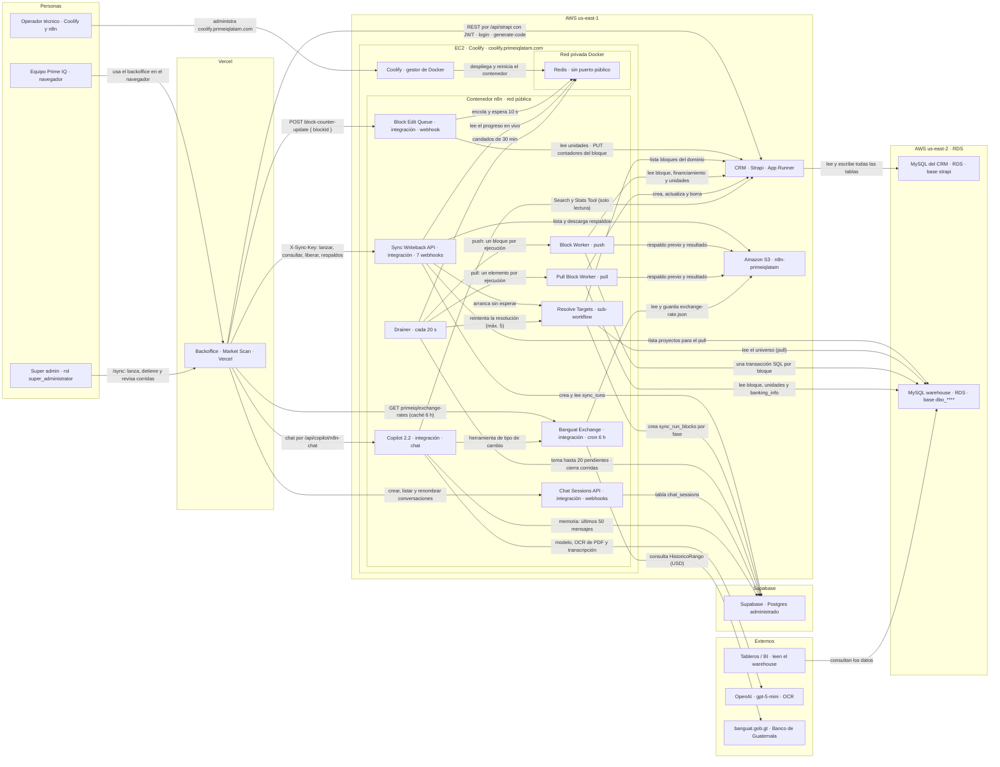

### Dónde corre cada pieza

| Zona | Piezas | Descripción |
|---|---|---|
| Personas | Equipo Prime IQ, Super admin, Operador técnico | Quién usa el sistema: el equipo desde el navegador, los super admin que sincronizan y el operador técnico que administra Coolify y n8n. |
| Vercel | Backoffice | El backoffice de Market Scan (dashboard administrativo). Escala solo; cada petición termina en el CRM o en el sistema de integraciones. |
| AWS us-east-1 | CRM, Amazon S3, Coolify, Redis, Block Edit Queue, Sync Writeback API, Copilot 2.2, Chat Sessions API, Banguat Exchange, Resolve Targets, Drainer, Block Worker, Pull Block Worker | App Runner con el CRM, el EC2 con Coolify (n8n y Redis) y el bucket S3. |
| EC2 · Coolify | Coolify, Redis, Block Edit Queue, Sync Writeback API, Copilot 2.2, Chat Sessions API, Banguat Exchange, Resolve Targets, Drainer, Block Worker, Pull Block Worker | Servidor EC2 en AWS us-east-1 con Coolify en coolify.primeiqlatam.com. Desde ese panel se despliegan, reinician y revisan los contenedores Docker de n8n y Redis. |
| Contenedor n8n | Block Edit Queue, Sync Writeback API, Copilot 2.2, Chat Sessions API, Banguat Exchange, Resolve Targets, Drainer, Block Worker, Pull Block Worker | El sistema de integraciones. Recibe webhooks desde internet en n8n.primeiqlatam.com y tiene salida a la red pública para llamar al CRM, Supabase, las bases RDS, S3, OpenAI y Banguat. |
| Red privada | Redis | Redis vive en la red privada de Docker dentro del EC2. No expone puerto público: solo lo alcanzan los contenedores de esa red, es decir n8n. |
| AWS us-east-2 | MySQL del CRM, MySQL warehouse | Las dos bases MySQL en RDS: la del CRM y el warehouse que leen los tableros. |
| Supabase | Supabase | Bitácora de sincronización, sesiones y memoria del Copilot. |
| Externos | OpenAI, banguat.gob.gt, Tableros / BI | Servicios de terceros y los tableros que consumen el warehouse. |

### Piezas

| Pieza | Detalle | Descripción |
|---|---|---|
| Equipo Prime IQ | navegador | Capturistas y analistas que usan el backoffice en admin.primeiqlatam.com. |
| Super admin | rol super_administrator | Usuario con rol Super Administrator en el CRM. Es el único que lanza sincronizaciones. |
| Backoffice | Market Scan · Vercel | Backoffice de Market Scan (dashboard administrativo) · Vercel · admin.primeiqlatam.com · repo market-scan-back-office. |
| Operador técnico | Coolify y n8n | Persona técnica: administra Coolify y n8n. |
| CRM | Strapi · App Runner | CRM de Prime IQ en Strapi 5.30 · AWS App Runner us-east-1 · repo Admin-PrimeIQ/dataSystem. |
| Block Edit Queue | integración · webhook | Webhook POST /webhook/block-counter-update · debounce en Redis. |
| Sync Writeback API | integración · 7 webhooks | Webhooks primeiq/sync/* con header X-Sync-Key · ID ULurOzOGSpgNlRyY. |
| Copilot 2.2 | integración · chat | Chat Trigger 506f****/chat · agente gpt-5-mini · herramientas de solo lectura. |
| Chat Sessions API | integración · webhooks | primeiq-chat-session-create / list / rename. |
| Banguat Exchange | integración · cron 6 h | Cron cada 6 h y GET primeiq/exchange-rates · ID Vr3vL5F0x9B04wEt. |
| Resolve Targets | sub-workflow | Arma la lista de trabajo de una corrida · ID bpLA8t0B6vr7Qq7f. |
| Drainer | cada 20 s | Programado cada 20 s · reparte bloques a los workers · ID nnG8jsmOmPkBks7c. |
| Block Worker | push | Push de un bloque CRM → warehouse · ID yBuM3XVk36DwRgbs. |
| Pull Block Worker | pull | Pull de un elemento warehouse → CRM en 3 fases · ID t2Sqx3pvDRuhBAdF. |
| Redis | sin puerto público | Contenedor Redis en la red privada de Docker del EC2. Sin acceso desde internet. |
| Coolify | gestor de Docker | Panel coolify.primeiqlatam.com sobre EC2 en AWS us-east-1. Despliega y reinicia los contenedores de n8n y Redis, y muestra sus logs. |
| Amazon S3 | n8n-primeiqlatam | AWS S3 us-east-1 · respaldos de sincronización y exchange-rate.json. |
| MySQL del CRM | RDS · base strapi | AWS RDS MySQL us-east-2 · base strapi · fuente de verdad del CRM. |
| MySQL warehouse | RDS · base dbo_**** | AWS RDS MySQL us-east-2 · housing_*, office_*, industrial_*. |
| Supabase | Postgres administrado | sync_runs, sync_run_blocks, chat_sessions y memoria del Copilot. |
| Tableros / BI | leen el warehouse | Herramientas de BI de Prime IQ que consultan el warehouse. |
| OpenAI | gpt-5-mini · OCR | API de OpenAI · credencial Prime IQ - OpenAi. |
| banguat.gob.gt | Banco de Guatemala | Formulario público HistoricoRango del Banco de Guatemala. |

### Conexiones: ida y vuelta

| De | A | Tipo | Ida (petición) | Vuelta (respuesta) |
|---|---|---|---|---|
| Equipo Prime IQ | Backoffice | Uso humano | usa el backoffice en el navegador | pantallas y datos |
| Super admin | Backoffice | Uso humano | /sync: lanza, detiene y revisa corridas | estado de las corridas |
| Backoffice | CRM | Backoffice ↔ CRM | REST por /api/strapi con JWT · login · generate-code | JSON {data, meta} o error 4xx |
| CRM | MySQL del CRM | Bases y almacenamiento | lee y escribe todas las tablas | filas |
| Backoffice | Block Edit Queue | Backoffice ↔ CRM | POST block-counter-update { blockId } | { success, counters } o skipped |
| Block Edit Queue | Redis | Bases y almacenamiento | encola y espera 10 s | cola actual: ¿sigo primero? |
| Block Edit Queue | CRM | Backoffice ↔ CRM | lee unidades · PUT contadores del bloque | unidades y bloque actualizado |
| Backoffice | Banguat Exchange | Backoffice ↔ CRM | GET primeiq/exchange-rates (caché 6 h) | compra, venta y fecha |
| Backoffice | Sync Writeback API | Sincronización | X-Sync-Key: lanzar, consultar, liberar, respaldos | 202 runId · 409 · estado y progreso |
| Sync Writeback API | Supabase | Bases y almacenamiento | crea y lee sync_runs | fila de la corrida |
| Sync Writeback API | Redis | Bases y almacenamiento | lee el progreso en vivo | done, failed, total |
| Sync Writeback API | Resolve Targets | Sincronización | arranca sin esperar | sin respuesta: el llamador no espera |
| Sync Writeback API | MySQL warehouse | Bases y almacenamiento | lista proyectos para el pull | cod_proyecto, nombre, país… |
| Sync Writeback API | Amazon S3 | Bases y almacenamiento | lista y descarga respaldos | listado y archivos JSON |
| Resolve Targets | CRM | Sincronización | lista bloques del dominio | documentId, legacyId, name |
| Resolve Targets | MySQL warehouse | Sincronización | lee el universo (pull) | filas del universo |
| Resolve Targets | Supabase | Bases y almacenamiento | crea sync_run_blocks por fase | sin respuesta: el llamador no espera |
| Drainer | Supabase | Bases y almacenamiento | toma hasta 20 pendientes · cierra corridas | filas pendientes |
| Drainer | Redis | Bases y almacenamiento | candados de 30 min | candado tomado o no |
| Drainer | Resolve Targets | Sincronización | reintenta la resolución (máx. 5) | sin respuesta: el llamador no espera |
| Drainer | Block Worker | Sincronización | push: un bloque por ejecución | done, failed o failed_sanity |
| Drainer | Pull Block Worker | Sincronización | pull: un elemento por ejecución | done o failed |
| Block Worker | CRM | Sincronización | lee bloque, financiamiento y unidades | JSON del bloque y unidades |
| Block Worker | Amazon S3 | Bases y almacenamiento | respaldo previo y resultado | sin respuesta: el llamador no espera |
| Block Worker | MySQL warehouse | Sincronización | una transacción SQL por bloque | filas afectadas o error (rollback) |
| Pull Block Worker | MySQL warehouse | Sincronización | lee bloque, unidades y banking_info | filas |
| Pull Block Worker | Amazon S3 | Bases y almacenamiento | respaldo previo y resultado | sin respuesta: el llamador no espera |
| Pull Block Worker | CRM | Sincronización | crea, actualiza y borra | documentId de lo creado |
| Tableros / BI | MySQL warehouse | Bases y almacenamiento | consultan los datos | resultados |
| Backoffice | Copilot 2.2 | Copilot / IA | chat por /api/copilot/n8n-chat | respuesta en streaming con bloques ::: |
| Backoffice | Chat Sessions API | Copilot / IA | crear, listar y renombrar conversaciones | lista de sesiones |
| Chat Sessions API | Supabase | Bases y almacenamiento | tabla chat_sessions | filas |
| Copilot 2.2 | Supabase | Bases y almacenamiento | memoria: últimos 50 mensajes | historial |
| Copilot 2.2 | OpenAI | Copilot / IA | modelo, OCR de PDF y transcripción | texto generado |
| Copilot 2.2 | CRM | Copilot / IA | Search y Stats Tool (solo lectura) | proyectos, bloques, unidades, conteos |
| Copilot 2.2 | Banguat Exchange | Copilot / IA | herramienta de tipo de cambio | tasa del día |
| Banguat Exchange | banguat.gob.gt | Servicio externo | consulta HistoricoRango (USD) | tabla HTML |
| Banguat Exchange | Amazon S3 | Bases y almacenamiento | lee y guarda exchange-rate.json | histórico |
| Operador técnico | Coolify | Operación y despliegue | administra coolify.primeiqlatam.com | estado y logs de los contenedores |
| Coolify | Redis | Operación y despliegue | despliega y reinicia el contenedor | sin respuesta: el llamador no espera |

### Escenarios de prueba

#### Editar y guardar unidades

Un capturista corrige precios en la hoja de un bloque. Es el recorrido más usado.

1. **Equipo Prime IQ → Backoffice** · Abre /units/list/:id y edita celdas; las fórmulas recalculan en el navegador
2. **Backoffice → CRM** · Guardar: updateUnitBatch envía PUT /api/units/:id por el proxy
3. **CRM → MySQL del CRM** · El CRM escribe units y, si cambian, sus vínculos y componentes
4. **CRM ↩ Backoffice** · Vuelve 200 con la unidad, o 400 si el código ya existe
5. **Backoffice → CRM** · Si el código choca, generate-code pide el siguiente libre y reintenta
6. **Backoffice → Block Edit Queue** · El backoffice avisa: POST block-counter-update con el blockId
7. **Block Edit Queue → Redis** · Encola el pedido y espera 10 s; solo el último continúa
8. **Block Edit Queue → CRM** · Lee todas las unidades y hace PUT con contadores y promedios
9. **Block Edit Queue ↩ Backoffice** · Responde { success, counters }
10. **Backoffice ↩ Equipo Prime IQ** · El aviso lista los campos recalculados

**Cómo probarlo**

1. Cambiar el precio total de una unidad y guardar
2. Esperar unos 15 s y abrir la vista del bloque
3. En Vercel → Logs, buscar el PUT /units con el correo del usuario

**Resultado esperado:** No quedan celdas amarillas y el bloque muestra el nuevo precio promedio.

#### Push: CRM → warehouse

Publica los datos del CRM en el warehouse que leen los tableros.

1. **Super admin → Backoffice** · En /sync elige Nueva corrida → push, dominio y bloques
2. **Backoffice → Sync Writeback API** · POST primeiq/sync/writeback con X-Sync-Key
3. **Sync Writeback API → Supabase** · Crea sync_runs en resolving; si ya hay una activa, 409
4. **Sync Writeback API ↩ Backoffice** · Responde 202 con el runId
5. **Sync Writeback API → Resolve Targets** · Arranca Resolve Targets sin esperar
6. **Resolve Targets → CRM** · Lista los bloques del dominio
7. **CRM ↩ Resolve Targets** · Vuelven documentId, legacyId y nombre
8. **Resolve Targets → Supabase** · Crea una fila por bloque en sync_run_blocks
9. **Drainer → Supabase** · Cada 20 s toma hasta 20 bloques pendientes
10. **Drainer → Redis** · Reclama cada bloque con un candado de 30 min
11. **Drainer → Block Worker** · Llama al Block Worker, un bloque por ejecución
12. **Block Worker → CRM** · Lee bloque, financiamiento y unidades
13. **Block Worker → Amazon S3** · Guarda un respaldo de las filas actuales del warehouse
14. **Block Worker → MySQL warehouse** · Una transacción: universo, unidades, amenidades y banking_info
15. **Block Worker ↩ Drainer** · El worker devuelve done o failed
16. **Backoffice → Sync Writeback API** · El backoffice consulta el avance cada 5 s
17. **Tableros / BI → MySQL warehouse** · Los tableros ya leen los datos nuevos

**Cómo probarlo**

1. Lanzar un push de un solo bloque de prueba
2. Confirmar el estado completed en /sync
3. Abrir Archivos de la corrida: mysql-snapshot y apply-result
4. SELECT * FROM housing_universe WHERE cod_proyecto = '<legacyId>'

**Resultado esperado:** La fila del warehouse coincide con el bloque en el CRM. Si algo falla, el respaldo en S3 permite restaurar.

#### Pull: warehouse → CRM

Trae al CRM lo que existe en el warehouse. Puede borrar unidades: usar con cuidado.

1. **Super admin → Backoffice** · Nueva corrida → pull; el selector muestra proyectos del warehouse
2. **Backoffice → Sync Writeback API** · GET primeiq/sync/sql/projects
3. **Sync Writeback API → MySQL warehouse** · Lee el universo del dominio
4. **Sync Writeback API ↩ Backoffice** · Vuelve la lista para elegir
5. **Backoffice → Sync Writeback API** · POST writeback con operation=pull
6. **Sync Writeback API → Resolve Targets** · Arranca la resolución
7. **Resolve Targets → MySQL warehouse** · Lee las filas elegidas
8. **Resolve Targets → Supabase** · Arma tres fases: catálogos, proyectos y bloques
9. **Drainer → Pull Block Worker** · Despacha por fase: no empieza proyectos hasta terminar catálogos
10. **Pull Block Worker → MySQL warehouse** · Lee bloque, unidades y banking_info
11. **Pull Block Worker → Amazon S3** · Respaldo previo del estado en el CRM
12. **Pull Block Worker → CRM** · Crea o actualiza el bloque; altas, cambios y bajas de unidades
13. **CRM ↩ Pull Block Worker** · El CRM devuelve los documentId creados
14. **Drainer → Supabase** · Cierra la corrida

**Cómo probarlo**

1. Elegir un proyecto de prueba del warehouse
2. Correr pull solo de ese proyecto
3. Comparar /units/list con el warehouse
4. Confirmar que no había unidades creadas en el backoffice en ese bloque

**Resultado esperado:** El bloque en el CRM refleja el warehouse. Las unidades que no existen en MySQL se eliminan.

#### Pregunta al Copilot

El usuario consulta los datos en lenguaje natural, con o sin archivos.

1. **Equipo Prime IQ → Backoffice** · Abre /copilots y escribe; puede adjuntar PDF, Excel o audio
2. **Backoffice → Chat Sessions API** · Crea o lista la conversación por correo
3. **Chat Sessions API → Supabase** · chat_sessions guarda la sesión
4. **Backoffice → Copilot 2.2** · El mensaje va por /api/copilot/n8n-chat al Chat Trigger
5. **Copilot 2.2 → OpenAI** · Extrae el texto de los adjuntos
6. **Copilot 2.2 → Supabase** · Carga los últimos 50 mensajes
7. **Copilot 2.2 → CRM** · Search y Stats Tool consultan el CRM
8. **CRM ↩ Copilot 2.2** · Vuelven proyectos, bloques, unidades o conteos
9. **Copilot 2.2 → Banguat Exchange** · Si pregunta por tipo de cambio, usa Banguat
10. **Copilot 2.2 → OpenAI** · gpt-5-mini redacta la respuesta
11. **Copilot 2.2 ↩ Backoffice** · La respuesta llega en streaming con bloques :::

**Cómo probarlo**

1. Preguntar: ¿cuántas unidades disponibles tiene el bloque X?
2. Comparar con el contador del bloque en el backoffice
3. Recargar y confirmar que la conversación sigue en la lista

**Resultado esperado:** La cifra coincide con el CRM y la conversación queda guardada.

#### Tipo de cambio del día

De la página de Banguat a la barra lateral del backoffice.

1. **Banguat Exchange → banguat.gob.gt** · Cada 6 h consulta HistoricoRango en USD
2. **banguat.gob.gt ↩ Banguat Exchange** · Vuelve la tabla HTML
3. **Banguat Exchange → Amazon S3** · Une con el histórico y guarda exchange-rate.json
4. **Backoffice → Banguat Exchange** · El backoffice pide GET primeiq/exchange-rates
5. **Banguat Exchange ↩ Backoffice** · Recibe compra, venta y fecha
6. **Backoffice ↩ Equipo Prime IQ** · La barra lateral muestra el tipo de cambio

**Cómo probarlo**

1. Abrir la barra de tipo de cambio
2. En DevTools, ver el header x-exchange-rates-cache (hit, miss o stale)
3. Comparar con banguat.gob.gt

**Resultado esperado:** Mismo valor que Banguat. Si n8n falla, el backoffice muestra el último dato guardado.

#### Login y permisos

Cómo entra un usuario y qué decide su rol.

1. **Equipo Prime IQ → Backoffice** · Entra a /login con correo y contraseña
2. **Backoffice → CRM** · POST /api/auth/local
3. **CRM → MySQL del CRM** · Valida contra up_users y up_roles
4. **CRM ↩ Backoffice** · Devuelve el JWT; se guarda en el navegador
5. **Backoffice → CRM** · GET /api/users/me?populate=role
6. **CRM ↩ Backoffice** · Devuelve el usuario con su rol
7. **Super admin → Backoffice** · Si es super administrador, aparecen las acciones de /sync

**Cómo probarlo**

1. Entrar con un usuario Operator: edita pero no borra
2. Entrar con Super Administrator: ve Nueva corrida en /sync
3. Bloquear un usuario en el CRM y confirmar que no entra

**Resultado esperado:** Cada rol ve y hace solo lo suyo; el CRM responde 403 a lo no permitido.

#### Operar n8n desde Coolify

Reiniciar o revisar el sistema de integraciones.

1. **Operador técnico → Coolify** · Entra a coolify.primeiqlatam.com
2. **Coolify ↩ Operador técnico** · Ve estado y logs de los contenedores n8n y Redis
3. **Coolify → Redis** · Reinicia o redespliega Redis (red privada)
4. **Drainer → Redis** · Los workflows vuelven a tomar candados
5. **Backoffice → Sync Writeback API** · El backoffice confirma que la API de sincronización responde

**Cómo probarlo**

1. En Coolify, abrir el contenedor n8n y revisar los logs
2. Desde un navegador, abrir n8n.primeiqlatam.com (responde)
3. Confirmar que Redis no responde desde internet (sin puerto público)

**Resultado esperado:** n8n responde en su dominio público y Redis solo es visible dentro de la red de Docker.

### Componentes

| Componente | Rol | Habla con |
|---|---|---|
| **Backoffice** (admin) | Dashboard administrativo de Market Scan: captura y edición. Autenticación con JWT del CRM. | CRM (vía proxy propio), integraciones (webhooks) |
| **CRM** (Strapi) | API REST, panel de contenido, usuarios y roles. Fuente de verdad. | MySQL del CRM |
| **Sistema de integraciones** (n8n) | Sincronización, contadores, tipo de cambio, Copilot. Corre en Docker sobre Coolify. | CRM, warehouse, Supabase, Redis, S3, OpenAI, Banguat |
| **Coolify** | Panel en coolify.primeiqlatam.com que despliega y reinicia los contenedores del EC2. | Contenedores n8n y Redis |
| **Warehouse MySQL** | Base histórica que leen los tableros. | Recibe del push y entrega en el pull |
| **Supabase** | Bitácora de sincronizaciones, sesiones y memoria del chat. | n8n |
| **Redis** | Progreso en vivo, candados y colas. Solo en la red privada. | n8n |
| **S3** | Respaldos antes de cada escritura e histórico del tipo de cambio. | n8n |

---

## Dónde está desplegado

*05 · Visión general*

Inventario de infraestructura. Todas las cuentas y servicios son de Prime IQ.

| Servicio | Proveedor / región | Dirección | Cómo se despliega |
|---|---|---|---|
| **Backoffice** | Vercel | `https://admin.primeiqlatam.com` | Automático al hacer push a `main` en GitHub. Solo acepta commits de la cuenta **Admin-PrimeIQ** con correo `engteam@primeiqlatam.com`. |
| **CRM (Strapi)** | AWS App Runner · us-east-1 | `https://gep8aekqnp.us-east-1.awsapprunner.com` Panel: `/admin` · Docs API: `/documentation` · GraphQL: `/graphql` | Compila desde el repo de GitHub; los comandos de build/start y las variables viven en la consola de App Runner. |
| **MySQL del CRM** | AWS RDS MySQL · us-east-2 | `strapi.cfkk****.us-east-2.rds.amazonaws.com` · base `strapi` | Las migraciones corren solas al arrancar Strapi. |
| **Warehouse MySQL** | AWS RDS MySQL · us-east-2 | `prim****.us-east-2.rds.amazonaws.com` · base `dbo_****` | Base heredada que leen los tableros. |
| **Coolify** | AWS EC2 · us-east-1 | `https://coolify.primeiqlatam.com` | Panel desde el que se gestionan los contenedores Docker del EC2: despliegue, reinicio, variables y logs de n8n y Redis. |
| **Integraciones (n8n)** | Contenedor Docker en el EC2 de Coolify · us-east-1 | `https://n8n.primeiqlatam.com` · entrada y salida a la red pública | Los workflows se publican con `n8n-manager/scripts/n8n-sync.js push` (API pública de n8n). El contenedor se reinicia desde Coolify. |
| **Redis** | Contenedor Docker en el mismo EC2 · red privada | Sin puerto público; solo lo alcanza n8n por la red interna de Docker (credencial `Redis Coolify`) | Sin persistencia crítica: progreso, candados y colas temporales. |
| **Supabase** | Supabase (Postgres administrado) | Credencial n8n `Supabase` | Migraciones SQL en `n8n-manager/sql/`. |
| **S3** | AWS S3 · us-east-1 | Bucket `n8n-primeiqlatam` | `exchange-rate.json` y `sync-runs/<runId>/…` |
| **OpenAI** | API OpenAI | Modelos `gpt-5-mini`, `gpt-5.4-mini` | Credencial n8n `Prime IQ - OpenAi`. |

---

## Cuentas y propietarios

*06 · Administrativo*

Dónde vive cada parte del sistema. Todas las cuentas pertenecen a Prime IQ.

| Cuenta | Qué contiene | Titular |
|---|---|---|
| **GitHub** · `Admin-PrimeIQ` | Repos `market-scan-back-office` (backoffice), `dataSystem` (CRM) y `n8n-manager` (integraciones) | Prime IQ |
| **Vercel** | Proyecto del backoffice, dominio, variables de entorno y logs | Prime IQ |
| **AWS** | App Runner (CRM), EC2 con Coolify, 2 RDS MySQL, bucket S3 y usuario IAM de n8n | Prime IQ |
| **Coolify** · `coolify.primeiqlatam.com` | Contenedores Docker de n8n y Redis en el EC2 | Prime IQ |
| **n8n** · `n8n.primeiqlatam.com` | Workflows y credenciales de las integraciones | Prime IQ |
| **Supabase** | Bitácora de sincronización, sesiones y memoria del Copilot | Prime IQ |
| **OpenAI** | Modelos del Copilot y extracción de documentos | Prime IQ |
| **Correo SMTP** | Correos del CRM (recuperar contraseña) | Prime IQ |
| **DNS** · `primeiqlatam.com` | admin, n8n y coolify | Prime IQ |
| **CRM · panel** | Usuario de panel que usa el backoffice para generar códigos | Prime IQ |

**Contacto técnico saliente — Kike Rios · devroot.studio**

Autor del backoffice, el CRM y los workflows de n8n.

**Regla de despliegue — Solo la cuenta Admin-PrimeIQ despliega**

Vercel ignora pushes de otras cuentas. Configuración SSH multi-cuenta (alias `github-primeiq`) en el README del backoffice.

---

## Backoffice (Next.js)

*07 · Técnico*

El dashboard administrativo de Market Scan. Repositorio `Admin-PrimeIQ/market-scan-back-office` · paquete `market-scan-back-office` v1.27.3 · 359 commits desde dic 2025.

**Stack**

- Next.js 16.0.10 (App Router), React 19.2
- Tailwind 4 + shadcn/ui (Radix)
- Glide Data Grid 6.0.4-alpha24 (hoja de unidades)
- next-intl 4 (ES/EN por cookie)
- @n8n/chat 1.14.0 con parche local
- MapLibre (mapa base CARTO, sin API key)

**Comandos**

- `pnpm install` (aplica parches)
- `pnpm dev` / `pnpm build` / `pnpm start`
- `npx tsc --noEmit` (el build ignora errores de tipos)
- Node 24.14.1 ( `.nvmrc` ), mínimo 20

**Autenticación**

Login contra Strapi (`/api/auth/local`). El JWT queda en `localStorage`. El layout protege las páginas en el cliente; `middleware.ts` no bloquea nada. Las rutas de servidor sensibles validan el token contra Strapi.

### Módulos

| Módulo | Ruta | Qué hace |
|---|---|---|
| **Proyectos** | `/projects` | Tabla con filtros por región, país, departamento y tipo de inmueble. Formulario por pestañas: datos generales, ubicación en mapa, amenidades, servicios, monedas, financiamiento. |
| **Bloques** | `/blocks` | CRUD y clonado. El nombre se arma como "Proyecto - Fase X - Sector Y - Torre Z". La vista muestra la tarjeta de financiamiento (tasas por banco, enganche, plazos). |
| **Unidades** | `/units` → `/units/list/[id]` | Hoja de cálculo por bloque: edición masiva, pegado, deshacer, fórmulas en cascada, m² o varas², USD o moneda local. Al abrir, marca en amarillo los valores guardados que no coinciden con las fórmulas. |
| **Perfiles de tipo de cambio** | `/exchange-rate-profiles` | Tasas de compra/venta por moneda (MXN, GTQ, HNL, CRC, NIO, PAB, BZD) que usa cada proyecto. Además, una barra lateral muestra el tipo de cambio de Banguat del día. |
| **Catálogos** | `/catalogs/…` | Amenidades, países, desarrolladoras, NSE, tipos de seguridad, servicios, categorías/enfoques/estados de bloque, topografías, tipos de parqueo, usos. |
| **Sincronización** `beta` | `/sync` | Lanza y monitorea push (Strapi → warehouse) y pull (warehouse → Strapi) por dominio. Línea de tiempo por fase, respaldos de S3, comparación antes/después. |
| **Copilot** | `/copilots` | Chat de IA sobre los datos (solo lectura). Acepta archivos (PDF, Office, audio, imagen). Respuestas con bloques visuales `:::`. |
| **Configuración** | `/settings` | Perfil, contraseña, idioma, tema. Super admins ven la URL de Strapi. |
| **Dashboard** | `/dashboard` | Oculto del menú; usa datos de ejemplo. |

### Rutas de servidor (API del backoffice)

| Ruta | Métodos | Protección | Función |
|---|---|---|---|
| `/api/strapi/[...path]` | todos | Reenvía el token del usuario | Proxy a Strapi que registra cada llamada (usuario, ruta, estado, duración) en los logs de Vercel. |
| `/api/blocks/generate-code` | POST | Token válido (sesión iniciada) | Entra al panel de Strapi con el usuario admin y genera el código único del bloque. |
| `/api/units/generate-code` | POST | Token válido (sesión iniciada) | Igual, para unidades (siguiente correlativo libre). |
| `/api/exchange-rates` | GET, DELETE | Token válido | Tipo de cambio de Banguat vía n8n, con caché de 6 h que sirve datos viejos si n8n falla. |
| `/api/copilot/n8n-chat` | POST | Token válido (sesión iniciada) | Proxy al chat de n8n (evita CORS); hasta 120 s, con streaming. |
| `/api/sync/runs` | GET, POST | GET token · POST super admin | Lista y lanza corridas de sincronización. |
| `/api/sync/runs/[runId]` (+ `/release`, `/snapshots`, `/snapshot`) | GET, POST | Token / super admin | Detalle, liberar una corrida trabada, ver y descargar respaldos de S3. |
| `/api/sync/sql-projects` | GET | Super admin | Lista proyectos del warehouse para elegir qué traer en un pull. |

### Roles en la interfaz

El backoffice distingue solo dos niveles: **super admin** y el resto. El super admin puede lanzar y detener sincronizaciones, ver los respaldos y saltar al panel de Strapi desde la hoja de unidades; esto se verifica también en el servidor en cada llamada. Los permisos sobre los datos los aplica Strapi según el rol del usuario (ver Strapi). No hay pantalla de gestión de usuarios: se administran en el panel de Strapi.

> **Cómo se guarda una unidad, paso a paso** El recorrido completo (proxy, CRM, reintento por código duplicado y recálculo de contadores) está animado en Diagramas de secuencia → Guardar unidades y en el escenario Editar y guardar unidades del mapa.

---

## CRM (Strapi)

*08 · Técnico*

El CRM de Prime IQ: fuente de verdad de proyectos, bloques, unidades, catálogos, usuarios y permisos. Repositorio `Admin-PrimeIQ/dataSystem` (código en `backend/`) · Strapi 5.30.0 · 59 commits desde sep 2025.

**Plugins**

- users-permissions (login y roles)
- documentation (OpenAPI en `/documentation` )
- graphql ( `/graphql` )
- config-sync (roles y vistas versionados)
- schema-visualizer
- email con Nodemailer (Gmail)
- i18n desactivado

**Configuración clave**

- Base: MySQL vía `mysql2` (no hay driver de Postgres)
- REST: 25 por página, sin tope máximo ( `API_MAX_LIMIT` )
- Archivos: proveedor local
- CORS con la configuración por defecto de Strapi
- Sin endpoints, políticas ni middlewares propios

**Comandos**

- `npm run develop` / `build` / `start`
- `npm run config:dump` / `config:restore`
- `npm run upgrade:dry`
- Node 20 o 22

### Roles y permisos

| Rol | Datos | Archivos | Extra |
|---|---|---|---|
| **Public** | Ninguno | — | Solo login, registro y recuperación de contraseña |
| **Operator** | Crear, leer y editar (sin borrar) | Leer y subir | — |
| **Supervisor** | CRUD completo | Incluye borrar | — |
| **Administrator** | CRUD completo | Completo | Gestiona usuarios |
| **Super Administrator** | Todo | Completo | Roles, envío de correo, lectura del modelo; activa funciones de super admin en el backoffice |

Los cuatro roles propios se crean solos al arrancar Strapi si no existen (`src/index.js`). Sus permisos están versionados en `backend/config/sync/` y se restauran con Config Sync.

### Migraciones de base de datos

| Archivo | Cambio |
|---|---|
| `2026.01.12…coordinates-precision` | Latitud y longitud de proyectos a DECIMAL(10,8) |
| `2026.04.05…currency-rate-decimal-precision` | Tasas de compra/venta a DECIMAL(18,8) |
| `2026.06.08…unit-decimal-precision` | 19 columnas de unidades: tamaños (14,4), precios (15,2), absorción (18,12), baños a DECIMAL(4,1) |
| `2026.09.09…block-domain-and-parking` | Bloques: `domain` y `parking_for_sale`, con relleno de 1,361 bloques |

> **Las migraciones corren al arrancar** Strapi ejecuta `backend/database/migrations/` en cada inicio, antes de sincronizar el esquema. Antes de desplegar una migración nueva: snapshot de RDS, prueba en una copia local y ventana de poco tráfico.

---

## Modelo de datos

*09 · Técnico*

La jerarquía es **Proyecto → Bloque → Unidad**. Un bloque es una fase, torre o sector de un proyecto en un periodo de recolección. Todas las colecciones tienen además `id`, `documentId` y fechas de creación/edición.

### Mapa de relaciones

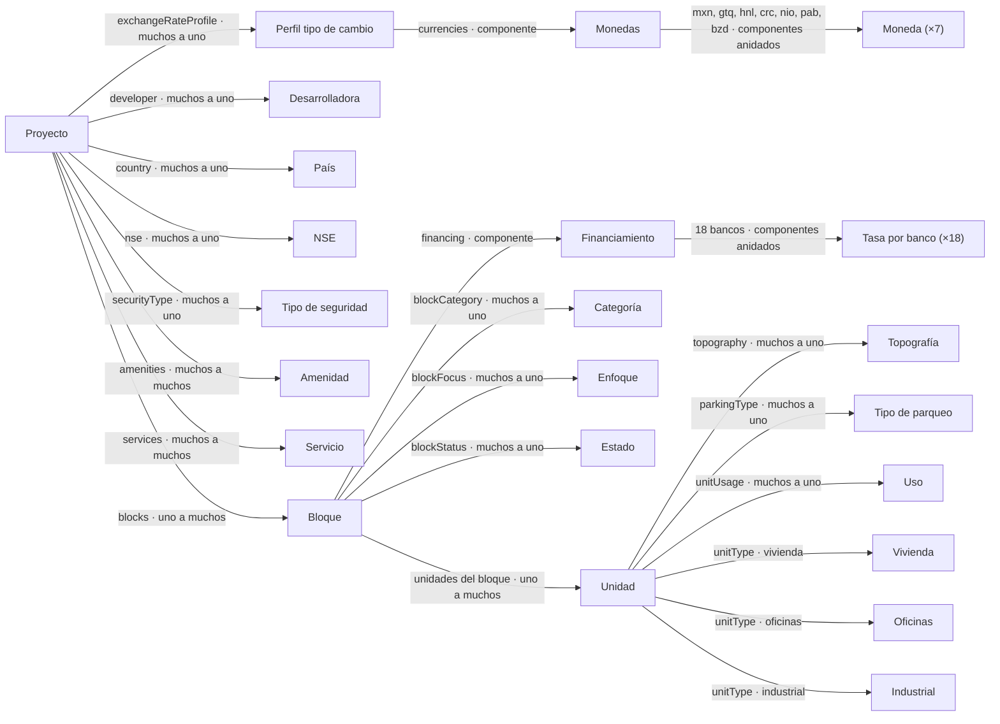

| De | A | Relación | Lado inverso | Explicación |
|---|---|---|---|---|
| Proyecto | Desarrolladora | developer · muchos a uno | — | **Para qué:** Cada proyecto tiene una desarrolladora; una desarrolladora tiene muchos proyectos. **Dónde se guarda:** `projects_developer_lnk` (project_id, developer_id). **Warehouse:** columna `desarrollador` con el nombre. **En el backoffice:** pestaña General del proyecto; catálogo Desarrolladoras. |
| Proyecto | País | country · muchos a uno | — | **Para qué:** País del proyecto. Su `isoCode2` (GT o SV) decide el IVA y la cuota de todas sus unidades. Si falta, las fórmulas usan Guatemala. **Dónde se guarda:** `projects_country_lnk`. **Warehouse:** `pais` (nombre). **En el backoffice:** filtros por país en proyectos y unidades; catálogo Países. |
| Proyecto | NSE | nse · muchos a uno | — | **Para qué:** Nivel socioeconómico al que apunta el proyecto. **Dónde se guarda:** `projects_nse_lnk`. **Warehouse:** `nse_proyecto` y se copia a cada unidad como `nse`. **En el backoffice:** pestaña General; catálogo NSE. |
| Proyecto | Tipo de seguridad | securityType · muchos a uno | — | **Para qué:** Tipo de seguridad del proyecto (garita, circuito, etc.). **Dónde se guarda:** `projects_security_type_lnk`. **Warehouse:** `tipo_de_seguridad`. **En el backoffice:** pestaña General; catálogo Tipos de seguridad. |
| Proyecto | Amenidad | amenities · muchos a muchos | Amenity.projects | **Para qué:** Un proyecto tiene varias amenidades y cada amenidad está en muchos proyectos. El proyecto es el lado dueño. **Dónde se guarda:** `projects_amenities_lnk` (5,647 vínculos). **Warehouse:** `housing_amenities`: una columna 0/1 por amenidad. El code del CRM `area-bbq` corresponde a la columna `area_bbq`. En oficinas hay alias: gym ↔ gimnasio, co_working ↔ coworking. **En el backoffice:** pestaña Amenidades del proyecto; catálogo Amenidades. |
| Proyecto | Servicio | services · muchos a muchos | Service.projects | **Para qué:** Servicios del proyecto (agua, alumbrado, elevadores…). El servicio es el lado dueño de la relación. **Dónde se guarda:** `services_projects_lnk` (6,252 vínculos). **Warehouse:** `housing_services`: 9 columnas 0/1. Solo vivienda tiene servicios. **En el backoffice:** pestaña Servicios del proyecto; catálogo Servicios. |
| Proyecto | Perfil tipo de cambio | exchangeRateProfile · muchos a uno | ExchangeRateProfile.projects | **Para qué:** Qué tasas de cambio usa el proyecto para mostrar y editar precios en moneda local. Es bidireccional: el perfil lista sus proyectos. **Dónde se guarda:** `projects_exchange_rate_profile_lnk`. **Warehouse:** el push calcula las columnas `_qtz` con `gtq.buyRate`. Sin perfil, esas columnas quedan NULL. **En el backoffice:** pestaña Monedas del proyecto; módulo Perfiles de tipo de cambio. |
| Proyecto | Bloque | blocks · uno a muchos | Block.project | **Para qué:** Un proyecto tiene muchos bloques: fases, torres, sectores y periodos de recolección. **Dónde se guarda:** `blocks_project_lnk` (el bloque es el lado dueño). **Warehouse:** cada bloque es una fila de `housing_universe`. Varias filas se agrupan en un proyecto por nombre, desarrolladora y país (a menos de 10 km). **En el backoffice:** el nombre del bloque se arma con el del proyecto: "Proyecto - Fase X - Torre Z". |
| Perfil tipo de cambio | Monedas | currencies · componente | — | **Para qué:** Componente único que agrupa las monedas del perfil. **Dónde se guarda:** `exchange_rate_profiles_cmps` → `components_currencies_currencies`. **En el backoffice:** formulario del perfil. |
| Monedas | Moneda (×7) | mxn, gtq, hnl, crc, nio, pab, bzd · componentes anidados | — | **Para qué:** Cada moneda guarda buyRate y sellRate (DECIMAL 18,8). Precio local = USD × tasa; al editar en local se divide para volver a USD, que es lo que se guarda. **Dónde se guarda:** `components_currencies_currencies_cmps` → `components_currencies_currency_*` (una tabla por moneda). **Warehouse:** solo GTQ viaja: columnas `precio_*_qtz`. **En el backoffice:** la hoja de unidades muestra una moneda local a la vez, editable. |
| Bloque | Categoría | blockCategory · muchos a uno | — | **Para qué:** Categoría del bloque (Residencial horizontal, Comercial, Turismo…). En industrial decide reglas de tamaño; "Lote" en periodo semestral usa IVA 1.12. **Dónde se guarda:** `blocks_block_category_lnk`. **Warehouse:** `categoria` (máx. 20 caracteres). **En el backoffice:** formulario del bloque; catálogo Categorías. |
| Bloque | Enfoque | blockFocus · muchos a uno | — | **Para qué:** Enfoque: residencial, oficinas, bodegas. En oficinas, enfoque principal y secundario se guardan juntos separados por " \| ". **Dónde se guarda:** `blocks_block_focus_lnk`. **Warehouse:** `enfoque_principal` / `enfoque_secundario` en oficinas. **En el backoffice:** formulario del bloque; catálogo Enfoques. |
| Bloque | Estado | blockStatus · muchos a uno | — | **Para qué:** Estado de obra: en planos, en construcción, entregado, movimiento de tierra. **Dónde se guarda:** `blocks_block_status_lnk`. **Warehouse:** `estado`. **En el backoffice:** formulario del bloque; catálogo Estados. |
| Bloque | Financiamiento | financing · componente | — | **Para qué:** Condiciones de financiamiento del bloque (solo vivienda): enganche, enganche fraccionado, mínimos y plazos FHA, bancos y financiamiento propio. **Dónde se guarda:** `blocks_cmps` → `components_financing_financings` (798). **Warehouse:** `banking_info`, upsert por `cod_proyecto`. El enganche fraccionado viaja como "Sí"/"No". **En el backoffice:** tarjeta Financiamiento en la vista del bloque. |
| Financiamiento | Tasa por banco (×18) | 18 bancos · componentes anidados | — | **Para qué:** Una tasa anual por banco: BAC, BAM, Azteca, Credicorp, Banrural, Bantrab, BI, Inmobiliario, Internacional, INV, Antigua, CHN, FHA, Ficohsa, G&T, Promerica, Vivibanco y financiamiento propio. Vacío = el desarrollador no trabaja con ese banco. **Dónde se guarda:** `components_financing_financings_cmps` → `components_financing_bank_rates` (1,388). **Warehouse:** una columna por banco en `banking_info` (`percentage_bac`, `banrural`…); vacío viaja como 0. **En el backoffice:** tarjeta Financiamiento: tasas por banco. |
| Bloque | Unidad | unidades del bloque · uno a muchos | Unit.block | **Para qué:** Un bloque tiene muchas unidades. La relación vive en la unidad (declarada oneToOne en el esquema, unidireccional). Los contadores y promedios del bloque se recalculan desde sus unidades. **Dónde se guarda:** `units_block_lnk` (237,504 vínculos). **Warehouse:** `housing_units.cod_proyecto` = legacyId o documentId del bloque. **En el backoffice:** la hoja /units/list/:id muestra las unidades de un bloque; al guardar se dispara block-counter-update. |
| Unidad | Topografía | topography · muchos a uno | — | **Para qué:** Topografía del terreno: plana, inclinada, irregular. **Dónde se guarda:** `units_topography_lnk`. **Warehouse:** `topografia`. **En el backoffice:** columna de la hoja; catálogo Topografías. |
| Unidad | Tipo de parqueo | parkingType · muchos a uno | — | **Para qué:** Tipo de parqueo (simple, tándem, carlift). Solo aplica si hasParking. **Dónde se guarda:** `units_parking_type_lnk`. **Warehouse:** `tipo_parqueo`. **En el backoffice:** columna de la hoja; catálogo Tipos de parqueo. |
| Unidad | Uso | unitUsage · muchos a uno | — | **Para qué:** Venta o Renta. En vivienda de Guatemala, "Venta" cambia el divisor de IVA a 0.916. **Dónde se guarda:** `units_unit_usage_lnk`. **Warehouse:** `uso`. **En el backoffice:** columna de la hoja; catálogo Usos. |
| Unidad | Vivienda | unitType · vivienda | — | **Para qué:** Campos propios de vivienda: dormitorios y tamaño de balcón o terraza. **Dónde se guarda:** `units_cmps` con component_type `unit-types.housing` → `components_unit_types_housings`. **Warehouse:** `cant_dormitorios`, `tamaño_balcon_terraza`. **En el backoffice:** columnas visibles solo en bloques de vivienda. |
| Unidad | Oficinas | unitType · oficinas | — | **Para qué:** Clasificación de oficina, capacidad de empleados y rangos, precio sin parqueo. **Dónde se guarda:** `units_cmps` → `components_unit_types_offices`. **Warehouse:** `office_units`. **En el backoffice:** columnas visibles solo en bloques de oficinas. |
| Unidad | Industrial | unitType · industrial | — | **Para qué:** Bodega, oficina, mezzanine, área de carga, frentes, fondos y altura. **Dónde se guarda:** `units_cmps` → `components_unit_types_industrials`. **Warehouse:** `industrial_units`. **En el backoffice:** columnas visibles solo en bloques industriales; el tamaño de unidad se suma. |

### Recorridos de datos

#### Precio en quetzales

Cómo una unidad llega a su tasa de cambio.

1. **Unidad ↩ Bloque** · La unidad conoce su bloque por units_block_lnk
2. **Bloque ↩ Proyecto** · El bloque conoce su proyecto por blocks_project_lnk
3. **Proyecto → Perfil tipo de cambio** · El proyecto apunta a su perfil de tipo de cambio
4. **Perfil tipo de cambio → Monedas** · El perfil tiene el componente de monedas
5. **Monedas → Moneda (×7)** · gtq.buyRate: precio en Q = precio USD × tasa

**Cómo verificarlo**

1. Abrir el proyecto y revisar su perfil en la pestaña Monedas
2. En la hoja de unidades activar GTQ
3. Comparar totalPriceUSD × gtq.buyRate con la columna en quetzales

**Resultado esperado:** Coinciden. Si el proyecto no tiene perfil, no hay moneda local y el warehouse recibe NULL en _qtz.

#### IVA y cuota según el país

Por qué dos unidades iguales pueden tener precios sin IVA distintos.

1. **Unidad ↩ Bloque** · Desde la unidad se sube al bloque
2. **Bloque ↩ Proyecto** · Del bloque al proyecto
3. **Proyecto → País** · isoCode2: GT usa IVA 1.12 y cuota 7.5% / 20 años; SV usa 1.0 y 8% / 25 años
4. **Unidad → Uso** · En GT, uso "Venta" cambia el divisor a 0.916
5. **Bloque → Categoría** · Lote en periodo semestral (Interior) usa 1.12

**Cómo verificarlo**

1. Tomar una unidad de un proyecto GT y otra de SV con el mismo precio
2. Comparar priceWithoutVATUSD e installmentUSD

**Resultado esperado:** GT divide entre 1.12 (o 0.916 en Venta); SV no descuenta IVA.

#### Tasas de banco de un bloque

De dónde salen las tasas que ven los tableros de financiamiento.

1. **Proyecto → Bloque** · Cada bloque tiene sus propias condiciones
2. **Bloque → Financiamiento** · Componente de financiamiento: enganche y plazos
3. **Financiamiento → Tasa por banco (×18)** · 18 tasas, una por banco

**Cómo verificarlo**

1. Abrir /blocks/view/:id y ver la tarjeta Financiamiento
2. Correr un push de ese bloque
3. SELECT * FROM banking_info WHERE cod_proyecto = '<legacyId>'

**Resultado esperado:** Cada banco tiene su tasa; los vacíos aparecen como 0 en banking_info.

#### Catálogos del proyecto

Todas las listas que completan un proyecto.

1. **Proyecto → Desarrolladora** · Desarrolladora
2. **Proyecto → País** · País
3. **Proyecto → NSE** · NSE
4. **Proyecto → Tipo de seguridad** · Tipo de seguridad
5. **Proyecto → Amenidad** · Amenidades: muchas por proyecto
6. **Proyecto → Servicio** · Servicios: muchos por proyecto

**Cómo verificarlo**

1. Crear un catálogo nuevo en /catalogs
2. Asignarlo a un proyecto de prueba
3. Hacer push y revisar la columna correspondiente en el warehouse

**Resultado esperado:** El valor aparece en el proyecto y en el warehouse. Una amenidad nueva necesita su columna en housing_amenities.

#### Campos según el tipo de unidad

Por qué la hoja cambia de columnas entre vivienda, oficinas e industrial.

1. **Bloque → Enfoque** · El enfoque y el dominio del bloque dicen qué tipo de inmueble es
2. **Bloque → Unidad** · Cada unidad del bloque
3. **Unidad → Vivienda** · Vivienda: dormitorios y balcón
4. **Unidad → Oficinas** · Oficinas: clasificación y capacidad
5. **Unidad → Industrial** · Industrial: bodega, mezzanine, alturas

**Cómo verificarlo**

1. Abrir un bloque de cada dominio en /units/list
2. Ver qué columnas aparecen

**Resultado esperado:** Cada dominio muestra solo sus columnas.

### Entidades y dónde se guarda cada campo

#### Amenidad · `api::amenity.amenity`

Tabla `amenities` · 85 filas · 3 tablas físicas

| Campo | Tipo | Requerido | Valores / relación | Se guarda en |
|---|---|---|---|---|
| code | uid |  |  | `amenities.code` (varchar(255)) |
| name | string | sí |  | `amenities.name` (varchar(255)) |
| description | text |  |  | `amenities.description` (longtext) |
| category | enumeration |  | recreation, wellness, leisure, outdoor, business, technology, residential, parking, security, sustainability, convenience, luxury, other | `amenities.category` (varchar(255)) |
| projects | relation |  | muchos a muchos → Proyecto | vínculo `projects_amenities_lnk` → `projects` |

#### Bloque · `api::block.block`

Tabla `blocks` · 1,693 filas · 11 tablas físicas

| Campo | Tipo | Requerido | Valores / relación | Se guarda en |
|---|---|---|---|---|
| project | relation |  | muchos a uno → Proyecto | vínculo `blocks_project_lnk` → `projects` |
| code | uid |  |  | `blocks.code` (varchar(255)) |
| name | string |  |  | `blocks.name` (varchar(255)) |
| legacyId | string |  |  | `blocks.legacy_id` (varchar(255)) |
| domain | enumeration |  | housing, office, industrial | `blocks.domain` (varchar(255)) |
| phase | string |  |  | `blocks.phase` (varchar(255)) |
| tower | string |  |  | `blocks.tower` (varchar(255)) |
| sector | string |  |  | `blocks.sector` (varchar(255)) |
| year | integer | sí |  | `blocks.year` (int) |
| quarter | enumeration | sí | T1, T2, T3, T4, S1, S2 | `blocks.quarter` (varchar(255)) |
| collectionDate | date |  |  | `blocks.collection_date` (date) |
| blockCategory | relation |  | muchos a uno → Categoría de bloque | vínculo `blocks_block_category_lnk` → `block_categories` |
| blockFocus | relation |  | muchos a uno → Enfoque de bloque | vínculo `blocks_block_focus_lnk` → `block_focuses` |
| blockStatus | relation |  | muchos a uno → Estado de bloque | vínculo `blocks_block_status_lnk` → `block_statuses` |
| market | enumeration |  | Primary, Secondary | `blocks.market` (varchar(255)) |
| startDate | date |  |  | `blocks.start_date` (date) |
| deliveryDate | date |  |  | `blocks.delivery_date` (date) |
| commercializationMonths | integer |  |  | `blocks.commercialization_months` (int) |
| totalUnits | integer |  |  | `blocks.total_units` (int) |
| totalM2 | decimal |  |  | `blocks.total_m_2` (decimal(10,2)) |
| availableUnits | integer |  |  | `blocks.available_units` (int) |
| availableM2 | decimal |  |  | `blocks.available_m_2` (decimal(10,2)) |
| averagePriceUSD | decimal |  |  | `blocks.average_price_usd` (decimal(10,2)) |
| averageSizeM2 | decimal |  |  | `blocks.average_size_m_2` (decimal(10,2)) |
| averagePricePerM2USD | decimal |  |  | `blocks.average_price_per_m_2_usd` (decimal(10,2)) |
| averageInstallmentUSD | decimal |  |  | `blocks.average_installment_usd` (decimal(10,2)) |
| averageIncomeUSD | decimal |  |  | `blocks.average_income_usd` (decimal(10,2)) |
| additionalParkingPriceUSD | decimal |  |  | `blocks.additional_parking_price_usd` (decimal(10,2)) |
| visitorParking | integer |  |  | `blocks.visitor_parking` (int) |
| assignedParking | integer |  |  | `blocks.assigned_parking` (int) |
| totalProjectParking | integer |  |  | `blocks.total_project_parking` (int) |
| migNumber | integer |  |  | `blocks.mig_number` (int) |
| parkingForSale | integer |  |  | `blocks.parking_for_sale` (int) |
| financing | component |  | financing.financing | pivote `blocks_cmps` → `components_financing_financings` |

#### Categoría de bloque · `api::block-category.block-category`

Tabla `block_categories` · 7 filas · 1 tablas físicas

| Campo | Tipo | Requerido | Valores / relación | Se guarda en |
|---|---|---|---|---|
| code | uid |  |  | `block_categories.code` (varchar(255)) |
| name | string | sí |  | `block_categories.name` (varchar(255)) |
| description | text |  |  | `block_categories.description` (longtext) |

#### Enfoque de bloque · `api::block-focus.block-focus`

Tabla `block_focuses` · 15 filas · 1 tablas físicas

| Campo | Tipo | Requerido | Valores / relación | Se guarda en |
|---|---|---|---|---|
| code | uid |  |  | `block_focuses.code` (varchar(255)) |
| name | string | sí |  | `block_focuses.name` (varchar(255)) |
| description | text |  |  | `block_focuses.description` (longtext) |

#### Estado de bloque · `api::block-status.block-status`

Tabla `block_statuses` · 10 filas · 1 tablas físicas

| Campo | Tipo | Requerido | Valores / relación | Se guarda en |
|---|---|---|---|---|
| code | uid |  |  | `block_statuses.code` (varchar(255)) |
| name | string | sí |  | `block_statuses.name` (varchar(255)) |
| description | text |  |  | `block_statuses.description` (longtext) |

#### País · `api::country.country`

Tabla `countries` · 2 filas · 1 tablas físicas

| Campo | Tipo | Requerido | Valores / relación | Se guarda en |
|---|---|---|---|---|
| code | uid |  |  | `countries.code` (varchar(255)) |
| name | string | sí |  | `countries.name` (varchar(255)) |
| description | text |  |  | `countries.description` (longtext) |
| isoCode | string | sí |  | `countries.iso_code` (varchar(255)) |
| isoCode2 | string |  |  | `countries.iso_code_2` (varchar(255)) |

#### Desarrolladora · `api::developer.developer`

Tabla `developers` · 537 filas · 1 tablas físicas

| Campo | Tipo | Requerido | Valores / relación | Se guarda en |
|---|---|---|---|---|
| code | uid |  |  | `developers.code` (varchar(255)) |
| name | string | sí |  | `developers.name` (varchar(255)) |
| description | text |  |  | `developers.description` (longtext) |
| address | text |  |  | `developers.address` (longtext) |
| phone | string |  |  | `developers.phone` (varchar(255)) |
| email | email |  |  | `developers.email` (varchar(255)) |
| website | string |  |  | `developers.website` (varchar(255)) |
| taxId | string |  |  | `developers.tax_id` (varchar(255)) |
| contactPerson | string |  |  | `developers.contact_person` (varchar(255)) |
| contactPhone | string |  |  | `developers.contact_phone` (varchar(255)) |
| contactEmail | email |  |  | `developers.contact_email` (varchar(255)) |

#### Perfil de tipo de cambio · `api::exchange-rate-profile.exchange-rate-profile`

Tabla `exchange_rate_profiles` · 2 filas · 5 tablas físicas

| Campo | Tipo | Requerido | Valores / relación | Se guarda en |
|---|---|---|---|---|
| code | uid |  |  | `exchange_rate_profiles.code` (varchar(255)) |
| name | string | sí |  | `exchange_rate_profiles.name` (varchar(255)) |
| description | text |  |  | `exchange_rate_profiles.description` (longtext) |
| currencies | component |  | currencies.currencies | pivote `exchange_rate_profiles_cmps` → `components_currencies_currencies` |
| projects | relation |  | uno a muchos → Proyecto | vínculo `projects_exchange_rate_profile_lnk` → `projects` |

#### NSE · `api::nse.nse`

Tabla `nses` · 15 filas · 1 tablas físicas

| Campo | Tipo | Requerido | Valores / relación | Se guarda en |
|---|---|---|---|---|
| code | uid |  |  | `nses.code` (varchar(255)) |
| name | string | sí |  | `nses.name` (varchar(255)) |
| description | text |  |  | `nses.description` (longtext) |

#### Proyecto · `api::project.project`

Tabla `projects` · 1,115 filas · 17 tablas físicas

| Campo | Tipo | Requerido | Valores / relación | Se guarda en |
|---|---|---|---|---|
| code | uid | sí |  | `projects.code` (varchar(255)) |
| name | string | sí |  | `projects.name` (varchar(255)) |
| developer | relation |  | muchos a uno → Desarrolladora | vínculo `projects_developer_lnk` → `developers` |
| country | relation |  | muchos a uno → País | vínculo `projects_country_lnk` → `countries` |
| department | string |  |  | `projects.department` (varchar(255)) |
| municipality | string |  |  | `projects.municipality` (varchar(255)) |
| zone | string |  |  | `projects.zone` (varchar(255)) |
| subzone | string |  |  | `projects.subzone` (varchar(255)) |
| latitude | decimal |  |  | `projects.latitude` (decimal(10,8)) |
| longitude | decimal |  |  | `projects.longitude` (decimal(10,8)) |
| nse | relation |  | muchos a uno → NSE | vínculo `projects_nse_lnk` → `nses` |
| securityType | relation |  | muchos a uno → Tipo de seguridad | vínculo `projects_security_type_lnk` → `security_types` |
| muvi | boolean |  |  | `projects.muvi` (tinyint(1)) |
| showroom | boolean |  |  | `projects.showroom` (tinyint(1)) |
| modelHouse | boolean |  |  | `projects.model_house` (tinyint(1)) |
| accessQuantity | integer |  |  | `projects.access_quantity` (int) |
| imageUrl | string |  |  | `projects.image_url` (varchar(255)) |
| fha | boolean |  |  | `projects.fha` (tinyint(1)) |
| fractionalDownPayment | boolean |  |  | `projects.fractional_down_payment` (tinyint(1)) |
| downPaymentPercentage | decimal |  |  | `projects.down_payment_percentage` (decimal(10,2)) |
| amenities | relation |  | muchos a muchos → Amenidad | vínculo `projects_amenities_lnk` → `amenities` |
| services | relation |  | muchos a muchos → Servicio | vínculo `services_projects_lnk` → `services` |
| exchangeRateProfile | relation |  | muchos a uno → Perfil de tipo de cambio | vínculo `projects_exchange_rate_profile_lnk` → `exchange_rate_profiles` |
| blocks | relation |  | uno a muchos → Bloque | vínculo `blocks_project_lnk` → `blocks` |

#### Tipo de seguridad · `api::security-type.security-type`

Tabla `security_types` · 9 filas · 1 tablas físicas

| Campo | Tipo | Requerido | Valores / relación | Se guarda en |
|---|---|---|---|---|
| code | uid |  |  | `security_types.code` (varchar(255)) |
| name | string | sí |  | `security_types.name` (varchar(255)) |
| description | text |  |  | `security_types.description` (longtext) |

#### Servicio · `api::service.service`

Tabla `services` · 18 filas · 3 tablas físicas

| Campo | Tipo | Requerido | Valores / relación | Se guarda en |
|---|---|---|---|---|
| code | uid |  |  | `services.code` (varchar(255)) |
| name | string | sí |  | `services.name` (varchar(255)) |
| description | text |  |  | `services.description` (longtext) |
| category | enumeration |  | utility, security, maintenance, administrative, telecommunications, waste, energy, water, gas, internet, cable, other | `services.category` (varchar(255)) |
| projects | relation |  | muchos a muchos → Proyecto | vínculo `services_projects_lnk` → `projects` |

#### Unidad · `api::unit.unit`

Tabla `units` · 238,177 filas · 13 tablas físicas

| Campo | Tipo | Requerido | Valores / relación | Se guarda en |
|---|---|---|---|---|
| block | relation |  | uno a uno → Bloque | vínculo `units_block_lnk` → `blocks` |
| code | uid |  |  | `units.code` (varchar(255)) |
| name | string |  |  | `units.name` (varchar(255)) |
| legacyId | string |  |  | `units.legacy_id` (varchar(255)) |
| unitNumber | string |  |  | `units.unit_number` (varchar(255)) |
| model | string |  |  | `units.model` (varchar(255)) |
| topography | relation |  | muchos a uno → Topografía | vínculo `units_topography_lnk` → `unit_topographies` |
| frontM2 | decimal |  |  | `units.front_m_2` (decimal(14,4)) |
| depthM2 | decimal |  |  | `units.depth_m_2` (decimal(14,4)) |
| landM2 | decimal |  |  | `units.land_m_2` (decimal(14,4)) |
| unitSizeM2 | decimal |  |  | `units.unit_size_m_2` (decimal(14,4)) |
| parkingSizeM2 | decimal |  |  | `units.parking_size_m_2` (decimal(14,4)) |
| totalSizeM2 | decimal |  |  | `units.total_size_m_2` (decimal(14,4)) |
| habitableConstructionM2 | decimal |  |  | `units.habitable_construction_m_2` (decimal(14,4)) |
| bathrooms | decimal |  |  | `units.bathrooms` (decimal(4,1)) |
| hasParking | boolean |  |  | `units.has_parking` (tinyint(1)) |
| hasMotorcycleParking | boolean |  |  | `units.has_motorcycle_parking` (tinyint(1)) |
| parkingType | relation |  | muchos a uno → Tipo de parqueo | vínculo `units_parking_type_lnk` → `unit_parking_types` |
| parkingSpaces | integer |  |  | `units.parking_spaces` (int) |
| availability | enumeration |  | Available, Not Available | `units.availability` (varchar(255)) |
| unitUsage | relation |  | muchos a uno → Uso de unidad | vínculo `units_unit_usage_lnk` → `unit_usages` |
| unitType | dynamiczone |  | unit-types.housing, unit-types.offices, unit-types.industrial | pivote `units_cmps` → `components_unit_types_housings`, `components_unit_types_offices`, `components_unit_types_industrials` |
| totalPriceUSD | decimal |  |  | `units.total_price_usd` (decimal(15,2)) |
| priceWithoutVATUSD | decimal |  |  | `units.price_without_vatusd` (decimal(15,2)) |
| pricePerM2USD | decimal |  |  | `units.price_per_m_2_usd` (decimal(15,2)) |
| rentalPriceUSD | decimal |  |  | `units.rental_price_usd` (decimal(15,2)) |
| rentalPriceWithoutVATUSD | decimal |  |  | `units.rental_price_without_vatusd` (decimal(15,2)) |
| rentalPricePerM2WithoutVATUSD | decimal |  |  | `units.rental_price_per_m_2_without_vatusd` (decimal(15,2)) |
| maintenanceTotalPriceM2USD | decimal |  |  | `units.maintenance_total_price_m_2_usd` (decimal(15,2)) |
| maintenancePricePerM2USD | decimal |  |  | `units.maintenance_price_per_m_2_usd` (decimal(15,2)) |
| installmentUSD | decimal |  |  | `units.installment_usd` (decimal(15,2)) |
| incomeUSD | decimal |  |  | `units.income_usd` (decimal(15,2)) |
| unitAbsorption | decimal |  |  | `units.unit_absorption` (decimal(18,12)) |
| absorptionPerM2 | decimal |  |  | `units.absorption_per_m_2` (decimal(18,12)) |

#### Tipo de parqueo · `api::unit-parking-type.unit-parking-type`

Tabla `unit_parking_types` · 5 filas · 1 tablas físicas

| Campo | Tipo | Requerido | Valores / relación | Se guarda en |
|---|---|---|---|---|
| code | uid |  |  | `unit_parking_types.code` (varchar(255)) |
| name | string | sí |  | `unit_parking_types.name` (varchar(255)) |
| description | text |  |  | `unit_parking_types.description` (longtext) |

#### Topografía · `api::unit-topography.unit-topography`

Tabla `unit_topographies` · 12 filas · 1 tablas físicas

| Campo | Tipo | Requerido | Valores / relación | Se guarda en |
|---|---|---|---|---|
| code | uid |  |  | `unit_topographies.code` (varchar(255)) |
| name | string | sí |  | `unit_topographies.name` (varchar(255)) |
| description | text |  |  | `unit_topographies.description` (longtext) |

#### Uso de unidad · `api::unit-usage.unit-usage`

Tabla `unit_usages` · 2 filas · 1 tablas físicas

| Campo | Tipo | Requerido | Valores / relación | Se guarda en |
|---|---|---|---|---|
| code | uid |  |  | `unit_usages.code` (varchar(255)) |
| name | string | sí |  | `unit_usages.name` (varchar(255)) |
| description | text |  |  | `unit_usages.description` (longtext) |

#### Monedas · `currencies.currencies`

Tabla `components_currencies_currencies` · 5 filas · 9 tablas físicas

| Campo | Tipo | Requerido | Valores / relación | Se guarda en |
|---|---|---|---|---|
| mxn | component |  | currencies.currency-peso-mexicano | pivote `components_currencies_currencies_cmps` → `components_currencies_currency_peso_mexicanos` |
| gtq | component |  | currencies.currency-quetzal | pivote `components_currencies_currencies_cmps` → `components_currencies_currency_quetzals` |
| hnl | component |  | currencies.currency-lempira | pivote `components_currencies_currencies_cmps` → `components_currencies_currency_lempiras` |
| crc | component |  | currencies.currency-colon-costarricense | pivote `components_currencies_currencies_cmps` → `components_currencies_currency_colon_costarricenses` |
| nio | component |  | currencies.currency-cordoba | pivote `components_currencies_currencies_cmps` → `components_currencies_currency_cordobas` |
| pab | component |  | currencies.currency-balboa | pivote `components_currencies_currencies_cmps` → `components_currencies_currency_balboas` |
| bzd | component |  | currencies.currency-belize | pivote `components_currencies_currencies_cmps` → `components_currencies_currency_belizes` |

#### currencies.currency-balboa · `currencies.currency-balboa`

Tabla `components_currencies_currency_balboas` · 0 filas · 1 tablas físicas

| Campo | Tipo | Requerido | Valores / relación | Se guarda en |
|---|---|---|---|---|
| buyRate | decimal |  |  | `components_currencies_currency_balboas.buy_rate` (decimal(18,8)) |
| sellRate | decimal |  |  | `components_currencies_currency_balboas.sell_rate` (decimal(18,8)) |

#### currencies.currency-belize · `currencies.currency-belize`

Tabla `components_currencies_currency_belizes` · 0 filas · 1 tablas físicas

| Campo | Tipo | Requerido | Valores / relación | Se guarda en |
|---|---|---|---|---|
| buyRate | decimal |  |  | `components_currencies_currency_belizes.buy_rate` (decimal(18,8)) |
| sellRate | decimal |  |  | `components_currencies_currency_belizes.sell_rate` (decimal(18,8)) |

#### currencies.currency-colon-costarricense · `currencies.currency-colon-costarricense`

Tabla `components_currencies_currency_colon_costarricenses` · 0 filas · 1 tablas físicas

| Campo | Tipo | Requerido | Valores / relación | Se guarda en |
|---|---|---|---|---|
| buyRate | decimal |  |  | `components_currencies_currency_colon_costarricenses.buy_rate` (decimal(18,8)) |
| sellRate | decimal |  |  | `components_currencies_currency_colon_costarricenses.sell_rate` (decimal(18,8)) |

#### currencies.currency-cordoba · `currencies.currency-cordoba`

Tabla `components_currencies_currency_cordobas` · 0 filas · 1 tablas físicas

| Campo | Tipo | Requerido | Valores / relación | Se guarda en |
|---|---|---|---|---|
| buyRate | decimal |  |  | `components_currencies_currency_cordobas.buy_rate` (decimal(18,8)) |
| sellRate | decimal |  |  | `components_currencies_currency_cordobas.sell_rate` (decimal(18,8)) |

#### currencies.currency-lempira · `currencies.currency-lempira`

Tabla `components_currencies_currency_lempiras` · 0 filas · 1 tablas físicas

| Campo | Tipo | Requerido | Valores / relación | Se guarda en |
|---|---|---|---|---|
| buyRate | decimal |  |  | `components_currencies_currency_lempiras.buy_rate` (decimal(18,8)) |
| sellRate | decimal |  |  | `components_currencies_currency_lempiras.sell_rate` (decimal(18,8)) |

#### currencies.currency-peso-mexicano · `currencies.currency-peso-mexicano`

Tabla `components_currencies_currency_peso_mexicanos` · 1 filas · 1 tablas físicas

| Campo | Tipo | Requerido | Valores / relación | Se guarda en |
|---|---|---|---|---|
| buyRate | decimal |  |  | `components_currencies_currency_peso_mexicanos.buy_rate` (decimal(18,8)) |
| sellRate | decimal |  |  | `components_currencies_currency_peso_mexicanos.sell_rate` (decimal(18,8)) |

#### currencies.currency-quetzal · `currencies.currency-quetzal`

Tabla `components_currencies_currency_quetzals` · 5 filas · 1 tablas físicas

| Campo | Tipo | Requerido | Valores / relación | Se guarda en |
|---|---|---|---|---|
| buyRate | decimal |  |  | `components_currencies_currency_quetzals.buy_rate` (decimal(18,8)) |
| sellRate | decimal |  |  | `components_currencies_currency_quetzals.sell_rate` (decimal(18,8)) |

#### Tasa de banco · `financing.bank-rate`

Tabla `components_financing_bank_rates` · 1,388 filas · 1 tablas físicas

| Campo | Tipo | Requerido | Valores / relación | Se guarda en |
|---|---|---|---|---|
| annualRatePercent | decimal |  |  | `components_financing_bank_rates.annual_rate_percent` (decimal(10,2)) |

#### Financiamiento · `financing.financing`

Tabla `components_financing_financings` · 798 filas · 3 tablas físicas

| Campo | Tipo | Requerido | Valores / relación | Se guarda en |
|---|---|---|---|---|
| downPaymentPercent | decimal |  |  | `components_financing_financings.down_payment_percent` (decimal(10,2)) |
| fractionalDownPayment | boolean |  |  | `components_financing_financings.fractional_down_payment` (tinyint(1)) |
| fractionalDownPaymentFHA | decimal |  |  | `components_financing_financings.fractional_down_payment_fha` (decimal(10,2)) |
| fractionalInstallmentsOtherBanks | decimal |  |  | `components_financing_financings.fractional_installments_other_banks` (decimal(10,2)) |
| minDownPaymentFHA | decimal |  |  | `components_financing_financings.min_down_payment_fha` (decimal(10,2)) |
| minDownPaymentOtherBanks | decimal |  |  | `components_financing_financings.min_down_payment_other_banks` (decimal(10,2)) |
| maxLoanTermYearsFHA | integer |  |  | `components_financing_financings.max_loan_term_years_fha` (int) |
| maxLoanTermYearsBanks | integer |  |  | `components_financing_financings.max_loan_term_years_banks` (int) |
| maxLoanTermYearsOwner | integer |  |  | `components_financing_financings.max_loan_term_years_owner` (int) |
| bac | component |  | financing.bank-rate | pivote `components_financing_financings_cmps` → `components_financing_bank_rates` |
| bam | component |  | financing.bank-rate | pivote `components_financing_financings_cmps` → `components_financing_bank_rates` |
| azteca | component |  | financing.bank-rate | pivote `components_financing_financings_cmps` → `components_financing_bank_rates` |
| credicorp | component |  | financing.bank-rate | pivote `components_financing_financings_cmps` → `components_financing_bank_rates` |
| banrural | component |  | financing.bank-rate | pivote `components_financing_financings_cmps` → `components_financing_bank_rates` |
| bantrab | component |  | financing.bank-rate | pivote `components_financing_financings_cmps` → `components_financing_bank_rates` |
| bi | component |  | financing.bank-rate | pivote `components_financing_financings_cmps` → `components_financing_bank_rates` |
| inmobiliario | component |  | financing.bank-rate | pivote `components_financing_financings_cmps` → `components_financing_bank_rates` |
| internacional | component |  | financing.bank-rate | pivote `components_financing_financings_cmps` → `components_financing_bank_rates` |
| inv | component |  | financing.bank-rate | pivote `components_financing_financings_cmps` → `components_financing_bank_rates` |
| antigua | component |  | financing.bank-rate | pivote `components_financing_financings_cmps` → `components_financing_bank_rates` |
| chn | component |  | financing.bank-rate | pivote `components_financing_financings_cmps` → `components_financing_bank_rates` |
| fha | component |  | financing.bank-rate | pivote `components_financing_financings_cmps` → `components_financing_bank_rates` |
| ficohsa | component |  | financing.bank-rate | pivote `components_financing_financings_cmps` → `components_financing_bank_rates` |
| gtc | component |  | financing.bank-rate | pivote `components_financing_financings_cmps` → `components_financing_bank_rates` |
| promerica | component |  | financing.bank-rate | pivote `components_financing_financings_cmps` → `components_financing_bank_rates` |
| vivibanco | component |  | financing.bank-rate | pivote `components_financing_financings_cmps` → `components_financing_bank_rates` |
| ownerFinancing | component |  | financing.bank-rate | pivote `components_financing_financings_cmps` → `components_financing_bank_rates` |

#### Tipo: vivienda · `unit-types.housing`

Tabla `components_unit_types_housings` · 126,809 filas · 1 tablas físicas

| Campo | Tipo | Requerido | Valores / relación | Se guarda en |
|---|---|---|---|---|
| bedrooms | integer |  |  | `components_unit_types_housings.bedrooms` (int) |
| balconyTerraceSizeM2 | decimal |  |  | `components_unit_types_housings.balcony_terrace_size_m_2` (decimal(10,2)) |

#### Tipo: industrial · `unit-types.industrial`

Tabla `components_unit_types_industrials` · 2,548 filas · 1 tablas físicas

| Campo | Tipo | Requerido | Valores / relación | Se guarda en |
|---|---|---|---|---|
| qualityClassification | string |  |  | `components_unit_types_industrials.quality_classification` (varchar(255)) |
| warehouseStorageSizeM2 | decimal |  |  | `components_unit_types_industrials.warehouse_storage_size_m_2` (decimal(10,2)) |
| officeSizeM2 | decimal |  |  | `components_unit_types_industrials.office_size_m_2` (decimal(10,2)) |
| mezzanineSizeM2 | decimal |  |  | `components_unit_types_industrials.mezzanine_size_m_2` (decimal(10,2)) |
| loadingAreaM2 | decimal |  |  | `components_unit_types_industrials.loading_area_m_2` (decimal(10,2)) |
| width1M2 | decimal |  |  | `components_unit_types_industrials.width_1_m_2` (decimal(10,2)) |
| depth1M2 | decimal |  |  | `components_unit_types_industrials.depth_1_m_2` (decimal(10,2)) |
| depth2M2 | decimal |  |  | `components_unit_types_industrials.depth_2_m_2` (decimal(10,2)) |
| heightM2 | decimal |  |  | `components_unit_types_industrials.height_m_2` (decimal(10,2)) |
| additionalParkingPriceUSD | decimal |  |  | `components_unit_types_industrials.additional_parking_price_usd` (decimal(10,2)) |

#### Tipo: oficinas · `unit-types.offices`

Tabla `components_unit_types_offices` · 1,130 filas · 1 tablas físicas

| Campo | Tipo | Requerido | Valores / relación | Se guarda en |
|---|---|---|---|---|
| balconyTerraceSizeM2 | decimal |  |  | `components_unit_types_offices.balcony_terrace_size_m_2` (decimal(10,2)) |
| employeeCapacity | integer |  |  | `components_unit_types_offices.employee_capacity` (int) |
| parkingForSale | integer |  |  | `components_unit_types_offices.parking_for_sale` (int) |
| priceWithoutParkingM2USD | decimal |  |  | `components_unit_types_offices.price_without_parking_m_2_usd` (decimal(10,2)) |
| propertyValueWithoutParkingUSD | decimal |  |  | `components_unit_types_offices.property_value_without_parking_usd` (decimal(10,2)) |
| officeClassification | enumeration |  | Micro 1, Micro 2, Small 1, Small 2, Medium 1, Medium 2, Medium 3, Large 1, Large 2, Large 3, Large 4, Large 5 | `components_unit_types_offices.office_classification` (varchar(255)) |
| generalSizeClassification | enumeration |  | Micro, Small, Medium, Large | `components_unit_types_offices.general_size_classification` (varchar(255)) |
| employeeCapacityRange | enumeration |  | Range_1_To_5, Range_6_To_10, Range_11_To_15, Range_16_To_20, Range_21_To_30, Range_31_To_40, Range_41_To_50, Range_51_To_80, Range_81_To_100, Range_101_To_140, Range_141_To_170, Range_More_Than_171 | `components_unit_types_offices.employee_capacity_range` (varchar(255)) |
| m2Range | string |  |  | `components_unit_types_offices.m_2_range` (varchar(255)) |
| sizeEmployeeCapacityCombined | string |  |  | `components_unit_types_offices.size_employee_capacity_combined` (varchar(255)) |
| sizeM2Combined | string |  |  | `components_unit_types_offices.size_m_2_combined` (varchar(255)) |

---

## Almacenamiento en MySQL

*10 · Técnico*

Strapi v5 no guarda una fila por registro. Cada colección es una tabla, pero cada relación vive en su propia tabla de vínculo y cada componente en su propia tabla con un pivote. Esta sección muestra ese reparto con la estructura real de la base `strapi`.

| Cifra | Qué |
|---|---|
| 87 | tablas en la base strapi |
| 719 | columnas |
| 129 | llaves foráneas |
| 15 | tablas de vínculo (_lnk) |
| 18 | tablas de componentes y pivotes |
| 238,177 | filas en units |

### Lineal contra distribuido: una unidad

Modelo lineal (lo que entrega la API, valores de ejemplo):

```json
{
"id": 51234,
"documentId": "q8x2ma7c1v0dk3",
"code": "torre-norte-a-101",
"name": "Torre Norte - Fase 1 - Torre A - 101",
"unitNumber": "101",
"unitSizeM2": 74.5,
"totalSizeM2": 74.5,
"bathrooms": 2,
"availability": "Available",
"totalPriceUSD": 128500,
"pricePerM2USD": 1724.83,
"block": { "documentId": "b7k1x0pq9w2m", "name": "Torre Norte - Fase 1 - Torre A" },
"topography": { "documentId": "t0p9g2h1k4ls", "name": "Plana" },
"unitUsage": { "documentId": "u5g2a9k3m1qe", "name": "Venta" },
"unitType": [
{ "__component": "unit-types.housing",
"bedrooms": 2,
"balconyTerraceSizeM2": 6.2 }
]
}
```

Modelo distribuido (las filas que escribe Strapi en MySQL):

**`units`** — 1 fila con los campos simples

| Columna | Valor |
|---|---|
| id | 51234 |
| document_id | q8x2ma7c1v0dk3 |
| code | torre-norte-a-101 |
| name | Torre Norte - Fase 1 - Torre A - 101 |
| unit_number | 101 |
| unit_size_m_2 | 74.5 |
| total_size_m_2 | 74.5 |
| bathrooms | 2 |
| availability | Available |
| total_price_usd | 128500 |
| price_per_m_2_usd | 1724.83 |
| created_at | 2026-10-08 10:42:11 |
| published_at | 2026-10-08 10:42:11 |

**`units_block_lnk`** — vínculo de block

| Columna | Valor |
|---|---|
| id | 480000 |
| unit_id | 51234 |
| block_id | 812 |

**`units_topography_lnk`** — vínculo de topography

| Columna | Valor |
|---|---|
| id | 480001 |
| unit_id | 51234 |
| unit_topography_id | 3 |

**`units_unit_usage_lnk`** — vínculo de unitUsage

| Columna | Valor |
|---|---|
| id | 480002 |
| unit_id | 51234 |
| unit_usage_id | 1 |

**`units_cmps`** — pivote: dice qué componente lleva la unidad

| Columna | Valor |
|---|---|
| id | 130401 |
| entity_id | 51234 |
| cmp_id | 90311 |
| component_type | unit-types.housing |
| field | unitType |
| order | 1 |

**`components_unit_types_housings`** — los campos del tipo vivienda

| Columna | Valor |
|---|---|
| id | 90311 |
| bedrooms | 2 |
| balcony_terrace_size_m_2 | 6.2 |

### Convenciones de Strapi v5

| Concepto lógico | Cómo se guarda en MySQL | Ejemplo real |
|---|---|---|
| **Colección** | Una tabla; el nombre lo fija collectionName. | Unit → `units` |
| **Campo simple** | Columna en snake_case en esa tabla. | totalPriceUSD → `units.total_price_usd` unitSizeM2 → `units.unit_size_m_2` |
| **Identificadores** | id: entero interno que cambia entre entornos. document_id: texto estable que usa la API y que se manda al escribir relaciones. | `units.id` · `units.document_id` |
| **Relación (cualquier cardinalidad)** | Tabla propia <tabla>_<campo>_lnk con los dos ids y columnas _ord para el orden. Pasa incluso con muchos a uno. | Unit.block → `units_block_lnk` |
| **Relación inversa (mappedBy)** | No crea tabla: usa la del lado dueño. | Project.blocks → `blocks_project_lnk` |
| **Componente** | Fila en components_<categoría>_<nombre>s, unida por la pivote <tabla>_cmps (entity_id, cmp_id, component_type, field, order). | Block.financing → `blocks_cmps` + `components_financing_financings` |
| **Componente anidado** | El componente tiene su propia pivote. | `components_financing_financings_cmps` → `components_financing_bank_rates` |
| **Zona dinámica** | La misma pivote; component_type dice en qué tabla está el dato. | Unit.unitType → `units_cmps` + 3 tablas unit_types |
| **Enumeración** | varchar(255). La lista válida solo la controla Strapi. | quarter → `blocks.quarter` |
| **Booleano** | tinyint(1). | fha → `projects.fha` |
| **uid** | varchar. La unicidad la valida Strapi; MySQL no tiene índice único. | code → `units.code` |
| **Auditoría** | created_at, updated_at, published_at, created_by_id y updated_by_id (→ admin_users) y locale. | en todas las colecciones |

> **No escribir directo en MySQL** Crear una unidad directo en MySQL exige insertar filas coherentes en hasta seis tablas y mantener `document_id`, los vínculos y los pivotes alineados. Use siempre la API del CRM, el backoffice o n8n.

### Tablas de la base `strapi`

| Tabla | Tipo | Filas | Columnas |
|---|---|---|---|
| admin_permissions | Sistema Strapi | 161 | id int unsigned PK, document_id varchar(255), action varchar(255), action_parameters json, subject varchar(255), properties json, conditions json, created_at datetime(6), updated_at datetime(6), published_at datetime(6), created_by_id int unsigned → admin_users, updated_by_id int unsigned → admin_users, locale varchar(255) |
| admin_permissions_role_lnk | Sistema Strapi | 161 | id int unsigned PK, permission_id int unsigned → admin_permissions, role_id int unsigned → admin_roles, permission_ord double unsigned |
| admin_roles | Sistema Strapi | 3 | id int unsigned PK, document_id varchar(255), name varchar(255), code varchar(255), description varchar(255), created_at datetime(6), updated_at datetime(6), published_at datetime(6), created_by_id int unsigned → admin_users, updated_by_id int unsigned → admin_users, locale varchar(255) |
| admin_users | Sistema Strapi | 0 | id int unsigned PK, document_id varchar(255), firstname varchar(255), lastname varchar(255), username varchar(255), email varchar(255), password varchar(255), reset_password_token varchar(255), registration_token varchar(255), is_active tinyint(1), blocked tinyint(1), prefered_language varchar(255), created_at datetime(6), updated_at datetime(6), published_at datetime(6), created_by_id int unsigned → admin_users, updated_by_id int unsigned → admin_users, locale varchar(255) |
| admin_users_roles_lnk | Sistema Strapi | 6 | id int unsigned PK, user_id int unsigned → admin_users, role_id int unsigned → admin_roles, role_ord double unsigned, user_ord double unsigned |
| amenities | Colección | 85 | id int unsigned PK, document_id varchar(255), code varchar(255), name varchar(255), description longtext, category varchar(255), created_at datetime(6), updated_at datetime(6), published_at datetime(6), created_by_id int unsigned → admin_users, updated_by_id int unsigned → admin_users, locale varchar(255) |
| block_categories | Colección | 7 | id int unsigned PK, document_id varchar(255), code varchar(255), name varchar(255), description longtext, created_at datetime(6), updated_at datetime(6), published_at datetime(6), created_by_id int unsigned → admin_users, updated_by_id int unsigned → admin_users, locale varchar(255) |
| block_focuses | Colección | 15 | id int unsigned PK, document_id varchar(255), code varchar(255), name varchar(255), description longtext, created_at datetime(6), updated_at datetime(6), published_at datetime(6), created_by_id int unsigned → admin_users, updated_by_id int unsigned → admin_users, locale varchar(255) |
| block_statuses | Colección | 10 | id int unsigned PK, document_id varchar(255), code varchar(255), name varchar(255), description longtext, created_at datetime(6), updated_at datetime(6), published_at datetime(6), created_by_id int unsigned → admin_users, updated_by_id int unsigned → admin_users, locale varchar(255) |
| blocks | Colección | 1,693 | id int unsigned PK, document_id varchar(255), phase varchar(255), tower varchar(255), sector varchar(255), year int, collection_date date, start_date date, delivery_date date, commercialization_months int, total_units int, total_m_2 decimal(10,2), available_units int, available_m_2 decimal(10,2), visitor_parking int, assigned_parking int, total_project_parking int, mig_number int, created_at datetime(6), updated_at datetime(6), published_at datetime(6), created_by_id int unsigned → admin_users, updated_by_id int unsigned → admin_users, locale varchar(255), legacy_id varchar(255), code varchar(255), name varchar(255), quarter varchar(255), average_price_usd decimal(10,2), average_size_m_2 decimal(10,2), average_price_per_m_2_usd decimal(10,2), average_installment_usd decimal(10,2), average_income_usd decimal(10,2), additional_parking_price_usd decimal(10,2), market varchar(255), domain varchar(255), parking_for_sale int |
| blocks_block_category_lnk | Vínculo | 1,693 | id int unsigned PK, block_id int unsigned → blocks, block_category_id int unsigned → block_categories |
| blocks_block_focus_lnk | Vínculo | 1,572 | id int unsigned PK, block_id int unsigned → blocks, block_focus_id int unsigned → block_focuses |
| blocks_block_status_lnk | Vínculo | 1,650 | id int unsigned PK, block_id int unsigned → blocks, block_status_id int unsigned → block_statuses |
| blocks_cmps | Pivote | 798 | id int unsigned PK, entity_id int unsigned → blocks, cmp_id int unsigned, component_type varchar(255), field varchar(255), order double unsigned |
| blocks_project_lnk | Vínculo | 1,691 | id int unsigned PK, block_id int unsigned → blocks, project_id int unsigned → projects, block_ord double unsigned |
| components_currencies_currencies | Componente | 5 | id int unsigned PK |
| components_currencies_currencies_cmps | Pivote | 6 | id int unsigned PK, entity_id int unsigned → components_currencies_currencies, cmp_id int unsigned, component_type varchar(255), field varchar(255), order double unsigned |
| components_currencies_currency_balboas | Componente | 0 | id int unsigned PK, buy_rate decimal(18,8), sell_rate decimal(18,8) |
| components_currencies_currency_belizes | Componente | 0 | id int unsigned PK, buy_rate decimal(18,8), sell_rate decimal(18,8) |
| components_currencies_currency_colon_costarricenses | Componente | 0 | id int unsigned PK, buy_rate decimal(18,8), sell_rate decimal(18,8) |
| components_currencies_currency_cordobas | Componente | 0 | id int unsigned PK, buy_rate decimal(18,8), sell_rate decimal(18,8) |
| components_currencies_currency_lempiras | Componente | 0 | id int unsigned PK, buy_rate decimal(18,8), sell_rate decimal(18,8) |
| components_currencies_currency_peso_mexicanos | Componente | 1 | id int unsigned PK, buy_rate decimal(18,8), sell_rate decimal(18,8) |
| components_currencies_currency_quetzals | Componente | 5 | id int unsigned PK, buy_rate decimal(18,8), sell_rate decimal(18,8) |
| components_financing_bank_rates | Componente | 1,388 | id int unsigned PK, annual_rate_percent decimal(10,2) |
| components_financing_financings | Componente | 798 | id int unsigned PK, down_payment_percent decimal(10,2), fractional_down_payment tinyint(1), fractional_down_payment_fha decimal(10,2), fractional_installments_other_banks decimal(10,2), min_down_payment_fha decimal(10,2), min_down_payment_other_banks decimal(10,2), max_loan_term_years_fha int, max_loan_term_years_banks int, max_loan_term_years_owner int |
| components_financing_financings_cmps | Pivote | 1,388 | id int unsigned PK, entity_id int unsigned → components_financing_financings, cmp_id int unsigned, component_type varchar(255), field varchar(255), order double unsigned |
| components_unit_types_housings | Componente | 126,809 | id int unsigned PK, bedrooms int, balcony_terrace_size_m_2 decimal(10,2) |
| components_unit_types_industrials | Componente | 2,548 | id int unsigned PK, warehouse_storage_size_m_2 decimal(10,2), office_size_m_2 decimal(10,2), mezzanine_size_m_2 decimal(10,2), loading_area_m_2 decimal(10,2), width_1_m_2 decimal(10,2), depth_1_m_2 decimal(10,2), depth_2_m_2 decimal(10,2), height_m_2 decimal(10,2), additional_parking_price_usd decimal(10,2), quality_classification varchar(255) |
| components_unit_types_offices | Componente | 1,130 | id int unsigned PK, employee_capacity int, price_without_parking_m_2_usd decimal(10,2), property_value_without_parking_usd decimal(10,2), office_classification varchar(255), general_size_classification varchar(255), employee_capacity_range varchar(255), m_2_range varchar(255), size_employee_capacity_combined varchar(255), size_m_2_combined varchar(255), parking_for_sale int, balcony_terrace_size_m_2 decimal(10,2) |
| countries | Colección | 2 | id int unsigned PK, document_id varchar(255), code varchar(255), name varchar(255), description longtext, iso_code varchar(255), iso_code_2 varchar(255), created_at datetime(6), updated_at datetime(6), published_at datetime(6), created_by_id int unsigned → admin_users, updated_by_id int unsigned → admin_users, locale varchar(255) |
| developers | Colección | 537 | id int unsigned PK, document_id varchar(255), code varchar(255), name varchar(255), description longtext, address longtext, phone varchar(255), email varchar(255), website varchar(255), tax_id varchar(255), contact_person varchar(255), contact_phone varchar(255), contact_email varchar(255), created_at datetime(6), updated_at datetime(6), published_at datetime(6), created_by_id int unsigned → admin_users, updated_by_id int unsigned → admin_users, locale varchar(255) |
| exchange_rate_profiles | Colección | 2 | id int unsigned PK, document_id varchar(255), code varchar(255), name varchar(255), description longtext, created_at datetime(6), updated_at datetime(6), published_at datetime(6), created_by_id int unsigned → admin_users, updated_by_id int unsigned → admin_users, locale varchar(255) |
| exchange_rate_profiles_cmps | Pivote | 2 | id int unsigned PK, entity_id int unsigned → exchange_rate_profiles, cmp_id int unsigned, component_type varchar(255), field varchar(255), order double unsigned |
| files | Sistema Strapi | 0 | id int unsigned PK, document_id varchar(255), name varchar(255), alternative_text varchar(255), caption varchar(255), width int, height int, formats json, hash varchar(255), ext varchar(255), mime varchar(255), size decimal(10,2), url varchar(255), preview_url varchar(255), provider varchar(255), provider_metadata json, folder_path varchar(255), created_at datetime(6), updated_at datetime(6), published_at datetime(6), created_by_id int unsigned → admin_users, updated_by_id int unsigned → admin_users, locale varchar(255) |
| files_folder_lnk | Sistema Strapi | 0 | id int unsigned PK, file_id int unsigned → files, folder_id int unsigned → upload_folders, file_ord double unsigned |
| files_related_mph | Sistema Strapi | 0 | id int unsigned PK, file_id int unsigned → files, related_id int unsigned, related_type varchar(255), field varchar(255), order double unsigned |
| i18n_locale | Sistema Strapi | 2 | id int unsigned PK, document_id varchar(255), name varchar(255), code varchar(255), created_at datetime(6), updated_at datetime(6), published_at datetime(6), created_by_id int unsigned → admin_users, updated_by_id int unsigned → admin_users, locale varchar(255) |
| nses | Colección | 15 | id int unsigned PK, document_id varchar(255), code varchar(255), name varchar(255), description longtext, created_at datetime(6), updated_at datetime(6), published_at datetime(6), created_by_id int unsigned → admin_users, updated_by_id int unsigned → admin_users, locale varchar(255) |
| projects | Colección | 1,115 | id int unsigned PK, document_id varchar(255), code varchar(255), name varchar(255), department varchar(255), municipality varchar(255), zone varchar(255), subzone varchar(255), latitude decimal(10,8), longitude decimal(10,8), muvi tinyint(1), showroom tinyint(1), model_house tinyint(1), access_quantity int, image_url varchar(255), created_at datetime(6), updated_at datetime(6), published_at datetime(6), created_by_id int unsigned → admin_users, updated_by_id int unsigned → admin_users, locale varchar(255), fha tinyint(1), fractional_down_payment tinyint(1), down_payment_percentage decimal(10,2) |
| projects_amenities_lnk | Vínculo | 5,647 | id int unsigned PK, project_id int unsigned → projects, amenity_id int unsigned → amenities, amenity_ord double unsigned, project_ord double unsigned |
| projects_country_lnk | Vínculo | 1,113 | id int unsigned PK, project_id int unsigned → projects, country_id int unsigned → countries |
| projects_developer_lnk | Vínculo | 1,062 | id int unsigned PK, project_id int unsigned → projects, developer_id int unsigned → developers |
| projects_exchange_rate_profile_lnk | Vínculo | 929 | id int unsigned PK, project_id int unsigned → projects, exchange_rate_profile_id int unsigned → exchange_rate_profiles, project_ord double unsigned |
| projects_nse_lnk | Vínculo | 896 | id int unsigned PK, project_id int unsigned → projects, nse_id int unsigned → nses |
| projects_security_type_lnk | Vínculo | 750 | id int unsigned PK, project_id int unsigned → projects, security_type_id int unsigned → security_types |
| security_types | Colección | 9 | id int unsigned PK, document_id varchar(255), code varchar(255), name varchar(255), description longtext, created_at datetime(6), updated_at datetime(6), published_at datetime(6), created_by_id int unsigned → admin_users, updated_by_id int unsigned → admin_users, locale varchar(255) |
| services | Colección | 18 | id int unsigned PK, document_id varchar(255), code varchar(255), name varchar(255), description longtext, category varchar(255), created_at datetime(6), updated_at datetime(6), published_at datetime(6), created_by_id int unsigned → admin_users, updated_by_id int unsigned → admin_users, locale varchar(255) |
| services_projects_lnk | Vínculo | 6,252 | id int unsigned PK, service_id int unsigned → services, project_id int unsigned → projects, project_ord double unsigned, service_ord double unsigned |
| strapi_ai_localization_jobs | Sistema Strapi | 0 | id int unsigned PK, content_type varchar(255), related_document_id varchar(255), source_locale varchar(255), target_locales json, status varchar(255), created_at datetime(6), updated_at datetime(6) |
| strapi_api_token_permissions | Sistema Strapi | 0 | id int unsigned PK, document_id varchar(255), action varchar(255), created_at datetime(6), updated_at datetime(6), published_at datetime(6), created_by_id int unsigned → admin_users, updated_by_id int unsigned → admin_users, locale varchar(255) |
| strapi_api_token_permissions_token_lnk | Sistema Strapi | 0 | id int unsigned PK, api_token_permission_id int unsigned → strapi_api_token_permissions, api_token_id int unsigned → strapi_api_tokens, api_token_permission_ord double unsigned |
| strapi_api_tokens | Sistema Strapi | 4 | id int unsigned PK, document_id varchar(255), name varchar(255), description varchar(255), type varchar(255), access_key varchar(255), encrypted_key longtext, last_used_at datetime(6), expires_at datetime(6), lifespan bigint, created_at datetime(6), updated_at datetime(6), published_at datetime(6), created_by_id int unsigned → admin_users, updated_by_id int unsigned → admin_users, locale varchar(255) |
| strapi_core_store_settings | Sistema Strapi | 62 | id int unsigned PK, key varchar(255), value longtext, type varchar(255), environment varchar(255), tag varchar(255) |
| strapi_database_schema | Sistema Strapi | 1 | id int unsigned PK, schema json, time datetime, hash varchar(255) |
| strapi_history_versions | Sistema Strapi | 76 | id int unsigned PK, content_type varchar(255), related_document_id varchar(255), locale varchar(255), status varchar(255), data json, schema json, created_at datetime(6), created_by_id int unsigned → admin_users |
| strapi_migrations | Sistema Strapi | 3 | id int unsigned PK, name varchar(255), time datetime |
| strapi_migrations_internal | Sistema Strapi | 7 | id int unsigned PK, name varchar(255), time datetime |
| strapi_release_actions | Sistema Strapi | 0 | id int unsigned PK, document_id varchar(255), type varchar(255), content_type varchar(255), entry_document_id varchar(255), locale varchar(255), is_entry_valid tinyint(1), created_at datetime(6), updated_at datetime(6), published_at datetime(6), created_by_id int unsigned → admin_users, updated_by_id int unsigned → admin_users |
| strapi_release_actions_release_lnk | Sistema Strapi | 0 | id int unsigned PK, release_action_id int unsigned → strapi_release_actions, release_id int unsigned → strapi_releases, release_action_ord double unsigned |
| strapi_releases | Sistema Strapi | 0 | id int unsigned PK, document_id varchar(255), name varchar(255), released_at datetime(6), scheduled_at datetime(6), timezone varchar(255), status varchar(255), created_at datetime(6), updated_at datetime(6), published_at datetime(6), created_by_id int unsigned → admin_users, updated_by_id int unsigned → admin_users, locale varchar(255) |
| strapi_sessions | Sistema Strapi | 493 | id int unsigned PK, document_id varchar(255), user_id varchar(255), session_id varchar(255), child_id varchar(255), device_id varchar(255), origin varchar(255), expires_at datetime(6), absolute_expires_at datetime(6), status varchar(255), type varchar(255), created_at datetime(6), updated_at datetime(6), published_at datetime(6), created_by_id int unsigned → admin_users, updated_by_id int unsigned → admin_users, locale varchar(255) |
| strapi_transfer_token_permissions | Sistema Strapi | 0 | id int unsigned PK, document_id varchar(255), action varchar(255), created_at datetime(6), updated_at datetime(6), published_at datetime(6), created_by_id int unsigned → admin_users, updated_by_id int unsigned → admin_users, locale varchar(255) |
| strapi_transfer_token_permissions_token_lnk | Sistema Strapi | 0 | id int unsigned PK, transfer_token_permission_id int unsigned → strapi_transfer_token_permissions, transfer_token_id int unsigned → strapi_transfer_tokens, transfer_token_permission_ord double unsigned |
| strapi_transfer_tokens | Sistema Strapi | 0 | id int unsigned PK, document_id varchar(255), name varchar(255), description varchar(255), access_key varchar(255), last_used_at datetime(6), expires_at datetime(6), lifespan bigint, created_at datetime(6), updated_at datetime(6), published_at datetime(6), created_by_id int unsigned → admin_users, updated_by_id int unsigned → admin_users, locale varchar(255) |
| strapi_webhooks | Sistema Strapi | 0 | id int unsigned PK, name varchar(255), url longtext, headers json, events json, enabled tinyint(1) |
| strapi_workflows | Sistema Strapi | 0 | id int unsigned PK, document_id varchar(255), name varchar(255), content_types json, created_at datetime(6), updated_at datetime(6), published_at datetime(6), created_by_id int unsigned → admin_users, updated_by_id int unsigned → admin_users, locale varchar(255) |
| strapi_workflows_stage_required_to_publish_lnk | Sistema Strapi | 0 | id int unsigned PK, workflow_id int unsigned → strapi_workflows, workflow_stage_id int unsigned → strapi_workflows_stages |
| strapi_workflows_stages | Sistema Strapi | 0 | id int unsigned PK, document_id varchar(255), name varchar(255), color varchar(255), created_at datetime(6), updated_at datetime(6), published_at datetime(6), created_by_id int unsigned → admin_users, updated_by_id int unsigned → admin_users, locale varchar(255) |
| strapi_workflows_stages_permissions_lnk | Sistema Strapi | 0 | id int unsigned PK, workflow_stage_id int unsigned → strapi_workflows_stages, permission_id int unsigned → admin_permissions, permission_ord double unsigned |
| strapi_workflows_stages_workflow_lnk | Sistema Strapi | 0 | id int unsigned PK, workflow_stage_id int unsigned → strapi_workflows_stages, workflow_id int unsigned → strapi_workflows, workflow_stage_ord double unsigned |
| unit_parking_types | Colección | 5 | id int unsigned PK, document_id varchar(255), code varchar(255), name varchar(255), description longtext, created_at datetime(6), updated_at datetime(6), published_at datetime(6), created_by_id int unsigned → admin_users, updated_by_id int unsigned → admin_users, locale varchar(255) |
| unit_topographies | Colección | 12 | id int unsigned PK, document_id varchar(255), code varchar(255), name varchar(255), description longtext, created_at datetime(6), updated_at datetime(6), published_at datetime(6), created_by_id int unsigned → admin_users, updated_by_id int unsigned → admin_users, locale varchar(255) |
| unit_usages | Colección | 2 | id int unsigned PK, document_id varchar(255), code varchar(255), name varchar(255), description longtext, created_at datetime(6), updated_at datetime(6), published_at datetime(6), created_by_id int unsigned → admin_users, updated_by_id int unsigned → admin_users, locale varchar(255) |
| units | Colección | 238,177 | id int unsigned PK, document_id varchar(255), code varchar(255), name varchar(255), legacy_id varchar(255), unit_number varchar(255), model varchar(255), front_m_2 decimal(14,4), depth_m_2 decimal(14,4), land_m_2 decimal(14,4), habitable_construction_m_2 decimal(14,4), bathrooms decimal(4,1), has_parking tinyint(1), has_motorcycle_parking tinyint(1), parking_spaces int, availability varchar(255), total_price_usd decimal(15,2), price_without_vatusd decimal(15,2), price_per_m_2_usd decimal(15,2), rental_price_usd decimal(15,2), rental_price_without_vatusd decimal(15,2), rental_price_per_m_2_without_vatusd decimal(15,2), installment_usd decimal(15,2), income_usd decimal(15,2), unit_absorption decimal(18,12), absorption_per_m_2 decimal(18,12), created_at datetime(6), updated_at datetime(6), published_at datetime(6), created_by_id int unsigned → admin_users, updated_by_id int unsigned → admin_users, locale varchar(255), unit_size_m_2 decimal(14,4), total_size_m_2 decimal(14,4), parking_size_m_2 decimal(14,4), maintenance_total_price_m_2_usd decimal(15,2), maintenance_price_per_m_2_usd decimal(15,2) |
| units_block_lnk | Vínculo | 237,504 | id int unsigned PK, unit_id int unsigned → units, block_id int unsigned → blocks |
| units_cmps | Pivote | 130,324 | id int unsigned PK, entity_id int unsigned → units, cmp_id int unsigned, component_type varchar(255), field varchar(255), order double unsigned |
| units_parking_type_lnk | Vínculo | 73,877 | id int unsigned PK, unit_id int unsigned → units, unit_parking_type_id int unsigned → unit_parking_types |
| units_topography_lnk | Vínculo | 137,474 | id int unsigned PK, unit_id int unsigned → units, unit_topography_id int unsigned → unit_topographies |
| units_unit_usage_lnk | Vínculo | 234,109 | id int unsigned PK, unit_id int unsigned → units, unit_usage_id int unsigned → unit_usages |
| up_permissions | Usuarios y permisos | 473 | id int unsigned PK, document_id varchar(255), action varchar(255), created_at datetime(6), updated_at datetime(6), published_at datetime(6), created_by_id int unsigned → admin_users, updated_by_id int unsigned → admin_users, locale varchar(255) |
| up_permissions_role_lnk | Usuarios y permisos | 473 | id int unsigned PK, permission_id int unsigned → up_permissions, role_id int unsigned → up_roles, permission_ord double unsigned |
| up_roles | Usuarios y permisos | 6 | id int unsigned PK, document_id varchar(255), name varchar(255), description varchar(255), type varchar(255), created_at datetime(6), updated_at datetime(6), published_at datetime(6), created_by_id int unsigned → admin_users, updated_by_id int unsigned → admin_users, locale varchar(255) |
| up_users | Usuarios y permisos | 17 | id int unsigned PK, document_id varchar(255), username varchar(255), email varchar(255), provider varchar(255), password varchar(255), reset_password_token varchar(255), confirmation_token varchar(255), confirmed tinyint(1), blocked tinyint(1), created_at datetime(6), updated_at datetime(6), published_at datetime(6), created_by_id int unsigned → admin_users, updated_by_id int unsigned → admin_users, locale varchar(255) |
| up_users_role_lnk | Usuarios y permisos | 17 | id int unsigned PK, user_id int unsigned → up_users, role_id int unsigned → up_roles, user_ord double unsigned |
| upload_folders | Sistema Strapi | 0 | id int unsigned PK, document_id varchar(255), name varchar(255), path_id int, path varchar(255), created_at datetime(6), updated_at datetime(6), published_at datetime(6), created_by_id int unsigned → admin_users, updated_by_id int unsigned → admin_users, locale varchar(255) |
| upload_folders_parent_lnk | Sistema Strapi | 0 | id int unsigned PK, folder_id int unsigned → upload_folders, inv_folder_id int unsigned → upload_folders, folder_ord double unsigned |

---

## Bases de datos y almacenamiento

*11 · Técnico*

Cinco lugares guardan datos. Solo dos son fuentes de verdad: MySQL de Strapi para los datos de mercado y el warehouse para los tableros.

**MySQL · RDS us-east-2 — Base de Strapi**

Base `strapi`. Tablas generadas por Strapi (`projects`, `blocks`, `units`, `components_*`…). **Fuente de verdad.** No editar directo: usar el CRM o su API.

**MySQL · RDS us-east-2 — Warehouse legado**

Base `dbo_****`. Lo leen los tableros. Lo escribe n8n en cada push.

**Postgres · Supabase — Bitácora y chat**

`sync_runs`, `sync_run_blocks`, `chat_sessions` y la memoria del Copilot.

**Redis · EC2 Coolify · red privada — Coordinación**

Progreso en vivo, candados por bloque y colas con espera. Se puede vaciar sin perder datos de negocio.

**S3 · us-east-1 — n8n-primeiqlatam**

Respaldos de cada bloque antes de escribir y el histórico del tipo de cambio de Banguat.

### Warehouse: tablas

| Dominio | Tablas | Filas (ago 2026) | Equivale en Strapi |
|---|---|---|---|
| Vivienda | `housing_universe` | 536 | 1 fila = 1 bloque |
|  | `housing_units` | 42,703 | Unidades |
|  | `housing_amenities` / `housing_services` | 531 / 531 | Amenidades y servicios del proyecto (columnas 0/1) |
|  | `banking_info` | 634 | Componente `financing` del bloque |
| Oficinas | `office_universe`, `office_units`, `office_amenities` | 23 bloques / 945 unidades | Bloques y unidades con `domain = office` |
| Industrial | `industrial_universe`, `industrial_units`, `industrial_amenities` | 119 bloques | Bloques y unidades con `domain = industrial` |

> **Cómo se enlazan las dos bases** La llave es `cod_proyecto`. Para bloques que vinieron del warehouse, `cod_proyecto` = `legacyId` del bloque. Para bloques creados en el backoffice (sin `legacyId`), `cod_proyecto` = `documentId` de Strapi. Las unidades se enlazan por `legacyId` = `housing_units.id`. Varias filas del universo se agrupan en un solo proyecto de Strapi (mismo nombre base, desarrolladora y país, a menos de 10 km).

### Mapeo de campos principales (Strapi → warehouse)

| Columna MySQL | Origen en Strapi | Nota |
|---|---|---|
| `housing_universe.cod_proyecto` | `Block.legacyId o documentId` | Llave de enlace |
| `proyecto` | `project.name` | Máx. 50 caracteres |
| `fase / torre / sector` | `phase / tower / sector` |  |
| `periodo` | `year + quarter` | 2026 + T2 → "2026 - 2T" |
| `fecha_recoleccion` | `collectionDate` |  |
| `categoria / estado` | `blockCategory.name / blockStatus.name` |  |
| `mercado` | `market` | Primary → Primario |
| `total_unidades / total_m2` | `totalUnits / totalM2` | Calculados por n8n |
| `precio_promedio, precio_prom_m2, cuota_promedio` | `average*USD` | En USD, sin conversión |
| `pais, desarrollador, nse_proyecto` | `project.country / developer / nse` |  |
| `fha, muvi, showroom, casa_modelo` | `booleans del proyecto` | "Si" / "No" |
| `housing_units.num_unidad / unidad / modelo` | `unitNumber / name / model` |  |
| `disponibilidad` | `availability` | Available → Disponible |
| `tamaño_unidad, tamaño_total, m2_terreno` | `unitSizeM2, totalSizeM2, landM2` |  |
| `frente_v2 / fondo_v2` | `frontM2 / depthM2 × 1.1976` | Vara lineal del warehouse |
| `v2_terreno / construccion_habitable_v2` | `m² × 1.4342` | Vara cuadrada del warehouse |
| `cant_dormitorios / tamaño_balcon_terraza` | `unitType.bedrooms / balconyTerraceSizeM2` |  |
| `cant_sanitarios` | `bathrooms` |  |
| `precio_total_usd, precio_sin_iva_usd, precio_m2_usd` | `totalPriceUSD, priceWithoutVATUSD, pricePerM2USD` |  |
| `precio_v2_usd` | `pricePerM2USD ÷ 1.4342` | Solo derivado |
| `precio_total_qtz, precio_sin_iva_qtz, precio_renta_*_qtz` | `USD × gtq.buyRate del perfil` | NULL si el proyecto no tiene perfil |
| `precio_mantenimiento_total / _m2` | `maintenanceTotalPriceM2USD / maintenancePricePerM2USD` | 1:1, sin factor de IVA |
| `precio_mantenimiento_v2` | `maintenancePricePerM2USD ÷ 1.4342` |  |
| `cuota / ingresos` | `installmentUSD / incomeUSD` | USD |
| `absorcion_unitaria / absorcion_m2` | `unitAbsorption / absorptionPerM2` |  |
| `housing_amenities.area_bbq …` | `Project.amenities (code area-bbq)` | Guion bajo ↔ guion |
| `banking_info.percentage_bac …` | `Block.financing.bac.annualRatePercent` | 0 = no trabaja con ese banco |

### Supabase: bitácora de sincronización

| Tabla | Campos clave | Para qué |
|---|---|---|
| `sync_runs` | id, operation (push/pull/purge), domain, status, requested_by, block_ids, force_flag, contadores, s3_prefix, error | Una fila por corrida. Un índice único parcial permite **una sola corrida activa** a la vez. |
| `sync_run_blocks` | run_id, phase (1 catálogos, 2 proyectos, 3 bloques), document_id, cod_proyecto, mode, status, units_affected, resolved_document_id | Una fila por elemento a procesar. El orden por fase obliga a crear catálogos antes que proyectos, y proyectos antes que bloques. |
| `chat_sessions` | id, email, name, active, created_at, updated_at | Conversaciones del Copilot. No tiene migración en el repo. |
| memoria del chat | tabla del nodo Postgres Chat Memory de n8n | Últimos 50 mensajes por sesión. |

**Llaves de Redis**

- `run:<id>:progress` progreso en vivo
- `run:<id>:claim:<doc>` candado por bloque (30 min)
- `run:<id>:resolve-attempts` reintentos
- `blockqueue:<blockId>` cola de contadores (sin expiración)

**Rutas en S3**

- `exchange-rate.json` histórico Banguat
- `sync-runs/<runId>/blocks/<doc>/` respaldo, origen, escrito, resultado
- `sync-runs/<runId>/projects/…` amenidades descartadas

---

## Integraciones (n8n)

*12 · Técnico*

El sistema de integraciones. Instancia `https://n8n.primeiqlatam.com`, en un contenedor Docker sobre el EC2 de Coolify (`coolify.primeiqlatam.com`, AWS us-east-1), con entrada y salida a internet. Redis corre al lado, en la red privada de Docker. Los JSON viven en el repo `n8n-manager`. El repo [`Admin-PrimeIQ/n8n-manager`](https://github.com/Admin-PrimeIQ/n8n-manager) guarda los JSON exportados de cada workflow, las migraciones SQL de Supabase y el script `scripts/n8n-sync.js`, que publica (`push`), descarga (`pull`) y activa los workflows con la API de n8n.

### [Prime IQ] Sync Writeback API

Puerta de entrada de la sincronización. La llama el backoffice desde /sync.

| Campo | Valor |
|---|---|
| ID | ULurOzOGSpgNlRyY |
| Estado | Activo |
| Acceso | Header X-Sync-Key |
| Disparador | 7 webhooks: POST primeiq/sync/writeback · GET primeiq/sync/runs · GET runs/:runId · POST runs/:runId/release · GET runs/:runId/snapshots · GET runs/:runId/snapshot · GET primeiq/sync/sql/projects |
| Sistemas | Supabase, Redis, MySQL warehouse, S3 |
| Llama a | Sync Resolve Targets |
| Lo llama | Admin (lib/sync/runs-api.ts) |

1. Valida operación (push/pull), dominio y bloques; rechaza purge
2. Crea la corrida en Supabase; si ya hay otra activa responde 409
3. Responde 202 con runId y dispara Resolve Targets
4. Los demás endpoints leen estado (Supabase + Redis), liberan corridas, listan y descargan respaldos de S3, y listan proyectos del warehouse

### [Prime IQ] Sync Resolve Targets

Arma la lista de trabajo de una corrida.

| Campo | Valor |
|---|---|
| ID | bpLA8t0B6vr7Qq7f |
| Estado | Sub-workflow |
| Acceso | Interno |
| Disparador | Execute Workflow (runId, blockIds, force) |
| Sistemas | Strapi, MySQL warehouse, Supabase, Redis |
| Llama a | — |
| Lo llama | Writeback API, Drainer (reintento) |

1. Lee operación y dominio de la corrida
2. Push: pagina los bloques de Strapi del dominio; salta legacyId duplicados
3. Pull: lee el universo del warehouse y arma tres fases (catálogos, proyectos, bloques)
4. Inserta las filas en sync_run_blocks y pone la corrida en running

### [Prime IQ] Sync Drainer

Motor de la cola: reparte bloques a los workers cada 20 segundos.

| Campo | Valor |
|---|---|
| ID | nnG8jsmOmPkBks7c |
| Estado | Activo |
| Acceso | Programado |
| Disparador | Schedule cada 20 s |
| Sistemas | Supabase, Redis |
| Llama a | Block Worker, Pull Block Worker, Resolve Targets |
| Lo llama | Programación |

1. Busca la corrida activa más antigua
2. Reinicia bloques trabados más de 35 min
3. Reintenta resolución si lleva más de 2 min (máx. 5)
4. Aborta si más del 20% falla la protección de vaciado
5. Toma hasta 20 pendientes de la fase más baja, los reclama en Redis y llama al worker
6. Al terminar, cierra la corrida y notifica

### [Prime IQ] Sync Block Worker

Push de un bloque: Strapi → warehouse.

| Campo | Valor |
|---|---|
| ID | yBuM3XVk36DwRgbs |
| Estado | Sub-workflow |
| Acceso | Interno |
| Disparador | Execute Workflow (runId, documentId, force, domain) |
| Sistemas | Strapi, MySQL warehouse, S3, Supabase, Redis |
| Llama a | — |
| Lo llama | Drainer |

1. Reclama la fila en Supabase
2. Lee bloque (con financiamiento) y unidades de Strapi
3. Respaldo de las filas actuales del warehouse en S3
4. Arma una transacción SQL: universo, unidades (borra e inserta), amenidades/servicios y banking_info
5. Ejecuta, guarda el resultado en S3 y actualiza progreso

### [Prime IQ] Sync Pull Block Worker

Pull de un elemento: warehouse → Strapi, en tres fases.

| Campo | Valor |
|---|---|
| ID | t2Sqx3pvDRuhBAdF |
| Estado | Sub-workflow |
| Acceso | Interno |
| Disparador | Execute Workflow (runId, documentId, phase, force, domain) |
| Sistemas | MySQL warehouse, Strapi, S3, Supabase, Redis |
| Llama a | — |
| Lo llama | Drainer |

1. Fase 1: busca o crea el catálogo en Strapi
2. Fase 2: busca el proyecto por bloques hermanos o lo crea con amenidades y servicios
3. Fase 3: respaldo en S3, crea o actualiza el bloque
4. Compara unidades y aplica altas, cambios y bajas en Strapi
5. Guarda resultado en S3 y progreso

### Block Edit Queue (webhook + Redis debounce)

Recalcula los contadores y promedios de un bloque cuando se editan sus unidades.

| Campo | Valor |
|---|---|
| ID | no exportado |
| Estado | Activo |
| Acceso | Público |
| Disparador | POST /webhook/block-counter-update { blockId } |
| Sistemas | Redis, CRM |
| Llama a | — |
| Lo llama | Hoja de unidades del backoffice |

1. Encola el pedido en Redis (blockqueue:blockId)
2. Espera 10 s; solo el pedido más reciente continúa
3. Lee todas las unidades del bloque en Strapi
4. Calcula disponibles, totales, promedios de precio, tamaño, cuota, ingreso y parqueos
5. PUT al bloque en Strapi

### Banguat Exchange Rate (scrape + S3)

Histórico del tipo de cambio USD/GTQ del Banco de Guatemala.

| Campo | Valor |
|---|---|
| ID | Vr3vL5F0x9B04wEt |
| Estado | Activo |
| Acceso | GET público |
| Disparador | Cron 0 */6 * * * · GET primeiq/exchange-rates · GET primeiq/exchange-rates/:id · Execute Workflow |
| Sistemas | Banguat, S3 |
| Llama a | — |
| Lo llama | Admin (/api/exchange-rates), Copilot |

1. Descarga el histórico de S3
2. Consulta el formulario HistoricoRango de banguat.gob.gt
3. Lee la tabla (fecha, compra, venta, TCR)
4. Une, quita duplicados y guarda en S3
5. Los GET sirven el archivo paginado

### [Prime IQ] Chat Sessions API

Crea, lista y renombra conversaciones del Copilot por correo.

| Campo | Valor |
|---|---|
| ID | no exportado |
| Estado | Activo |
| Acceso | Público |
| Disparador | POST primeiq-chat-session-create · GET primeiq-chat-session-list?email= · POST primeiq-chat-session-rename |
| Sistemas | Supabase |
| Llama a | — |
| Lo llama | Backoffice (/copilots) |

1. Valida correo y nombre
2. Inserta, lista o actualiza en public.chat_sessions
3. El id de la sesión es la llave de la memoria del chat

### [AI Agent] Orchestrator → AI Agents (2.2)

El Copilot actual.

| Campo | Valor |
|---|---|
| ID | xZlg5fXcX82Da7Yo |
| Estado | Activo |
| Acceso | Chat público |
| Disparador | Chat Trigger 506f****/chat (streaming, archivos) |
| Sistemas | OpenAI, Supabase, Strapi |
| Llama a | Banguat Exchange Rate |
| Lo llama | Backoffice |

1. Clasifica adjuntos: PDF (OCR gpt-5.4-mini), Office, hojas, audio (transcripción)
2. Compone el mensaje con el texto extraído
3. Agente gpt-5-mini con memoria en Supabase (50 mensajes)
4. Herramientas: Search Tool y Stats Tool sobre Strapi (solo lectura), tipo de cambio Banguat
5. Responde en markdown con bloques ::: que el backoffice dibuja

### Credenciales guardadas en n8n

| Nombre | Tipo | Usada por |
|---|---|---|
| `Strapi API` | Token de Strapi | Sync |
| `MySQL Warehouse` | MySQL | Sync (push y pull), listado de proyectos SQL |
| `Supabase` | Postgres | Sync, Chat Sessions, memoria del Copilot |
| `Redis Coolify` | Redis | Sync, Block Edit Queue |
| `AWS Account` | AWS (S3) | Sync, Banguat |
| `Sync API Auth` | Header auth (`X-Sync-Key`) | Webhooks de Sync Writeback API |
| `Prime IQ - OpenAi` | OpenAI | Copilot 2.2 |

---

## APIs

*13 · Técnico*

Referencia de los endpoints del CRM, del backoffice y de las integraciones de n8n: qué piden, qué devuelven y cómo llamarlos. Elija un endpoint para ver sus parámetros, el cuerpo, las respuestas por código y el ejemplo listo para copiar en cURL, JavaScript, Python o un nodo HTTP de n8n.

**Cómo obtener cada token**

- **Token del CRM:** `POST /api/auth/local` con correo y contraseña devuelve `jwt`. Para integraciones, cree un API token en el panel del CRM → Settings → API Tokens.
- **X-Sync-Key:** el valor de la credencial "Sync API Auth" en n8n, igual a `SYNC_API_KEY` en Vercel.
- **Token del panel:** `POST /admin/login`. Solo lo usa el servidor del backoffice.

**Direcciones base:** CRM `https://gep8aekqnp.us-east-1.awsapprunner.com` · Backoffice `https://admin.primeiqlatam.com` · n8n `https://n8n.primeiqlatam.com`

### CRM (Strapi)

#### Autenticación

| Método | Ruta | Qué hace |
|---|---|---|
| `POST` | `/api/auth/local` | Iniciar sesión |
| `GET` | `/api/users/me` | Usuario actual con su rol |
| `POST` | `/api/auth/forgot-password` | Pedir recuperación de contraseña |
| `POST` | `/api/auth/reset-password` | Restablecer contraseña |
| `POST` | `/api/auth/change-password` | Cambiar contraseña (con sesión) |

#### `POST` `/api/auth/local`

**Iniciar sesión.** Devuelve el JWT que se usa como Bearer en el resto de llamadas. Es la misma llamada que hace el login del backoffice.

**Autenticación:** Sin token

Cuerpo:

| Campo | Tipo | Requerido | Nota |
|---|---|---|---|
| identifier | string | sí | Correo o usuario |
| password | string | sí | Contraseña |

```json
{
  "identifier": "analista@primeiqlatam.com",
  "password": "••••••••"
}
```

**200** — Sesión iniciada

```json
{
  "jwt": "eyJhbGciOiJIUzI1NiIsInR5cCI6IkpXVCJ9.xxx****",
  "user": {
    "id": 12,
    "documentId": "u7a1b2c3d4e5f6g7h8i9j0k1",
    "username": "analista",
    "email": "analista@primeiqlatam.com",
    "provider": "local",
    "confirmed": true,
    "blocked": false,
    "createdAt": "2026-01-10T15:00:00.000Z",
    "updatedAt": "2026-09-30T15:00:00.000Z",
    "publishedAt": "2026-01-10T15:00:00.000Z"
  }
}
```

**400** — Credenciales inválidas

```json
{
  "data": null,
  "error": {
    "status": 400,
    "name": "ValidationError",
    "message": "Invalid identifier or password",
    "details": {}
  }
}
```

```bash
curl -X POST 'https://gep8aekqnp.us-east-1.awsapprunner.com/api/auth/local' \
  -H 'Content-Type: application/json' \
  -d '{
  "identifier": "analista@primeiqlatam.com",
  "password": "••••••••"
}'
```

#### `GET` `/api/users/me`

**Usuario actual con su rol.** El backoffice la usa para saber el rol (super admin o no).

**Autenticación:** Token del CRM · `Authorization: Bearer <crm>`

Parámetros de consulta:

| Nombre | Tipo | Descripción | Ejemplo |
|---|---|---|---|
| populate | string | Agregar role para traer el rol | role |

**200** — Usuario

```json
{
  "id": 12,
  "documentId": "u7a1b2c3d4e5f6g7h8i9j0k1",
  "username": "analista",
  "email": "analista@primeiqlatam.com",
  "provider": "local",
  "confirmed": true,
  "blocked": false,
  "createdAt": "2026-01-10T15:00:00.000Z",
  "updatedAt": "2026-09-30T15:00:00.000Z",
  "publishedAt": "2026-01-10T15:00:00.000Z",
  "role": {
    "id": 5,
    "documentId": "r1a2b3c4d5e6f7g8h9i0j1k2",
    "name": "Super Administrator",
    "description": "Acceso total",
    "type": "super_administrator"
  }
}
```

**401** — Token inválido

```json
{
  "data": null,
  "error": {
    "status": 401,
    "name": "UnauthorizedError",
    "message": "Missing or invalid credentials",
    "details": {}
  }
}
```

```bash
curl -X GET 'https://gep8aekqnp.us-east-1.awsapprunner.com/api/users/me?populate=role' \
  -H 'Authorization: Bearer <JWT_DEL_CRM>'
```

#### `POST` `/api/auth/forgot-password`

**Pedir recuperación de contraseña.** Envía el correo con el enlace de recuperación por SMTP.

**Autenticación:** Sin token

Cuerpo:

| Campo | Tipo | Requerido | Nota |
|---|---|---|---|
| email | string | sí | Correo del usuario |

```json
{
  "email": "analista@primeiqlatam.com"
}
```

**200** — Correo enviado (responde igual aunque el correo no exista)

```json
{
  "ok": true
}
```

```bash
curl -X POST 'https://gep8aekqnp.us-east-1.awsapprunner.com/api/auth/forgot-password' \
  -H 'Content-Type: application/json' \
  -d '{
  "email": "analista@primeiqlatam.com"
}'
```

#### `POST` `/api/auth/reset-password`

**Restablecer contraseña.** Usa el código que llega en el correo.

**Autenticación:** Sin token

Cuerpo:

| Campo | Tipo | Requerido | Nota |
|---|---|---|---|
| code | string | sí | Código del correo |
| password | string | sí | Nueva contraseña |
| passwordConfirmation | string | sí | Repetición |

```json
{
  "code": "abc123****",
  "password": "••••••••",
  "passwordConfirmation": "••••••••"
}
```

**200** — Contraseña cambiada

```json
{
  "jwt": "eyJhbGc****",
  "user": {
    "id": 12,
    "documentId": "u7a1b2c3d4e5f6g7h8i9j0k1",
    "username": "analista",
    "email": "analista@primeiqlatam.com",
    "provider": "local",
    "confirmed": true,
    "blocked": false,
    "createdAt": "2026-01-10T15:00:00.000Z",
    "updatedAt": "2026-09-30T15:00:00.000Z",
    "publishedAt": "2026-01-10T15:00:00.000Z"
  }
}
```

**400** — Código inválido

```json
{
  "data": null,
  "error": {
    "status": 400,
    "name": "ValidationError",
    "message": "Incorrect code provided",
    "details": {}
  }
}
```

```bash
curl -X POST 'https://gep8aekqnp.us-east-1.awsapprunner.com/api/auth/reset-password' \
  -H 'Content-Type: application/json' \
  -d '{
  "code": "abc123****",
  "password": "••••••••",
  "passwordConfirmation": "••••••••"
}'
```

#### `POST` `/api/auth/change-password`

**Cambiar contraseña (con sesión).** La usa la pantalla de configuración del backoffice.

**Autenticación:** Token del CRM · `Authorization: Bearer <crm>`

Cuerpo:

| Campo | Tipo | Requerido | Nota |
|---|---|---|---|
| currentPassword | string | sí |  |
| password | string | sí |  |
| passwordConfirmation | string | sí |  |

```json
{
  "currentPassword": "••••••••",
  "password": "••••••••",
  "passwordConfirmation": "••••••••"
}
```

**200** — Cambiada

```json
{
  "jwt": "eyJhbGc****",
  "user": {
    "id": 12,
    "documentId": "u7a1b2c3d4e5f6g7h8i9j0k1",
    "username": "analista",
    "email": "analista@primeiqlatam.com",
    "provider": "local",
    "confirmed": true,
    "blocked": false,
    "createdAt": "2026-01-10T15:00:00.000Z",
    "updatedAt": "2026-09-30T15:00:00.000Z",
    "publishedAt": "2026-01-10T15:00:00.000Z"
  }
}
```

**400** — Contraseña actual incorrecta

```json
{
  "data": null,
  "error": {
    "status": 400,
    "name": "ValidationError",
    "message": "The provided current password is invalid",
    "details": {}
  }
}
```

```bash
curl -X POST 'https://gep8aekqnp.us-east-1.awsapprunner.com/api/auth/change-password' \
  -H 'Authorization: Bearer <JWT_DEL_CRM>' \
  -H 'Content-Type: application/json' \
  -d '{
  "currentPassword": "••••••••",
  "password": "••••••••",
  "passwordConfirmation": "••••••••"
}'
```

#### `GET` `/api/users`

**Listar usuarios.** Solo para roles con permiso sobre usuarios (Administrator y Super Administrator).

**Autenticación:** Token del CRM · `Authorization: Bearer <crm>`

Parámetros de consulta:

| Nombre | Tipo | Descripción | Ejemplo |
|---|---|---|---|
| populate | string \| objeto | Relaciones y componentes a incluir. * trae el primer nivel; populate[project][populate][country]=true trae niveles anidados. | * |

**200** — Arreglo de usuarios (sin envoltura data)

```json
[
  {
    "id": 12,
    "documentId": "u7a1b2c3d4e5f6g7h8i9j0k1",
    "username": "analista",
    "email": "analista@primeiqlatam.com",
    "provider": "local",
    "confirmed": true,
    "blocked": false,
    "createdAt": "2026-01-10T15:00:00.000Z",
    "updatedAt": "2026-09-30T15:00:00.000Z",
    "publishedAt": "2026-01-10T15:00:00.000Z"
  }
]
```

**403** — Sin permiso

```json
{
  "data": null,
  "error": {
    "status": 403,
    "name": "ForbiddenError",
    "message": "Forbidden",
    "details": {}
  }
}
```

```bash
curl -X GET 'https://gep8aekqnp.us-east-1.awsapprunner.com/api/users?populate=role' \
  -H 'Authorization: Bearer <JWT_DEL_CRM>'
```

#### `POST` `/admin/login`

**Login del panel.** Lo usa el servidor del backoffice para obtener un token del panel con STRAPI_USERNAME y STRAPI_PASSWORD.

**Autenticación:** Sin token

Cuerpo:

| Campo | Tipo | Requerido | Nota |
|---|---|---|---|
| email | string | sí | Usuario del panel |
| password | string | sí |  |

```json
{
  "email": "eng****@primeiqlatam.com",
  "password": "••••••••"
}
```

**200** — Token del panel

```json
{
  "data": {
    "token": "eyJhbGc****",
    "user": {
      "id": 1,
      "firstname": "Equipo",
      "lastname": "Ingeniería",
      "email": "eng****@primeiqlatam.com"
    }
  }
}
```

**400** — Credenciales inválidas

```json
{
  "data": null,
  "error": {
    "status": 400,
    "name": "ApplicationError",
    "message": "Invalid credentials",
    "details": {}
  }
}
```

```bash
curl -X POST 'https://gep8aekqnp.us-east-1.awsapprunner.com/admin/login' \
  -H 'Content-Type: application/json' \
  -d '{
  "email": "eng****@primeiqlatam.com",
  "password": "••••••••"
}'
```

#### `POST` `/content-manager/uid/generate`

**Generar código único.** Calcula el siguiente code libre para un nombre. El backoffice lo llama a través de /api/blocks/generate-code y /api/units/generate-code.

**Autenticación:** Token del panel del CRM · `Authorization: Bearer <admin>`

Cuerpo:

| Campo | Tipo | Requerido | Nota |
|---|---|---|---|
| contentTypeUID | string | sí | api::block.block o api::unit.unit |
| field | string | sí | Siempre "code" |
| data.name | string | sí | Nombre del que sale el código |

```json
{
  "contentTypeUID": "api::unit.unit",
  "field": "code",
  "data": {
    "name": "Torre Norte - Fase 1 - Torre A - 101"
  }
}
```

**200** — Código libre

```json
{
  "data": "torre-norte-fase-1-torre-a-101-1"
}
```

**401** — Token del panel vencido

```json
{
  "data": null,
  "error": {
    "status": 401,
    "name": "UnauthorizedError",
    "message": "Missing or invalid credentials",
    "details": {}
  }
}
```

```bash
curl -X POST 'https://gep8aekqnp.us-east-1.awsapprunner.com/content-manager/uid/generate' \
  -H 'Authorization: Bearer <TOKEN_DEL_PANEL>' \
  -H 'Content-Type: application/json' \
  -d '{
  "contentTypeUID": "api::unit.unit",
  "field": "code",
  "data": {
    "name": "Torre Norte - Fase 1 - Torre A - 101"
  }
}'
```

#### Amenidad

| Método | Ruta | Qué hace |
|---|---|---|
| `GET` | `/api/amenities` | Listar amenidades |
| `GET` | `/api/amenities/{documentId}` | Obtener un registro |
| `POST` | `/api/amenities` | Crear |
| `PUT` | `/api/amenities/{documentId}` | Actualizar |
| `DELETE` | `/api/amenities/{documentId}` | Borrar |

#### `GET` `/api/amenities`

**Listar amenidades.** Devuelve la colección paginada. Las relaciones solo vienen si se piden con populate.

**Autenticación:** Token del CRM · `Authorization: Bearer <crm>`

Parámetros de consulta:

| Nombre | Tipo | Descripción | Ejemplo |
|---|---|---|---|
| populate | string \| objeto | Relaciones y componentes a incluir. * trae el primer nivel; populate[project][populate][country]=true trae niveles anidados. | * |
| filters[campo][$operador] | string | Filtros: $eq, $ne, $in, $contains, $containsi, $lt, $lte, $gt, $gte, $null. Se pueden anidar por relación: filters[block][documentId][$eq]. | filters[name][$containsi]=torre |
| sort | string | Orden: campo:asc o campo:desc. Varios con sort[0], sort[1]. | updatedAt:desc |
| pagination[page] · pagination[pageSize] | entero | Página y tamaño (25 por defecto; sin tope máximo en este CRM). | 1 · 100 |
| fields[0]… | string | Limita las columnas devueltas. | fields[0]=name&fields[1]=code |

**200** — Lista paginada

```json
{
  "data": [
    {
      "id": 51234,
      "documentId": "q8x2ma7c1v0dk3a9b7c6d5e4",
      "code": "torre-norte-a-101",
      "name": "Torre Norte",
      "description": "Descripción de ejemplo",
      "category": "recreation",
      "createdAt": "2026-09-30T15:00:00.000Z",
      "updatedAt": "2026-10-08T10:42:11.000Z",
      "publishedAt": "2026-09-30T15:00:00.000Z"
    }
  ],
  "meta": {
    "pagination": {
      "page": 1,
      "pageSize": 25,
      "pageCount": 4,
      "total": 85
    }
  }
}
```

**401** — Sin token o token inválido

```json
{
  "data": null,
  "error": {
    "status": 401,
    "name": "UnauthorizedError",
    "message": "Missing or invalid credentials",
    "details": {}
  }
}
```

**403** — El rol no tiene permiso

```json
{
  "data": null,
  "error": {
    "status": 403,
    "name": "ForbiddenError",
    "message": "Forbidden",
    "details": {}
  }
}
```

```bash
curl -X GET 'https://gep8aekqnp.us-east-1.awsapprunner.com/api/amenities?pagination[pageSize]=25&sort=updatedAt:desc' \
  -H 'Authorization: Bearer <JWT_DEL_CRM>'
```

#### `POST` `/api/amenities`

**Crear.** El cuerpo va dentro de "data". Las relaciones se mandan con documentId; los componentes, sin id.

**Autenticación:** Token del CRM · `Authorization: Bearer <crm>`

Cuerpo:

| Campo | Tipo | Requerido | Nota |
|---|---|---|---|
| name | string | sí |  |
| description | text |  |  |
| category | enumeration: recreation \| wellness \| leisure \| outdoor \| business \| technology \| residential \| parking \| security \| sustainability \| convenience \| luxury \| other |  |  |
| projects | documentId[] |  | Relación con Proyecto. Se envía el documentId, no el id. |

```json
{
  "data": {
    "name": "Torre Norte",
    "description": "Descripción de ejemplo",
    "category": "recreation",
    "projects": [
      "a1b2c3d4e5f6g7h8i9j0k1l2"
    ]
  }
}
```

**201** — Creado

```json
{
  "data": {
    "id": 51234,
    "documentId": "q8x2ma7c1v0dk3a9b7c6d5e4",
    "code": "torre-norte-a-101",
    "name": "Torre Norte",
    "description": "Descripción de ejemplo",
    "category": "recreation",
    "createdAt": "2026-09-30T15:00:00.000Z",
    "updatedAt": "2026-10-08T10:42:11.000Z",
    "publishedAt": "2026-09-30T15:00:00.000Z"
  },
  "meta": {}
}
```

**400** — Dato inválido

```json
{
  "data": null,
  "error": {
    "status": 400,
    "name": "ValidationError",
    "message": "1 error occurred",
    "details": {
      "errors": [
        {
          "path": [
            "name"
          ],
          "message": "name must be defined.",
          "name": "ValidationError"
        }
      ]
    }
  }
}
```

**403** — Sin permiso de crear

```json
{
  "data": null,
  "error": {
    "status": 403,
    "name": "ForbiddenError",
    "message": "Forbidden",
    "details": {}
  }
}
```

```bash
curl -X POST 'https://gep8aekqnp.us-east-1.awsapprunner.com/api/amenities' \
  -H 'Authorization: Bearer <JWT_DEL_CRM>' \
  -H 'Content-Type: application/json' \
  -d '{
  "data": {
    "name": "Torre Norte",
    "description": "Descripción de ejemplo",
    "category": "recreation",
    "projects": [
      "a1b2c3d4e5f6g7h8i9j0k1l2"
    ]
  }
}'
```

#### Bloque

| Método | Ruta | Qué hace |
|---|---|---|
| `GET` | `/api/blocks` | Listar bloques |
| `GET` | `/api/blocks/{documentId}` | Obtener un registro |
| `POST` | `/api/blocks` | Crear |
| `PUT` | `/api/blocks/{documentId}` | Actualizar |
| `DELETE` | `/api/blocks/{documentId}` | Borrar |

#### `GET` `/api/blocks`

**Listar bloques.** Devuelve la colección paginada. Las relaciones solo vienen si se piden con populate.

**Autenticación:** Token del CRM · `Authorization: Bearer <crm>`

Parámetros de consulta:

| Nombre | Tipo | Descripción | Ejemplo |
|---|---|---|---|
| populate | string \| objeto | Relaciones y componentes a incluir. * trae el primer nivel; populate[project][populate][country]=true trae niveles anidados. | * |
| filters[campo][$operador] | string | Filtros: $eq, $ne, $in, $contains, $containsi, $lt, $lte, $gt, $gte, $null. Se pueden anidar por relación: filters[block][documentId][$eq]. | filters[name][$containsi]=torre |
| sort | string | Orden: campo:asc o campo:desc. Varios con sort[0], sort[1]. | updatedAt:desc |
| pagination[page] · pagination[pageSize] | entero | Página y tamaño (25 por defecto; sin tope máximo en este CRM). | 1 · 100 |
| fields[0]… | string | Limita las columnas devueltas. | fields[0]=name&fields[1]=code |

**200** — Lista paginada

```json
{
  "data": [
    {
      "id": 51234,
      "documentId": "q8x2ma7c1v0dk3a9b7c6d5e4",
      "code": "torre-norte-a-101",
      "name": "Torre Norte",
      "legacyId": "1234",
      "domain": "housing",
      "phase": "Ejemplo",
      "tower": "Ejemplo",
      "sector": "Ejemplo",
      "year": 2026,
      "quarter": "T1",
      "collectionDate": "2026-09-30",
      "market": "Primary",
      "startDate": "2026-09-30",
      "deliveryDate": "2026-09-30",
      "commercializationMonths": 18,
      "totalUnits": 2,
      "totalM2": 74.5,
      "availableUnits": 2,
      "availableM2": 74.5,
      "averagePriceUSD": 128500,
      "averageSizeM2": 74.5,
      "averagePricePerM2USD": 1724.83,
      "averageInstallmentUSD": 128500,
      "averageIncomeUSD": 128500,
      "additionalParkingPriceUSD": 128500,
      "visitorParking": 2,
      "assignedParking": 2,
      "totalProjectParking": 2,
      "migNumber": 2,
      "parkingForSale": 2,
      "createdAt": "2026-09-30T15:00:00.000Z",
      "updatedAt": "2026-10-08T10:42:11.000Z",
      "publishedAt": "2026-09-30T15:00:00.000Z"
    }
  ],
  "meta": {
    "pagination": {
      "page": 1,
      "pageSize": 25,
      "pageCount": 68,
      "total": 1693
    }
  }
}
```

**401** — Sin token o token inválido

```json
{
  "data": null,
  "error": {
    "status": 401,
    "name": "UnauthorizedError",
    "message": "Missing or invalid credentials",
    "details": {}
  }
}
```

**403** — El rol no tiene permiso

```json
{
  "data": null,
  "error": {
    "status": 403,
    "name": "ForbiddenError",
    "message": "Forbidden",
    "details": {}
  }
}
```

```bash
curl -X GET 'https://gep8aekqnp.us-east-1.awsapprunner.com/api/blocks?pagination[pageSize]=25&sort=updatedAt:desc' \
  -H 'Authorization: Bearer <JWT_DEL_CRM>'
```

#### `POST` `/api/blocks`

**Crear.** El cuerpo va dentro de "data". Las relaciones se mandan con documentId; los componentes, sin id.

**Autenticación:** Token del CRM · `Authorization: Bearer <crm>`

Cuerpo:

| Campo | Tipo | Requerido | Nota |
|---|---|---|---|
| project | documentId |  | Relación con Proyecto. Se envía el documentId, no el id. |
| name | string |  |  |
| legacyId | string |  |  |
| domain | enumeration: housing \| office \| industrial |  |  |
| phase | string |  |  |
| tower | string |  |  |
| sector | string |  |  |
| year | integer | sí |  |
| quarter | enumeration: T1 \| T2 \| T3 \| T4 \| S1 \| S2 | sí |  |
| collectionDate | date |  |  |
| blockCategory | documentId |  | Relación con Categoría de bloque. Se envía el documentId, no el id. |
| blockFocus | documentId |  | Relación con Enfoque de bloque. Se envía el documentId, no el id. |
| blockStatus | documentId |  | Relación con Estado de bloque. Se envía el documentId, no el id. |
| market | enumeration: Primary \| Secondary |  |  |
| startDate | date |  |  |
| deliveryDate | date |  |  |
| commercializationMonths | integer |  |  |
| totalUnits | integer |  |  |
| totalM2 | decimal |  |  |
| availableUnits | integer |  |  |
| availableM2 | decimal |  |  |
| averagePriceUSD | decimal |  |  |
| averageSizeM2 | decimal |  |  |
| averagePricePerM2USD | decimal |  |  |
| averageInstallmentUSD | decimal |  |  |
| averageIncomeUSD | decimal |  |  |
| additionalParkingPriceUSD | decimal |  |  |
| visitorParking | integer |  |  |
| assignedParking | integer |  |  |
| totalProjectParking | integer |  |  |
| migNumber | integer |  |  |
| parkingForSale | integer |  |  |
| financing | objeto (financing.financing) |  | Sin campo id dentro del componente. |

```json
{
  "data": {
    "project": "a1b2c3d4e5f6g7h8i9j0k1l2",
    "name": "Torre Norte",
    "legacyId": "1234",
    "domain": "housing",
    "phase": "Ejemplo",
    "tower": "Ejemplo",
    "sector": "Ejemplo",
    "year": 2026,
    "quarter": "T1",
    "collectionDate": "2026-09-30",
    "blockCategory": "a1b2c3d4e5f6g7h8i9j0k1l2",
    "blockFocus": "a1b2c3d4e5f6g7h8i9j0k1l2",
    "blockStatus": "a1b2c3d4e5f6g7h8i9j0k1l2",
    "market": "Primary",
    "startDate": "2026-09-30",
    "deliveryDate": "2026-09-30",
    "commercializationMonths": 18,
    "totalUnits": 2,
    "totalM2": 74.5,
    "availableUnits": 2,
    "availableM2": 74.5,
    "averagePriceUSD": 128500,
    "averageSizeM2": 74.5,
    "averagePricePerM2USD": 1724.83,
    "averageInstallmentUSD": 128500,
    "averageIncomeUSD": 128500,
    "additionalParkingPriceUSD": 128500,
    "visitorParking": 2,
    "assignedParking": 2,
    "totalProjectParking": 2,
    "migNumber": 2,
    "parkingForSale": 2,
    "financing": {
      "downPaymentPercent": 7.5,
      "fractionalDownPayment": false,
      "fractionalDownPaymentFHA": 2,
      "fractionalInstallmentsOtherBanks": 2,
      "minDownPaymentFHA": 2,
      "minDownPaymentOtherBanks": 2,
      "maxLoanTermYearsFHA": 2026,
      "maxLoanTermYearsBanks": 2026,
      "maxLoanTermYearsOwner": 2026,
      "bac": {
        "annualRatePercent": 7.5
      },
      "bam": {
        "annualRatePercent": 7.5
      },
      "azteca": {
        "annualRatePercent": 7.5
      },
      "credicorp": {
        "annualRatePercent": 7.5
      },
      "banrural": {
        "annualRatePercent": 7.5
      },
      "bantrab": {
        "annualRatePercent": 7.5
      },
      "bi": {
        "annualRatePercent": 7.5
      },
      "inmobiliario": {
        "annualRatePercent": 7.5
      },
      "internacional": {
        "annualRatePercent": 7.5
      },
      "inv": {
        "annualRatePercent": 7.5
      },
      "antigua": {
        "annualRatePercent": 7.5
      },
      "chn": {
        "annualRatePercent": 7.5
      },
      "fha": {
        "annualRatePercent": 7.5
      },
      "ficohsa": {
        "annualRatePercent": 7.5
      },
      "gtc": {
        "annualRatePercent": 7.5
      },
      "promerica": {
        "annualRatePercent": 7.5
      },
      "vivibanco": {
        "annualRatePercent": 7.5
      },
      "ownerFinancing": {
        "annualRatePercent": 7.5
      }
    }
  }
}
```

**201** — Creado

```json
{
  "data": {
    "id": 51234,
    "documentId": "q8x2ma7c1v0dk3a9b7c6d5e4",
    "code": "torre-norte-a-101",
    "name": "Torre Norte",
    "legacyId": "1234",
    "domain": "housing",
    "phase": "Ejemplo",
    "tower": "Ejemplo",
    "sector": "Ejemplo",
    "year": 2026,
    "quarter": "T1",
    "collectionDate": "2026-09-30",
    "market": "Primary",
    "startDate": "2026-09-30",
    "deliveryDate": "2026-09-30",
    "commercializationMonths": 18,
    "totalUnits": 2,
    "totalM2": 74.5,
    "availableUnits": 2,
    "availableM2": 74.5,
    "averagePriceUSD": 128500,
    "averageSizeM2": 74.5,
    "averagePricePerM2USD": 1724.83,
    "averageInstallmentUSD": 128500,
    "averageIncomeUSD": 128500,
    "additionalParkingPriceUSD": 128500,
    "visitorParking": 2,
    "assignedParking": 2,
    "totalProjectParking": 2,
    "migNumber": 2,
    "parkingForSale": 2,
    "createdAt": "2026-09-30T15:00:00.000Z",
    "updatedAt": "2026-10-08T10:42:11.000Z",
    "publishedAt": "2026-09-30T15:00:00.000Z"
  },
  "meta": {}
}
```

**400** — Dato inválido

```json
{
  "data": null,
  "error": {
    "status": 400,
    "name": "ValidationError",
    "message": "1 error occurred",
    "details": {
      "errors": [
        {
          "path": [
            "name"
          ],
          "message": "name must be defined.",
          "name": "ValidationError"
        }
      ]
    }
  }
}
```

**403** — Sin permiso de crear

```json
{
  "data": null,
  "error": {
    "status": 403,
    "name": "ForbiddenError",
    "message": "Forbidden",
    "details": {}
  }
}
```

```bash
curl -X POST 'https://gep8aekqnp.us-east-1.awsapprunner.com/api/blocks' \
  -H 'Authorization: Bearer <JWT_DEL_CRM>' \
  -H 'Content-Type: application/json' \
  -d '{
  "data": {
    "project": "a1b2c3d4e5f6g7h8i9j0k1l2",
    "name": "Torre Norte",
    "legacyId": "1234",
    "domain": "housing",
    "phase": "Ejemplo",
    "tower": "Ejemplo",
    "sector": "Ejemplo",
    "year": 2026,
    "quarter": "T1",
    "collectionDate": "2026-09-30",
    "blockCategory": "a1b2c3d4e5f6g7h8i9j0k1l2",
    "blockFocus": "a1b2c3d4e5f6g7h8i9j0k1l2",
    "blockStatus": "a1b2c3d4e5f6g7h8i9j0k1l2",
    "market": "Primary",
    "startDate": "2026-09-30",
    "deliveryDate": "2026-09-30",
    "commercializationMonths": 18,
    "totalUnits": 2,
    "totalM2": 74.5,
    "availableUnits": 2,
    "availableM2": 74.5,
    "averagePriceUSD": 128500,
    "averageSizeM2": 74.5,
    "averagePricePerM2USD": 1724.83,
    "averageInstallmentUSD": 128500,
    "averageIncomeUSD": 128500,
    "additionalParkingPriceUSD": 128500,
    "visitorParking": 2,
    "assignedParking": 2,
    "totalProjectParking": 2,
    "migNumber": 2,
    "parkingForSale": 2,
    "financing": {
      "downPaymentPercent": 7.5,
      "fractionalDownPayment": false,
      "fractionalDownPaymentFHA": 2,
      "fractionalInstallmentsOtherBanks": 2,
      "minDownPaymentFHA": 2,
      "minDownPaymentOtherBanks": 2,
      "maxLoanTermYearsFHA": 2026,
      "maxLoanTermYearsBanks": 2026,
      "maxLoanTermYearsOwner": 2026,
      "bac": {
        "annualRatePercent": 7.5
      },
      "bam": {
        "annualRatePercent": 7.5
      },
      "azteca": {
        "annualRatePercent": 7.5
      },
      "credicorp": {
        "annualRatePercent": 7.5
      },
      "banrural": {
        "annualRatePercent": 7.5
      },
      "bantrab": {
        "annualRatePercent": 7.5
      },
      "bi": {
        "annualRatePercent": 7.5
      },
      "inmobiliario": {
        "annualRatePercent": 7.5
      },
      "internacional": {
        "annualRatePercent": 7.5
      },
      "inv": {
        "annualRatePercent": 7.5
      },
      "antigua": {
        "annualRatePercent": 7.5
      },
      "chn": {
        "annualRatePercent": 7.5
      },
      "fha": {
        "annualRatePercent": 7.5
      },
      "ficohsa": {
        "annualRatePercent": 7.5
      },
      "gtc": {
        "annualRatePercent": 7.5
      },
      "promerica": {
        "annualRatePercent": 7.5
      },
      "vivibanco": {
        "annualRatePercent": 7.5
      },
      "ownerFinancing": {
        "annualRatePercent": 7.5
      }
    }
  }
}'
```

#### Categoría de bloque

| Método | Ruta | Qué hace |
|---|---|---|
| `GET` | `/api/block-categories` | Listar categorías de bloque |
| `GET` | `/api/block-categories/{documentId}` | Obtener un registro |
| `POST` | `/api/block-categories` | Crear |
| `PUT` | `/api/block-categories/{documentId}` | Actualizar |
| `DELETE` | `/api/block-categories/{documentId}` | Borrar |

#### `GET` `/api/block-categories`

**Listar categorías de bloque.** Devuelve la colección paginada. Las relaciones solo vienen si se piden con populate.

**Autenticación:** Token del CRM · `Authorization: Bearer <crm>`

Parámetros de consulta:

| Nombre | Tipo | Descripción | Ejemplo |
|---|---|---|---|
| populate | string \| objeto | Relaciones y componentes a incluir. * trae el primer nivel; populate[project][populate][country]=true trae niveles anidados. | * |
| filters[campo][$operador] | string | Filtros: $eq, $ne, $in, $contains, $containsi, $lt, $lte, $gt, $gte, $null. Se pueden anidar por relación: filters[block][documentId][$eq]. | filters[name][$containsi]=torre |
| sort | string | Orden: campo:asc o campo:desc. Varios con sort[0], sort[1]. | updatedAt:desc |
| pagination[page] · pagination[pageSize] | entero | Página y tamaño (25 por defecto; sin tope máximo en este CRM). | 1 · 100 |
| fields[0]… | string | Limita las columnas devueltas. | fields[0]=name&fields[1]=code |

**200** — Lista paginada

```json
{
  "data": [
    {
      "id": 51234,
      "documentId": "q8x2ma7c1v0dk3a9b7c6d5e4",
      "code": "torre-norte-a-101",
      "name": "Torre Norte",
      "description": "Descripción de ejemplo",
      "createdAt": "2026-09-30T15:00:00.000Z",
      "updatedAt": "2026-10-08T10:42:11.000Z",
      "publishedAt": "2026-09-30T15:00:00.000Z"
    }
  ],
  "meta": {
    "pagination": {
      "page": 1,
      "pageSize": 25,
      "pageCount": 1,
      "total": 7
    }
  }
}
```

**401** — Sin token o token inválido

```json
{
  "data": null,
  "error": {
    "status": 401,
    "name": "UnauthorizedError",
    "message": "Missing or invalid credentials",
    "details": {}
  }
}
```

**403** — El rol no tiene permiso

```json
{
  "data": null,
  "error": {
    "status": 403,
    "name": "ForbiddenError",
    "message": "Forbidden",
    "details": {}
  }
}
```

```bash
curl -X GET 'https://gep8aekqnp.us-east-1.awsapprunner.com/api/block-categories?pagination[pageSize]=25&sort=updatedAt:desc' \
  -H 'Authorization: Bearer <JWT_DEL_CRM>'
```

#### `POST` `/api/block-categories`

**Crear.** El cuerpo va dentro de "data". Las relaciones se mandan con documentId; los componentes, sin id.

**Autenticación:** Token del CRM · `Authorization: Bearer <crm>`

Cuerpo:

| Campo | Tipo | Requerido | Nota |
|---|---|---|---|
| name | string | sí |  |
| description | text |  |  |

```json
{
  "data": {
    "name": "Torre Norte",
    "description": "Descripción de ejemplo"
  }
}
```

**201** — Creado

```json
{
  "data": {
    "id": 51234,
    "documentId": "q8x2ma7c1v0dk3a9b7c6d5e4",
    "code": "torre-norte-a-101",
    "name": "Torre Norte",
    "description": "Descripción de ejemplo",
    "createdAt": "2026-09-30T15:00:00.000Z",
    "updatedAt": "2026-10-08T10:42:11.000Z",
    "publishedAt": "2026-09-30T15:00:00.000Z"
  },
  "meta": {}
}
```

**400** — Dato inválido

```json
{
  "data": null,
  "error": {
    "status": 400,
    "name": "ValidationError",
    "message": "1 error occurred",
    "details": {
      "errors": [
        {
          "path": [
            "name"
          ],
          "message": "name must be defined.",
          "name": "ValidationError"
        }
      ]
    }
  }
}
```

**403** — Sin permiso de crear

```json
{
  "data": null,
  "error": {
    "status": 403,
    "name": "ForbiddenError",
    "message": "Forbidden",
    "details": {}
  }
}
```

```bash
curl -X POST 'https://gep8aekqnp.us-east-1.awsapprunner.com/api/block-categories' \
  -H 'Authorization: Bearer <JWT_DEL_CRM>' \
  -H 'Content-Type: application/json' \
  -d '{
  "data": {
    "name": "Torre Norte",
    "description": "Descripción de ejemplo"
  }
}'
```

#### Desarrolladora

| Método | Ruta | Qué hace |
|---|---|---|
| `GET` | `/api/developers` | Listar desarrolladoras |
| `GET` | `/api/developers/{documentId}` | Obtener un registro |
| `POST` | `/api/developers` | Crear |
| `PUT` | `/api/developers/{documentId}` | Actualizar |
| `DELETE` | `/api/developers/{documentId}` | Borrar |

#### `GET` `/api/developers`

**Listar desarrolladoras.** Devuelve la colección paginada. Las relaciones solo vienen si se piden con populate.

**Autenticación:** Token del CRM · `Authorization: Bearer <crm>`

Parámetros de consulta:

| Nombre | Tipo | Descripción | Ejemplo |
|---|---|---|---|
| populate | string \| objeto | Relaciones y componentes a incluir. * trae el primer nivel; populate[project][populate][country]=true trae niveles anidados. | * |
| filters[campo][$operador] | string | Filtros: $eq, $ne, $in, $contains, $containsi, $lt, $lte, $gt, $gte, $null. Se pueden anidar por relación: filters[block][documentId][$eq]. | filters[name][$containsi]=torre |
| sort | string | Orden: campo:asc o campo:desc. Varios con sort[0], sort[1]. | updatedAt:desc |
| pagination[page] · pagination[pageSize] | entero | Página y tamaño (25 por defecto; sin tope máximo en este CRM). | 1 · 100 |
| fields[0]… | string | Limita las columnas devueltas. | fields[0]=name&fields[1]=code |

**200** — Lista paginada

```json
{
  "data": [
    {
      "id": 51234,
      "documentId": "q8x2ma7c1v0dk3a9b7c6d5e4",
      "code": "torre-norte-a-101",
      "name": "Torre Norte",
      "description": "Descripción de ejemplo",
      "address": "Descripción de ejemplo",
      "phone": "Ejemplo",
      "email": "contacto@ejemplo.com",
      "website": "Ejemplo",
      "taxId": "Ejemplo",
      "contactPerson": "Ejemplo",
      "contactPhone": "Ejemplo",
      "contactEmail": "contacto@ejemplo.com",
      "createdAt": "2026-09-30T15:00:00.000Z",
      "updatedAt": "2026-10-08T10:42:11.000Z",
      "publishedAt": "2026-09-30T15:00:00.000Z"
    }
  ],
  "meta": {
    "pagination": {
      "page": 1,
      "pageSize": 25,
      "pageCount": 22,
      "total": 537
    }
  }
}
```

**401** — Sin token o token inválido

```json
{
  "data": null,
  "error": {
    "status": 401,
    "name": "UnauthorizedError",
    "message": "Missing or invalid credentials",
    "details": {}
  }
}
```

**403** — El rol no tiene permiso

```json
{
  "data": null,
  "error": {
    "status": 403,
    "name": "ForbiddenError",
    "message": "Forbidden",
    "details": {}
  }
}
```

```bash
curl -X GET 'https://gep8aekqnp.us-east-1.awsapprunner.com/api/developers?pagination[pageSize]=25&sort=updatedAt:desc' \
  -H 'Authorization: Bearer <JWT_DEL_CRM>'
```

#### `POST` `/api/developers`

**Crear.** El cuerpo va dentro de "data". Las relaciones se mandan con documentId; los componentes, sin id.

**Autenticación:** Token del CRM · `Authorization: Bearer <crm>`

Cuerpo:

| Campo | Tipo | Requerido | Nota |
|---|---|---|---|
| name | string | sí |  |
| description | text |  |  |
| address | text |  |  |
| phone | string |  |  |
| email | email |  |  |
| website | string |  |  |
| taxId | string |  |  |
| contactPerson | string |  |  |
| contactPhone | string |  |  |
| contactEmail | email |  |  |

```json
{
  "data": {
    "name": "Torre Norte",
    "description": "Descripción de ejemplo",
    "address": "Descripción de ejemplo",
    "phone": "Ejemplo",
    "email": "contacto@ejemplo.com",
    "website": "Ejemplo",
    "taxId": "Ejemplo",
    "contactPerson": "Ejemplo",
    "contactPhone": "Ejemplo",
    "contactEmail": "contacto@ejemplo.com"
  }
}
```

**201** — Creado

```json
{
  "data": {
    "id": 51234,
    "documentId": "q8x2ma7c1v0dk3a9b7c6d5e4",
    "code": "torre-norte-a-101",
    "name": "Torre Norte",
    "description": "Descripción de ejemplo",
    "address": "Descripción de ejemplo",
    "phone": "Ejemplo",
    "email": "contacto@ejemplo.com",
    "website": "Ejemplo",
    "taxId": "Ejemplo",
    "contactPerson": "Ejemplo",
    "contactPhone": "Ejemplo",
    "contactEmail": "contacto@ejemplo.com",
    "createdAt": "2026-09-30T15:00:00.000Z",
    "updatedAt": "2026-10-08T10:42:11.000Z",
    "publishedAt": "2026-09-30T15:00:00.000Z"
  },
  "meta": {}
}
```

**400** — Dato inválido

```json
{
  "data": null,
  "error": {
    "status": 400,
    "name": "ValidationError",
    "message": "1 error occurred",
    "details": {
      "errors": [
        {
          "path": [
            "name"
          ],
          "message": "name must be defined.",
          "name": "ValidationError"
        }
      ]
    }
  }
}
```

**403** — Sin permiso de crear

```json
{
  "data": null,
  "error": {
    "status": 403,
    "name": "ForbiddenError",
    "message": "Forbidden",
    "details": {}
  }
}
```

```bash
curl -X POST 'https://gep8aekqnp.us-east-1.awsapprunner.com/api/developers' \
  -H 'Authorization: Bearer <JWT_DEL_CRM>' \
  -H 'Content-Type: application/json' \
  -d '{
  "data": {
    "name": "Torre Norte",
    "description": "Descripción de ejemplo",
    "address": "Descripción de ejemplo",
    "phone": "Ejemplo",
    "email": "contacto@ejemplo.com",
    "website": "Ejemplo",
    "taxId": "Ejemplo",
    "contactPerson": "Ejemplo",
    "contactPhone": "Ejemplo",
    "contactEmail": "contacto@ejemplo.com"
  }
}'
```

#### Enfoque de bloque

| Método | Ruta | Qué hace |
|---|---|---|
| `GET` | `/api/block-focuses` | Listar enfoques de bloque |
| `GET` | `/api/block-focuses/{documentId}` | Obtener un registro |
| `POST` | `/api/block-focuses` | Crear |
| `PUT` | `/api/block-focuses/{documentId}` | Actualizar |
| `DELETE` | `/api/block-focuses/{documentId}` | Borrar |

#### `GET` `/api/block-focuses`

**Listar enfoques de bloque.** Devuelve la colección paginada. Las relaciones solo vienen si se piden con populate.

**Autenticación:** Token del CRM · `Authorization: Bearer <crm>`

Parámetros de consulta:

| Nombre | Tipo | Descripción | Ejemplo |
|---|---|---|---|
| populate | string \| objeto | Relaciones y componentes a incluir. * trae el primer nivel; populate[project][populate][country]=true trae niveles anidados. | * |
| filters[campo][$operador] | string | Filtros: $eq, $ne, $in, $contains, $containsi, $lt, $lte, $gt, $gte, $null. Se pueden anidar por relación: filters[block][documentId][$eq]. | filters[name][$containsi]=torre |
| sort | string | Orden: campo:asc o campo:desc. Varios con sort[0], sort[1]. | updatedAt:desc |
| pagination[page] · pagination[pageSize] | entero | Página y tamaño (25 por defecto; sin tope máximo en este CRM). | 1 · 100 |
| fields[0]… | string | Limita las columnas devueltas. | fields[0]=name&fields[1]=code |

**200** — Lista paginada

```json
{
  "data": [
    {
      "id": 51234,
      "documentId": "q8x2ma7c1v0dk3a9b7c6d5e4",
      "code": "torre-norte-a-101",
      "name": "Torre Norte",
      "description": "Descripción de ejemplo",
      "createdAt": "2026-09-30T15:00:00.000Z",
      "updatedAt": "2026-10-08T10:42:11.000Z",
      "publishedAt": "2026-09-30T15:00:00.000Z"
    }
  ],
  "meta": {
    "pagination": {
      "page": 1,
      "pageSize": 25,
      "pageCount": 1,
      "total": 15
    }
  }
}
```

**401** — Sin token o token inválido

```json
{
  "data": null,
  "error": {
    "status": 401,
    "name": "UnauthorizedError",
    "message": "Missing or invalid credentials",
    "details": {}
  }
}
```

**403** — El rol no tiene permiso

```json
{
  "data": null,
  "error": {
    "status": 403,
    "name": "ForbiddenError",
    "message": "Forbidden",
    "details": {}
  }
}
```

```bash
curl -X GET 'https://gep8aekqnp.us-east-1.awsapprunner.com/api/block-focuses?pagination[pageSize]=25&sort=updatedAt:desc' \
  -H 'Authorization: Bearer <JWT_DEL_CRM>'
```

#### `POST` `/api/block-focuses`

**Crear.** El cuerpo va dentro de "data". Las relaciones se mandan con documentId; los componentes, sin id.

**Autenticación:** Token del CRM · `Authorization: Bearer <crm>`

Cuerpo:

| Campo | Tipo | Requerido | Nota |
|---|---|---|---|
| name | string | sí |  |
| description | text |  |  |

```json
{
  "data": {
    "name": "Torre Norte",
    "description": "Descripción de ejemplo"
  }
}
```

**201** — Creado

```json
{
  "data": {
    "id": 51234,
    "documentId": "q8x2ma7c1v0dk3a9b7c6d5e4",
    "code": "torre-norte-a-101",
    "name": "Torre Norte",
    "description": "Descripción de ejemplo",
    "createdAt": "2026-09-30T15:00:00.000Z",
    "updatedAt": "2026-10-08T10:42:11.000Z",
    "publishedAt": "2026-09-30T15:00:00.000Z"
  },
  "meta": {}
}
```

**400** — Dato inválido

```json
{
  "data": null,
  "error": {
    "status": 400,
    "name": "ValidationError",
    "message": "1 error occurred",
    "details": {
      "errors": [
        {
          "path": [
            "name"
          ],
          "message": "name must be defined.",
          "name": "ValidationError"
        }
      ]
    }
  }
}
```

**403** — Sin permiso de crear

```json
{
  "data": null,
  "error": {
    "status": 403,
    "name": "ForbiddenError",
    "message": "Forbidden",
    "details": {}
  }
}
```

```bash
curl -X POST 'https://gep8aekqnp.us-east-1.awsapprunner.com/api/block-focuses' \
  -H 'Authorization: Bearer <JWT_DEL_CRM>' \
  -H 'Content-Type: application/json' \
  -d '{
  "data": {
    "name": "Torre Norte",
    "description": "Descripción de ejemplo"
  }
}'
```

#### Estado de bloque

| Método | Ruta | Qué hace |
|---|---|---|
| `GET` | `/api/block-statuses` | Listar estados de bloque |
| `GET` | `/api/block-statuses/{documentId}` | Obtener un registro |
| `POST` | `/api/block-statuses` | Crear |
| `PUT` | `/api/block-statuses/{documentId}` | Actualizar |
| `DELETE` | `/api/block-statuses/{documentId}` | Borrar |

#### `GET` `/api/block-statuses`

**Listar estados de bloque.** Devuelve la colección paginada. Las relaciones solo vienen si se piden con populate.

**Autenticación:** Token del CRM · `Authorization: Bearer <crm>`

Parámetros de consulta:

| Nombre | Tipo | Descripción | Ejemplo |
|---|---|---|---|
| populate | string \| objeto | Relaciones y componentes a incluir. * trae el primer nivel; populate[project][populate][country]=true trae niveles anidados. | * |
| filters[campo][$operador] | string | Filtros: $eq, $ne, $in, $contains, $containsi, $lt, $lte, $gt, $gte, $null. Se pueden anidar por relación: filters[block][documentId][$eq]. | filters[name][$containsi]=torre |
| sort | string | Orden: campo:asc o campo:desc. Varios con sort[0], sort[1]. | updatedAt:desc |
| pagination[page] · pagination[pageSize] | entero | Página y tamaño (25 por defecto; sin tope máximo en este CRM). | 1 · 100 |
| fields[0]… | string | Limita las columnas devueltas. | fields[0]=name&fields[1]=code |

**200** — Lista paginada

```json
{
  "data": [
    {
      "id": 51234,
      "documentId": "q8x2ma7c1v0dk3a9b7c6d5e4",
      "code": "torre-norte-a-101",
      "name": "Torre Norte",
      "description": "Descripción de ejemplo",
      "createdAt": "2026-09-30T15:00:00.000Z",
      "updatedAt": "2026-10-08T10:42:11.000Z",
      "publishedAt": "2026-09-30T15:00:00.000Z"
    }
  ],
  "meta": {
    "pagination": {
      "page": 1,
      "pageSize": 25,
      "pageCount": 1,
      "total": 10
    }
  }
}
```

**401** — Sin token o token inválido

```json
{
  "data": null,
  "error": {
    "status": 401,
    "name": "UnauthorizedError",
    "message": "Missing or invalid credentials",
    "details": {}
  }
}
```

**403** — El rol no tiene permiso

```json
{
  "data": null,
  "error": {
    "status": 403,
    "name": "ForbiddenError",
    "message": "Forbidden",
    "details": {}
  }
}
```

```bash
curl -X GET 'https://gep8aekqnp.us-east-1.awsapprunner.com/api/block-statuses?pagination[pageSize]=25&sort=updatedAt:desc' \
  -H 'Authorization: Bearer <JWT_DEL_CRM>'
```

#### `POST` `/api/block-statuses`

**Crear.** El cuerpo va dentro de "data". Las relaciones se mandan con documentId; los componentes, sin id.

**Autenticación:** Token del CRM · `Authorization: Bearer <crm>`

Cuerpo:

| Campo | Tipo | Requerido | Nota |
|---|---|---|---|
| name | string | sí |  |
| description | text |  |  |

```json
{
  "data": {
    "name": "Torre Norte",
    "description": "Descripción de ejemplo"
  }
}
```

**201** — Creado

```json
{
  "data": {
    "id": 51234,
    "documentId": "q8x2ma7c1v0dk3a9b7c6d5e4",
    "code": "torre-norte-a-101",
    "name": "Torre Norte",
    "description": "Descripción de ejemplo",
    "createdAt": "2026-09-30T15:00:00.000Z",
    "updatedAt": "2026-10-08T10:42:11.000Z",
    "publishedAt": "2026-09-30T15:00:00.000Z"
  },
  "meta": {}
}
```

**400** — Dato inválido

```json
{
  "data": null,
  "error": {
    "status": 400,
    "name": "ValidationError",
    "message": "1 error occurred",
    "details": {
      "errors": [
        {
          "path": [
            "name"
          ],
          "message": "name must be defined.",
          "name": "ValidationError"
        }
      ]
    }
  }
}
```

**403** — Sin permiso de crear

```json
{
  "data": null,
  "error": {
    "status": 403,
    "name": "ForbiddenError",
    "message": "Forbidden",
    "details": {}
  }
}
```

```bash
curl -X POST 'https://gep8aekqnp.us-east-1.awsapprunner.com/api/block-statuses' \
  -H 'Authorization: Bearer <JWT_DEL_CRM>' \
  -H 'Content-Type: application/json' \
  -d '{
  "data": {
    "name": "Torre Norte",
    "description": "Descripción de ejemplo"
  }
}'
```

#### NSE

| Método | Ruta | Qué hace |
|---|---|---|
| `GET` | `/api/nses` | Listar NSE |
| `GET` | `/api/nses/{documentId}` | Obtener un registro |
| `POST` | `/api/nses` | Crear |
| `PUT` | `/api/nses/{documentId}` | Actualizar |
| `DELETE` | `/api/nses/{documentId}` | Borrar |

#### `GET` `/api/nses`

**Listar NSE.** Devuelve la colección paginada. Las relaciones solo vienen si se piden con populate.

**Autenticación:** Token del CRM · `Authorization: Bearer <crm>`

Parámetros de consulta:

| Nombre | Tipo | Descripción | Ejemplo |
|---|---|---|---|
| populate | string \| objeto | Relaciones y componentes a incluir. * trae el primer nivel; populate[project][populate][country]=true trae niveles anidados. | * |
| filters[campo][$operador] | string | Filtros: $eq, $ne, $in, $contains, $containsi, $lt, $lte, $gt, $gte, $null. Se pueden anidar por relación: filters[block][documentId][$eq]. | filters[name][$containsi]=torre |
| sort | string | Orden: campo:asc o campo:desc. Varios con sort[0], sort[1]. | updatedAt:desc |
| pagination[page] · pagination[pageSize] | entero | Página y tamaño (25 por defecto; sin tope máximo en este CRM). | 1 · 100 |
| fields[0]… | string | Limita las columnas devueltas. | fields[0]=name&fields[1]=code |

**200** — Lista paginada

```json
{
  "data": [
    {
      "id": 51234,
      "documentId": "q8x2ma7c1v0dk3a9b7c6d5e4",
      "code": "torre-norte-a-101",
      "name": "Torre Norte",
      "description": "Descripción de ejemplo",
      "createdAt": "2026-09-30T15:00:00.000Z",
      "updatedAt": "2026-10-08T10:42:11.000Z",
      "publishedAt": "2026-09-30T15:00:00.000Z"
    }
  ],
  "meta": {
    "pagination": {
      "page": 1,
      "pageSize": 25,
      "pageCount": 1,
      "total": 15
    }
  }
}
```

**401** — Sin token o token inválido

```json
{
  "data": null,
  "error": {
    "status": 401,
    "name": "UnauthorizedError",
    "message": "Missing or invalid credentials",
    "details": {}
  }
}
```

**403** — El rol no tiene permiso

```json
{
  "data": null,
  "error": {
    "status": 403,
    "name": "ForbiddenError",
    "message": "Forbidden",
    "details": {}
  }
}
```

```bash
curl -X GET 'https://gep8aekqnp.us-east-1.awsapprunner.com/api/nses?pagination[pageSize]=25&sort=updatedAt:desc' \
  -H 'Authorization: Bearer <JWT_DEL_CRM>'
```

#### `POST` `/api/nses`

**Crear.** El cuerpo va dentro de "data". Las relaciones se mandan con documentId; los componentes, sin id.

**Autenticación:** Token del CRM · `Authorization: Bearer <crm>`

Cuerpo:

| Campo | Tipo | Requerido | Nota |
|---|---|---|---|
| name | string | sí |  |
| description | text |  |  |

```json
{
  "data": {
    "name": "Torre Norte",
    "description": "Descripción de ejemplo"
  }
}
```

**201** — Creado

```json
{
  "data": {
    "id": 51234,
    "documentId": "q8x2ma7c1v0dk3a9b7c6d5e4",
    "code": "torre-norte-a-101",
    "name": "Torre Norte",
    "description": "Descripción de ejemplo",
    "createdAt": "2026-09-30T15:00:00.000Z",
    "updatedAt": "2026-10-08T10:42:11.000Z",
    "publishedAt": "2026-09-30T15:00:00.000Z"
  },
  "meta": {}
}
```

**400** — Dato inválido

```json
{
  "data": null,
  "error": {
    "status": 400,
    "name": "ValidationError",
    "message": "1 error occurred",
    "details": {
      "errors": [
        {
          "path": [
            "name"
          ],
          "message": "name must be defined.",
          "name": "ValidationError"
        }
      ]
    }
  }
}
```

**403** — Sin permiso de crear

```json
{
  "data": null,
  "error": {
    "status": 403,
    "name": "ForbiddenError",
    "message": "Forbidden",
    "details": {}
  }
}
```

```bash
curl -X POST 'https://gep8aekqnp.us-east-1.awsapprunner.com/api/nses' \
  -H 'Authorization: Bearer <JWT_DEL_CRM>' \
  -H 'Content-Type: application/json' \
  -d '{
  "data": {
    "name": "Torre Norte",
    "description": "Descripción de ejemplo"
  }
}'
```

#### País

| Método | Ruta | Qué hace |
|---|---|---|
| `GET` | `/api/countries` | Listar países |
| `GET` | `/api/countries/{documentId}` | Obtener un registro |
| `POST` | `/api/countries` | Crear |
| `PUT` | `/api/countries/{documentId}` | Actualizar |
| `DELETE` | `/api/countries/{documentId}` | Borrar |

#### `GET` `/api/countries`

**Listar países.** Devuelve la colección paginada. Las relaciones solo vienen si se piden con populate.

**Autenticación:** Token del CRM · `Authorization: Bearer <crm>`

Parámetros de consulta:

| Nombre | Tipo | Descripción | Ejemplo |
|---|---|---|---|
| populate | string \| objeto | Relaciones y componentes a incluir. * trae el primer nivel; populate[project][populate][country]=true trae niveles anidados. | * |
| filters[campo][$operador] | string | Filtros: $eq, $ne, $in, $contains, $containsi, $lt, $lte, $gt, $gte, $null. Se pueden anidar por relación: filters[block][documentId][$eq]. | filters[name][$containsi]=torre |
| sort | string | Orden: campo:asc o campo:desc. Varios con sort[0], sort[1]. | updatedAt:desc |
| pagination[page] · pagination[pageSize] | entero | Página y tamaño (25 por defecto; sin tope máximo en este CRM). | 1 · 100 |
| fields[0]… | string | Limita las columnas devueltas. | fields[0]=name&fields[1]=code |

**200** — Lista paginada

```json
{
  "data": [
    {
      "id": 51234,
      "documentId": "q8x2ma7c1v0dk3a9b7c6d5e4",
      "code": "torre-norte-a-101",
      "name": "Torre Norte",
      "description": "Descripción de ejemplo",
      "isoCode": "GTM",
      "isoCode2": "GT",
      "createdAt": "2026-09-30T15:00:00.000Z",
      "updatedAt": "2026-10-08T10:42:11.000Z",
      "publishedAt": "2026-09-30T15:00:00.000Z"
    }
  ],
  "meta": {
    "pagination": {
      "page": 1,
      "pageSize": 25,
      "pageCount": 1,
      "total": 2
    }
  }
}
```

**401** — Sin token o token inválido

```json
{
  "data": null,
  "error": {
    "status": 401,
    "name": "UnauthorizedError",
    "message": "Missing or invalid credentials",
    "details": {}
  }
}
```

**403** — El rol no tiene permiso

```json
{
  "data": null,
  "error": {
    "status": 403,
    "name": "ForbiddenError",
    "message": "Forbidden",
    "details": {}
  }
}
```

```bash
curl -X GET 'https://gep8aekqnp.us-east-1.awsapprunner.com/api/countries?pagination[pageSize]=25&sort=updatedAt:desc' \
  -H 'Authorization: Bearer <JWT_DEL_CRM>'
```

#### `POST` `/api/countries`

**Crear.** El cuerpo va dentro de "data". Las relaciones se mandan con documentId; los componentes, sin id.

**Autenticación:** Token del CRM · `Authorization: Bearer <crm>`

Cuerpo:

| Campo | Tipo | Requerido | Nota |
|---|---|---|---|
| name | string | sí |  |
| description | text |  |  |
| isoCode | string | sí |  |
| isoCode2 | string |  |  |

```json
{
  "data": {
    "name": "Torre Norte",
    "description": "Descripción de ejemplo",
    "isoCode": "GTM",
    "isoCode2": "GT"
  }
}
```

**201** — Creado

```json
{
  "data": {
    "id": 51234,
    "documentId": "q8x2ma7c1v0dk3a9b7c6d5e4",
    "code": "torre-norte-a-101",
    "name": "Torre Norte",
    "description": "Descripción de ejemplo",
    "isoCode": "GTM",
    "isoCode2": "GT",
    "createdAt": "2026-09-30T15:00:00.000Z",
    "updatedAt": "2026-10-08T10:42:11.000Z",
    "publishedAt": "2026-09-30T15:00:00.000Z"
  },
  "meta": {}
}
```

**400** — Dato inválido

```json
{
  "data": null,
  "error": {
    "status": 400,
    "name": "ValidationError",
    "message": "1 error occurred",
    "details": {
      "errors": [
        {
          "path": [
            "name"
          ],
          "message": "name must be defined.",
          "name": "ValidationError"
        }
      ]
    }
  }
}
```

**403** — Sin permiso de crear

```json
{
  "data": null,
  "error": {
    "status": 403,
    "name": "ForbiddenError",
    "message": "Forbidden",
    "details": {}
  }
}
```

```bash
curl -X POST 'https://gep8aekqnp.us-east-1.awsapprunner.com/api/countries' \
  -H 'Authorization: Bearer <JWT_DEL_CRM>' \
  -H 'Content-Type: application/json' \
  -d '{
  "data": {
    "name": "Torre Norte",
    "description": "Descripción de ejemplo",
    "isoCode": "GTM",
    "isoCode2": "GT"
  }
}'
```

#### Perfil de tipo de cambio

| Método | Ruta | Qué hace |
|---|---|---|
| `GET` | `/api/exchange-rate-profiles` | Listar perfiles de tipo de cambio |
| `GET` | `/api/exchange-rate-profiles/{documentId}` | Obtener un registro |
| `POST` | `/api/exchange-rate-profiles` | Crear |
| `PUT` | `/api/exchange-rate-profiles/{documentId}` | Actualizar |
| `DELETE` | `/api/exchange-rate-profiles/{documentId}` | Borrar |

#### `GET` `/api/exchange-rate-profiles`

**Listar perfiles de tipo de cambio.** Devuelve la colección paginada. Las relaciones solo vienen si se piden con populate.

**Autenticación:** Token del CRM · `Authorization: Bearer <crm>`

Parámetros de consulta:

| Nombre | Tipo | Descripción | Ejemplo |
|---|---|---|---|
| populate | string \| objeto | Relaciones y componentes a incluir. * trae el primer nivel; populate[project][populate][country]=true trae niveles anidados. | * |
| filters[campo][$operador] | string | Filtros: $eq, $ne, $in, $contains, $containsi, $lt, $lte, $gt, $gte, $null. Se pueden anidar por relación: filters[block][documentId][$eq]. | filters[name][$containsi]=torre |
| sort | string | Orden: campo:asc o campo:desc. Varios con sort[0], sort[1]. | updatedAt:desc |
| pagination[page] · pagination[pageSize] | entero | Página y tamaño (25 por defecto; sin tope máximo en este CRM). | 1 · 100 |
| fields[0]… | string | Limita las columnas devueltas. | fields[0]=name&fields[1]=code |

**200** — Lista paginada

```json
{
  "data": [
    {
      "id": 51234,
      "documentId": "q8x2ma7c1v0dk3a9b7c6d5e4",
      "code": "torre-norte-a-101",
      "name": "Torre Norte",
      "description": "Descripción de ejemplo",
      "createdAt": "2026-09-30T15:00:00.000Z",
      "updatedAt": "2026-10-08T10:42:11.000Z",
      "publishedAt": "2026-09-30T15:00:00.000Z"
    }
  ],
  "meta": {
    "pagination": {
      "page": 1,
      "pageSize": 25,
      "pageCount": 1,
      "total": 2
    }
  }
}
```

**401** — Sin token o token inválido

```json
{
  "data": null,
  "error": {
    "status": 401,
    "name": "UnauthorizedError",
    "message": "Missing or invalid credentials",
    "details": {}
  }
}
```

**403** — El rol no tiene permiso

```json
{
  "data": null,
  "error": {
    "status": 403,
    "name": "ForbiddenError",
    "message": "Forbidden",
    "details": {}
  }
}
```

```bash
curl -X GET 'https://gep8aekqnp.us-east-1.awsapprunner.com/api/exchange-rate-profiles?pagination[pageSize]=25&sort=updatedAt:desc' \
  -H 'Authorization: Bearer <JWT_DEL_CRM>'
```

#### `POST` `/api/exchange-rate-profiles`

**Crear.** El cuerpo va dentro de "data". Las relaciones se mandan con documentId; los componentes, sin id.

**Autenticación:** Token del CRM · `Authorization: Bearer <crm>`

Cuerpo:

| Campo | Tipo | Requerido | Nota |
|---|---|---|---|
| name | string | sí |  |
| description | text |  |  |
| currencies | objeto (currencies.currencies) |  | Sin campo id dentro del componente. |
| projects | documentId[] |  | Relación con Proyecto. Se envía el documentId, no el id. |

```json
{
  "data": {
    "name": "Torre Norte",
    "description": "Descripción de ejemplo",
    "currencies": {
      "mxn": {
        "buyRate": 7.5,
        "sellRate": 7.5
      },
      "gtq": {
        "buyRate": 7.5,
        "sellRate": 7.5
      },
      "hnl": {
        "buyRate": 7.5,
        "sellRate": 7.5
      },
      "crc": {
        "buyRate": 7.5,
        "sellRate": 7.5
      },
      "nio": {
        "buyRate": 7.5,
        "sellRate": 7.5
      },
      "pab": {
        "buyRate": 7.5,
        "sellRate": 7.5
      },
      "bzd": {
        "buyRate": 7.5,
        "sellRate": 7.5
      }
    },
    "projects": [
      "a1b2c3d4e5f6g7h8i9j0k1l2"
    ]
  }
}
```

**201** — Creado

```json
{
  "data": {
    "id": 51234,
    "documentId": "q8x2ma7c1v0dk3a9b7c6d5e4",
    "code": "torre-norte-a-101",
    "name": "Torre Norte",
    "description": "Descripción de ejemplo",
    "createdAt": "2026-09-30T15:00:00.000Z",
    "updatedAt": "2026-10-08T10:42:11.000Z",
    "publishedAt": "2026-09-30T15:00:00.000Z"
  },
  "meta": {}
}
```

**400** — Dato inválido

```json
{
  "data": null,
  "error": {
    "status": 400,
    "name": "ValidationError",
    "message": "1 error occurred",
    "details": {
      "errors": [
        {
          "path": [
            "name"
          ],
          "message": "name must be defined.",
          "name": "ValidationError"
        }
      ]
    }
  }
}
```

**403** — Sin permiso de crear

```json
{
  "data": null,
  "error": {
    "status": 403,
    "name": "ForbiddenError",
    "message": "Forbidden",
    "details": {}
  }
}
```

```bash
curl -X POST 'https://gep8aekqnp.us-east-1.awsapprunner.com/api/exchange-rate-profiles' \
  -H 'Authorization: Bearer <JWT_DEL_CRM>' \
  -H 'Content-Type: application/json' \
  -d '{
  "data": {
    "name": "Torre Norte",
    "description": "Descripción de ejemplo",
    "currencies": {
      "mxn": {
        "buyRate": 7.5,
        "sellRate": 7.5
      },
      "gtq": {
        "buyRate": 7.5,
        "sellRate": 7.5
      },
      "hnl": {
        "buyRate": 7.5,
        "sellRate": 7.5
      },
      "crc": {
        "buyRate": 7.5,
        "sellRate": 7.5
      },
      "nio": {
        "buyRate": 7.5,
        "sellRate": 7.5
      },
      "pab": {
        "buyRate": 7.5,
        "sellRate": 7.5
      },
      "bzd": {
        "buyRate": 7.5,
        "sellRate": 7.5
      }
    },
    "projects": [
      "a1b2c3d4e5f6g7h8i9j0k1l2"
    ]
  }
}'
```

#### Proyecto

| Método | Ruta | Qué hace |
|---|---|---|
| `GET` | `/api/projects` | Listar proyectos |
| `GET` | `/api/projects/{documentId}` | Obtener un registro |
| `POST` | `/api/projects` | Crear |
| `PUT` | `/api/projects/{documentId}` | Actualizar |
| `DELETE` | `/api/projects/{documentId}` | Borrar |

#### `GET` `/api/projects`

**Listar proyectos.** Devuelve la colección paginada. Las relaciones solo vienen si se piden con populate.

**Autenticación:** Token del CRM · `Authorization: Bearer <crm>`

Parámetros de consulta:

| Nombre | Tipo | Descripción | Ejemplo |
|---|---|---|---|
| populate | string \| objeto | Relaciones y componentes a incluir. * trae el primer nivel; populate[project][populate][country]=true trae niveles anidados. | * |
| filters[campo][$operador] | string | Filtros: $eq, $ne, $in, $contains, $containsi, $lt, $lte, $gt, $gte, $null. Se pueden anidar por relación: filters[block][documentId][$eq]. | filters[name][$containsi]=torre |
| sort | string | Orden: campo:asc o campo:desc. Varios con sort[0], sort[1]. | updatedAt:desc |
| pagination[page] · pagination[pageSize] | entero | Página y tamaño (25 por defecto; sin tope máximo en este CRM). | 1 · 100 |
| fields[0]… | string | Limita las columnas devueltas. | fields[0]=name&fields[1]=code |

**200** — Lista paginada

```json
{
  "data": [
    {
      "id": 51234,
      "documentId": "q8x2ma7c1v0dk3a9b7c6d5e4",
      "code": "torre-norte-a-101",
      "name": "Torre Norte",
      "department": "Ejemplo",
      "municipality": "Ejemplo",
      "zone": "Ejemplo",
      "subzone": "Ejemplo",
      "latitude": 14.5986,
      "longitude": -90.515,
      "muvi": false,
      "showroom": false,
      "modelHouse": false,
      "accessQuantity": 2,
      "imageUrl": "Ejemplo",
      "fha": false,
      "fractionalDownPayment": false,
      "downPaymentPercentage": 7.5,
      "createdAt": "2026-09-30T15:00:00.000Z",
      "updatedAt": "2026-10-08T10:42:11.000Z",
      "publishedAt": "2026-09-30T15:00:00.000Z"
    }
  ],
  "meta": {
    "pagination": {
      "page": 1,
      "pageSize": 25,
      "pageCount": 45,
      "total": 1115
    }
  }
}
```

**401** — Sin token o token inválido

```json
{
  "data": null,
  "error": {
    "status": 401,
    "name": "UnauthorizedError",
    "message": "Missing or invalid credentials",
    "details": {}
  }
}
```

**403** — El rol no tiene permiso

```json
{
  "data": null,
  "error": {
    "status": 403,
    "name": "ForbiddenError",
    "message": "Forbidden",
    "details": {}
  }
}
```

```bash
curl -X GET 'https://gep8aekqnp.us-east-1.awsapprunner.com/api/projects?pagination[pageSize]=25&sort=updatedAt:desc' \
  -H 'Authorization: Bearer <JWT_DEL_CRM>'
```

#### `POST` `/api/projects`

**Crear.** El cuerpo va dentro de "data". Las relaciones se mandan con documentId; los componentes, sin id.

**Autenticación:** Token del CRM · `Authorization: Bearer <crm>`

Cuerpo:

| Campo | Tipo | Requerido | Nota |
|---|---|---|---|
| name | string | sí |  |
| developer | documentId |  | Relación con Desarrolladora. Se envía el documentId, no el id. |
| country | documentId |  | Relación con País. Se envía el documentId, no el id. |
| department | string |  |  |
| municipality | string |  |  |
| zone | string |  |  |
| subzone | string |  |  |
| latitude | decimal |  |  |
| longitude | decimal |  |  |
| nse | documentId |  | Relación con NSE. Se envía el documentId, no el id. |
| securityType | documentId |  | Relación con Tipo de seguridad. Se envía el documentId, no el id. |
| muvi | boolean |  |  |
| showroom | boolean |  |  |
| modelHouse | boolean |  |  |
| accessQuantity | integer |  |  |
| imageUrl | string |  |  |
| fha | boolean |  |  |
| fractionalDownPayment | boolean |  |  |
| downPaymentPercentage | decimal |  |  |
| amenities | documentId[] |  | Relación con Amenidad. Se envía el documentId, no el id. |
| services | documentId[] |  | Relación con Servicio. Se envía el documentId, no el id. |
| exchangeRateProfile | documentId |  | Relación con Perfil de tipo de cambio. Se envía el documentId, no el id. |
| blocks | documentId[] |  | Relación con Bloque. Se envía el documentId, no el id. |

```json
{
  "data": {
    "name": "Torre Norte",
    "developer": "a1b2c3d4e5f6g7h8i9j0k1l2",
    "country": "a1b2c3d4e5f6g7h8i9j0k1l2",
    "department": "Ejemplo",
    "municipality": "Ejemplo",
    "zone": "Ejemplo",
    "subzone": "Ejemplo",
    "latitude": 14.5986,
    "longitude": -90.515,
    "nse": "a1b2c3d4e5f6g7h8i9j0k1l2",
    "securityType": "a1b2c3d4e5f6g7h8i9j0k1l2",
    "muvi": false,
    "showroom": false,
    "modelHouse": false,
    "accessQuantity": 2,
    "imageUrl": "Ejemplo",
    "fha": false,
    "fractionalDownPayment": false,
    "downPaymentPercentage": 7.5,
    "amenities": [
      "a1b2c3d4e5f6g7h8i9j0k1l2"
    ],
    "services": [
      "a1b2c3d4e5f6g7h8i9j0k1l2"
    ],
    "exchangeRateProfile": "a1b2c3d4e5f6g7h8i9j0k1l2",
    "blocks": [
      "a1b2c3d4e5f6g7h8i9j0k1l2"
    ]
  }
}
```

**201** — Creado

```json
{
  "data": {
    "id": 51234,
    "documentId": "q8x2ma7c1v0dk3a9b7c6d5e4",
    "code": "torre-norte-a-101",
    "name": "Torre Norte",
    "department": "Ejemplo",
    "municipality": "Ejemplo",
    "zone": "Ejemplo",
    "subzone": "Ejemplo",
    "latitude": 14.5986,
    "longitude": -90.515,
    "muvi": false,
    "showroom": false,
    "modelHouse": false,
    "accessQuantity": 2,
    "imageUrl": "Ejemplo",
    "fha": false,
    "fractionalDownPayment": false,
    "downPaymentPercentage": 7.5,
    "createdAt": "2026-09-30T15:00:00.000Z",
    "updatedAt": "2026-10-08T10:42:11.000Z",
    "publishedAt": "2026-09-30T15:00:00.000Z"
  },
  "meta": {}
}
```

**400** — Dato inválido

```json
{
  "data": null,
  "error": {
    "status": 400,
    "name": "ValidationError",
    "message": "1 error occurred",
    "details": {
      "errors": [
        {
          "path": [
            "name"
          ],
          "message": "name must be defined.",
          "name": "ValidationError"
        }
      ]
    }
  }
}
```

**403** — Sin permiso de crear

```json
{
  "data": null,
  "error": {
    "status": 403,
    "name": "ForbiddenError",
    "message": "Forbidden",
    "details": {}
  }
}
```

```bash
curl -X POST 'https://gep8aekqnp.us-east-1.awsapprunner.com/api/projects' \
  -H 'Authorization: Bearer <JWT_DEL_CRM>' \
  -H 'Content-Type: application/json' \
  -d '{
  "data": {
    "name": "Torre Norte",
    "developer": "a1b2c3d4e5f6g7h8i9j0k1l2",
    "country": "a1b2c3d4e5f6g7h8i9j0k1l2",
    "department": "Ejemplo",
    "municipality": "Ejemplo",
    "zone": "Ejemplo",
    "subzone": "Ejemplo",
    "latitude": 14.5986,
    "longitude": -90.515,
    "nse": "a1b2c3d4e5f6g7h8i9j0k1l2",
    "securityType": "a1b2c3d4e5f6g7h8i9j0k1l2",
    "muvi": false,
    "showroom": false,
    "modelHouse": false,
    "accessQuantity": 2,
    "imageUrl": "Ejemplo",
    "fha": false,
    "fractionalDownPayment": false,
    "downPaymentPercentage": 7.5,
    "amenities": [
      "a1b2c3d4e5f6g7h8i9j0k1l2"
    ],
    "services": [
      "a1b2c3d4e5f6g7h8i9j0k1l2"
    ],
    "exchangeRateProfile": "a1b2c3d4e5f6g7h8i9j0k1l2",
    "blocks": [
      "a1b2c3d4e5f6g7h8i9j0k1l2"
    ]
  }
}'
```

#### Servicio

| Método | Ruta | Qué hace |
|---|---|---|
| `GET` | `/api/services` | Listar servicios |
| `GET` | `/api/services/{documentId}` | Obtener un registro |
| `POST` | `/api/services` | Crear |
| `PUT` | `/api/services/{documentId}` | Actualizar |
| `DELETE` | `/api/services/{documentId}` | Borrar |

#### `GET` `/api/services`

**Listar servicios.** Devuelve la colección paginada. Las relaciones solo vienen si se piden con populate.

**Autenticación:** Token del CRM · `Authorization: Bearer <crm>`

Parámetros de consulta:

| Nombre | Tipo | Descripción | Ejemplo |
|---|---|---|---|
| populate | string \| objeto | Relaciones y componentes a incluir. * trae el primer nivel; populate[project][populate][country]=true trae niveles anidados. | * |
| filters[campo][$operador] | string | Filtros: $eq, $ne, $in, $contains, $containsi, $lt, $lte, $gt, $gte, $null. Se pueden anidar por relación: filters[block][documentId][$eq]. | filters[name][$containsi]=torre |
| sort | string | Orden: campo:asc o campo:desc. Varios con sort[0], sort[1]. | updatedAt:desc |
| pagination[page] · pagination[pageSize] | entero | Página y tamaño (25 por defecto; sin tope máximo en este CRM). | 1 · 100 |
| fields[0]… | string | Limita las columnas devueltas. | fields[0]=name&fields[1]=code |

**200** — Lista paginada

```json
{
  "data": [
    {
      "id": 51234,
      "documentId": "q8x2ma7c1v0dk3a9b7c6d5e4",
      "code": "torre-norte-a-101",
      "name": "Torre Norte",
      "description": "Descripción de ejemplo",
      "category": "utility",
      "createdAt": "2026-09-30T15:00:00.000Z",
      "updatedAt": "2026-10-08T10:42:11.000Z",
      "publishedAt": "2026-09-30T15:00:00.000Z"
    }
  ],
  "meta": {
    "pagination": {
      "page": 1,
      "pageSize": 25,
      "pageCount": 1,
      "total": 18
    }
  }
}
```

**401** — Sin token o token inválido

```json
{
  "data": null,
  "error": {
    "status": 401,
    "name": "UnauthorizedError",
    "message": "Missing or invalid credentials",
    "details": {}
  }
}
```

**403** — El rol no tiene permiso

```json
{
  "data": null,
  "error": {
    "status": 403,
    "name": "ForbiddenError",
    "message": "Forbidden",
    "details": {}
  }
}
```

```bash
curl -X GET 'https://gep8aekqnp.us-east-1.awsapprunner.com/api/services?pagination[pageSize]=25&sort=updatedAt:desc' \
  -H 'Authorization: Bearer <JWT_DEL_CRM>'
```

#### `POST` `/api/services`

**Crear.** El cuerpo va dentro de "data". Las relaciones se mandan con documentId; los componentes, sin id.

**Autenticación:** Token del CRM · `Authorization: Bearer <crm>`

Cuerpo:

| Campo | Tipo | Requerido | Nota |
|---|---|---|---|
| name | string | sí |  |
| description | text |  |  |
| category | enumeration: utility \| security \| maintenance \| administrative \| telecommunications \| waste \| energy \| water \| gas \| internet \| cable \| other |  |  |
| projects | documentId[] |  | Relación con Proyecto. Se envía el documentId, no el id. |

```json
{
  "data": {
    "name": "Torre Norte",
    "description": "Descripción de ejemplo",
    "category": "utility",
    "projects": [
      "a1b2c3d4e5f6g7h8i9j0k1l2"
    ]
  }
}
```

**201** — Creado

```json
{
  "data": {
    "id": 51234,
    "documentId": "q8x2ma7c1v0dk3a9b7c6d5e4",
    "code": "torre-norte-a-101",
    "name": "Torre Norte",
    "description": "Descripción de ejemplo",
    "category": "utility",
    "createdAt": "2026-09-30T15:00:00.000Z",
    "updatedAt": "2026-10-08T10:42:11.000Z",
    "publishedAt": "2026-09-30T15:00:00.000Z"
  },
  "meta": {}
}
```

**400** — Dato inválido

```json
{
  "data": null,
  "error": {
    "status": 400,
    "name": "ValidationError",
    "message": "1 error occurred",
    "details": {
      "errors": [
        {
          "path": [
            "name"
          ],
          "message": "name must be defined.",
          "name": "ValidationError"
        }
      ]
    }
  }
}
```

**403** — Sin permiso de crear

```json
{
  "data": null,
  "error": {
    "status": 403,
    "name": "ForbiddenError",
    "message": "Forbidden",
    "details": {}
  }
}
```

```bash
curl -X POST 'https://gep8aekqnp.us-east-1.awsapprunner.com/api/services' \
  -H 'Authorization: Bearer <JWT_DEL_CRM>' \
  -H 'Content-Type: application/json' \
  -d '{
  "data": {
    "name": "Torre Norte",
    "description": "Descripción de ejemplo",
    "category": "utility",
    "projects": [
      "a1b2c3d4e5f6g7h8i9j0k1l2"
    ]
  }
}'
```

#### Tipo de parqueo

| Método | Ruta | Qué hace |
|---|---|---|
| `GET` | `/api/unit-parking-types` | Listar tipos de parqueo |
| `GET` | `/api/unit-parking-types/{documentId}` | Obtener un registro |
| `POST` | `/api/unit-parking-types` | Crear |
| `PUT` | `/api/unit-parking-types/{documentId}` | Actualizar |
| `DELETE` | `/api/unit-parking-types/{documentId}` | Borrar |

#### `GET` `/api/unit-parking-types`

**Listar tipos de parqueo.** Devuelve la colección paginada. Las relaciones solo vienen si se piden con populate.

**Autenticación:** Token del CRM · `Authorization: Bearer <crm>`

Parámetros de consulta:

| Nombre | Tipo | Descripción | Ejemplo |
|---|---|---|---|
| populate | string \| objeto | Relaciones y componentes a incluir. * trae el primer nivel; populate[project][populate][country]=true trae niveles anidados. | * |
| filters[campo][$operador] | string | Filtros: $eq, $ne, $in, $contains, $containsi, $lt, $lte, $gt, $gte, $null. Se pueden anidar por relación: filters[block][documentId][$eq]. | filters[name][$containsi]=torre |
| sort | string | Orden: campo:asc o campo:desc. Varios con sort[0], sort[1]. | updatedAt:desc |
| pagination[page] · pagination[pageSize] | entero | Página y tamaño (25 por defecto; sin tope máximo en este CRM). | 1 · 100 |
| fields[0]… | string | Limita las columnas devueltas. | fields[0]=name&fields[1]=code |

**200** — Lista paginada

```json
{
  "data": [
    {
      "id": 51234,
      "documentId": "q8x2ma7c1v0dk3a9b7c6d5e4",
      "code": "torre-norte-a-101",
      "name": "Torre Norte",
      "description": "Descripción de ejemplo",
      "createdAt": "2026-09-30T15:00:00.000Z",
      "updatedAt": "2026-10-08T10:42:11.000Z",
      "publishedAt": "2026-09-30T15:00:00.000Z"
    }
  ],
  "meta": {
    "pagination": {
      "page": 1,
      "pageSize": 25,
      "pageCount": 1,
      "total": 5
    }
  }
}
```

**401** — Sin token o token inválido

```json
{
  "data": null,
  "error": {
    "status": 401,
    "name": "UnauthorizedError",
    "message": "Missing or invalid credentials",
    "details": {}
  }
}
```

**403** — El rol no tiene permiso

```json
{
  "data": null,
  "error": {
    "status": 403,
    "name": "ForbiddenError",
    "message": "Forbidden",
    "details": {}
  }
}
```

```bash
curl -X GET 'https://gep8aekqnp.us-east-1.awsapprunner.com/api/unit-parking-types?pagination[pageSize]=25&sort=updatedAt:desc' \
  -H 'Authorization: Bearer <JWT_DEL_CRM>'
```

#### `POST` `/api/unit-parking-types`

**Crear.** El cuerpo va dentro de "data". Las relaciones se mandan con documentId; los componentes, sin id.

**Autenticación:** Token del CRM · `Authorization: Bearer <crm>`

Cuerpo:

| Campo | Tipo | Requerido | Nota |
|---|---|---|---|
| name | string | sí |  |
| description | text |  |  |

```json
{
  "data": {
    "name": "Torre Norte",
    "description": "Descripción de ejemplo"
  }
}
```

**201** — Creado

```json
{
  "data": {
    "id": 51234,
    "documentId": "q8x2ma7c1v0dk3a9b7c6d5e4",
    "code": "torre-norte-a-101",
    "name": "Torre Norte",
    "description": "Descripción de ejemplo",
    "createdAt": "2026-09-30T15:00:00.000Z",
    "updatedAt": "2026-10-08T10:42:11.000Z",
    "publishedAt": "2026-09-30T15:00:00.000Z"
  },
  "meta": {}
}
```

**400** — Dato inválido

```json
{
  "data": null,
  "error": {
    "status": 400,
    "name": "ValidationError",
    "message": "1 error occurred",
    "details": {
      "errors": [
        {
          "path": [
            "name"
          ],
          "message": "name must be defined.",
          "name": "ValidationError"
        }
      ]
    }
  }
}
```

**403** — Sin permiso de crear

```json
{
  "data": null,
  "error": {
    "status": 403,
    "name": "ForbiddenError",
    "message": "Forbidden",
    "details": {}
  }
}
```

```bash
curl -X POST 'https://gep8aekqnp.us-east-1.awsapprunner.com/api/unit-parking-types' \
  -H 'Authorization: Bearer <JWT_DEL_CRM>' \
  -H 'Content-Type: application/json' \
  -d '{
  "data": {
    "name": "Torre Norte",
    "description": "Descripción de ejemplo"
  }
}'
```

#### Tipo de seguridad

| Método | Ruta | Qué hace |
|---|---|---|
| `GET` | `/api/security-types` | Listar tipos de seguridad |
| `GET` | `/api/security-types/{documentId}` | Obtener un registro |
| `POST` | `/api/security-types` | Crear |
| `PUT` | `/api/security-types/{documentId}` | Actualizar |
| `DELETE` | `/api/security-types/{documentId}` | Borrar |

#### `GET` `/api/security-types`

**Listar tipos de seguridad.** Devuelve la colección paginada. Las relaciones solo vienen si se piden con populate.

**Autenticación:** Token del CRM · `Authorization: Bearer <crm>`

Parámetros de consulta:

| Nombre | Tipo | Descripción | Ejemplo |
|---|---|---|---|
| populate | string \| objeto | Relaciones y componentes a incluir. * trae el primer nivel; populate[project][populate][country]=true trae niveles anidados. | * |
| filters[campo][$operador] | string | Filtros: $eq, $ne, $in, $contains, $containsi, $lt, $lte, $gt, $gte, $null. Se pueden anidar por relación: filters[block][documentId][$eq]. | filters[name][$containsi]=torre |
| sort | string | Orden: campo:asc o campo:desc. Varios con sort[0], sort[1]. | updatedAt:desc |
| pagination[page] · pagination[pageSize] | entero | Página y tamaño (25 por defecto; sin tope máximo en este CRM). | 1 · 100 |
| fields[0]… | string | Limita las columnas devueltas. | fields[0]=name&fields[1]=code |

**200** — Lista paginada

```json
{
  "data": [
    {
      "id": 51234,
      "documentId": "q8x2ma7c1v0dk3a9b7c6d5e4",
      "code": "torre-norte-a-101",
      "name": "Torre Norte",
      "description": "Descripción de ejemplo",
      "createdAt": "2026-09-30T15:00:00.000Z",
      "updatedAt": "2026-10-08T10:42:11.000Z",
      "publishedAt": "2026-09-30T15:00:00.000Z"
    }
  ],
  "meta": {
    "pagination": {
      "page": 1,
      "pageSize": 25,
      "pageCount": 1,
      "total": 9
    }
  }
}
```

**401** — Sin token o token inválido

```json
{
  "data": null,
  "error": {
    "status": 401,
    "name": "UnauthorizedError",
    "message": "Missing or invalid credentials",
    "details": {}
  }
}
```

**403** — El rol no tiene permiso

```json
{
  "data": null,
  "error": {
    "status": 403,
    "name": "ForbiddenError",
    "message": "Forbidden",
    "details": {}
  }
}
```

```bash
curl -X GET 'https://gep8aekqnp.us-east-1.awsapprunner.com/api/security-types?pagination[pageSize]=25&sort=updatedAt:desc' \
  -H 'Authorization: Bearer <JWT_DEL_CRM>'
```

#### `POST` `/api/security-types`

**Crear.** El cuerpo va dentro de "data". Las relaciones se mandan con documentId; los componentes, sin id.

**Autenticación:** Token del CRM · `Authorization: Bearer <crm>`

Cuerpo:

| Campo | Tipo | Requerido | Nota |
|---|---|---|---|
| name | string | sí |  |
| description | text |  |  |

```json
{
  "data": {
    "name": "Torre Norte",
    "description": "Descripción de ejemplo"
  }
}
```

**201** — Creado

```json
{
  "data": {
    "id": 51234,
    "documentId": "q8x2ma7c1v0dk3a9b7c6d5e4",
    "code": "torre-norte-a-101",
    "name": "Torre Norte",
    "description": "Descripción de ejemplo",
    "createdAt": "2026-09-30T15:00:00.000Z",
    "updatedAt": "2026-10-08T10:42:11.000Z",
    "publishedAt": "2026-09-30T15:00:00.000Z"
  },
  "meta": {}
}
```

**400** — Dato inválido

```json
{
  "data": null,
  "error": {
    "status": 400,
    "name": "ValidationError",
    "message": "1 error occurred",
    "details": {
      "errors": [
        {
          "path": [
            "name"
          ],
          "message": "name must be defined.",
          "name": "ValidationError"
        }
      ]
    }
  }
}
```

**403** — Sin permiso de crear

```json
{
  "data": null,
  "error": {
    "status": 403,
    "name": "ForbiddenError",
    "message": "Forbidden",
    "details": {}
  }
}
```

```bash
curl -X POST 'https://gep8aekqnp.us-east-1.awsapprunner.com/api/security-types' \
  -H 'Authorization: Bearer <JWT_DEL_CRM>' \
  -H 'Content-Type: application/json' \
  -d '{
  "data": {
    "name": "Torre Norte",
    "description": "Descripción de ejemplo"
  }
}'
```

#### Topografía

| Método | Ruta | Qué hace |
|---|---|---|
| `GET` | `/api/unit-topographies` | Listar topografías |
| `GET` | `/api/unit-topographies/{documentId}` | Obtener un registro |
| `POST` | `/api/unit-topographies` | Crear |
| `PUT` | `/api/unit-topographies/{documentId}` | Actualizar |
| `DELETE` | `/api/unit-topographies/{documentId}` | Borrar |

#### `GET` `/api/unit-topographies`

**Listar topografías.** Devuelve la colección paginada. Las relaciones solo vienen si se piden con populate.

**Autenticación:** Token del CRM · `Authorization: Bearer <crm>`

Parámetros de consulta:

| Nombre | Tipo | Descripción | Ejemplo |
|---|---|---|---|
| populate | string \| objeto | Relaciones y componentes a incluir. * trae el primer nivel; populate[project][populate][country]=true trae niveles anidados. | * |
| filters[campo][$operador] | string | Filtros: $eq, $ne, $in, $contains, $containsi, $lt, $lte, $gt, $gte, $null. Se pueden anidar por relación: filters[block][documentId][$eq]. | filters[name][$containsi]=torre |
| sort | string | Orden: campo:asc o campo:desc. Varios con sort[0], sort[1]. | updatedAt:desc |
| pagination[page] · pagination[pageSize] | entero | Página y tamaño (25 por defecto; sin tope máximo en este CRM). | 1 · 100 |
| fields[0]… | string | Limita las columnas devueltas. | fields[0]=name&fields[1]=code |

**200** — Lista paginada

```json
{
  "data": [
    {
      "id": 51234,
      "documentId": "q8x2ma7c1v0dk3a9b7c6d5e4",
      "code": "torre-norte-a-101",
      "name": "Torre Norte",
      "description": "Descripción de ejemplo",
      "createdAt": "2026-09-30T15:00:00.000Z",
      "updatedAt": "2026-10-08T10:42:11.000Z",
      "publishedAt": "2026-09-30T15:00:00.000Z"
    }
  ],
  "meta": {
    "pagination": {
      "page": 1,
      "pageSize": 25,
      "pageCount": 1,
      "total": 12
    }
  }
}
```

**401** — Sin token o token inválido

```json
{
  "data": null,
  "error": {
    "status": 401,
    "name": "UnauthorizedError",
    "message": "Missing or invalid credentials",
    "details": {}
  }
}
```

**403** — El rol no tiene permiso

```json
{
  "data": null,
  "error": {
    "status": 403,
    "name": "ForbiddenError",
    "message": "Forbidden",
    "details": {}
  }
}
```

```bash
curl -X GET 'https://gep8aekqnp.us-east-1.awsapprunner.com/api/unit-topographies?pagination[pageSize]=25&sort=updatedAt:desc' \
  -H 'Authorization: Bearer <JWT_DEL_CRM>'
```

#### `POST` `/api/unit-topographies`

**Crear.** El cuerpo va dentro de "data". Las relaciones se mandan con documentId; los componentes, sin id.

**Autenticación:** Token del CRM · `Authorization: Bearer <crm>`

Cuerpo:

| Campo | Tipo | Requerido | Nota |
|---|---|---|---|
| name | string | sí |  |
| description | text |  |  |

```json
{
  "data": {
    "name": "Torre Norte",
    "description": "Descripción de ejemplo"
  }
}
```

**201** — Creado

```json
{
  "data": {
    "id": 51234,
    "documentId": "q8x2ma7c1v0dk3a9b7c6d5e4",
    "code": "torre-norte-a-101",
    "name": "Torre Norte",
    "description": "Descripción de ejemplo",
    "createdAt": "2026-09-30T15:00:00.000Z",
    "updatedAt": "2026-10-08T10:42:11.000Z",
    "publishedAt": "2026-09-30T15:00:00.000Z"
  },
  "meta": {}
}
```

**400** — Dato inválido

```json
{
  "data": null,
  "error": {
    "status": 400,
    "name": "ValidationError",
    "message": "1 error occurred",
    "details": {
      "errors": [
        {
          "path": [
            "name"
          ],
          "message": "name must be defined.",
          "name": "ValidationError"
        }
      ]
    }
  }
}
```

**403** — Sin permiso de crear

```json
{
  "data": null,
  "error": {
    "status": 403,
    "name": "ForbiddenError",
    "message": "Forbidden",
    "details": {}
  }
}
```

```bash
curl -X POST 'https://gep8aekqnp.us-east-1.awsapprunner.com/api/unit-topographies' \
  -H 'Authorization: Bearer <JWT_DEL_CRM>' \
  -H 'Content-Type: application/json' \
  -d '{
  "data": {
    "name": "Torre Norte",
    "description": "Descripción de ejemplo"
  }
}'
```

#### Unidad

| Método | Ruta | Qué hace |
|---|---|---|
| `GET` | `/api/units` | Listar unidades |
| `GET` | `/api/units/{documentId}` | Obtener un registro |
| `POST` | `/api/units` | Crear |
| `PUT` | `/api/units/{documentId}` | Actualizar |
| `DELETE` | `/api/units/{documentId}` | Borrar |

#### `GET` `/api/units`

**Listar unidades.** Devuelve la colección paginada. Las relaciones solo vienen si se piden con populate.

**Autenticación:** Token del CRM · `Authorization: Bearer <crm>`

Parámetros de consulta:

| Nombre | Tipo | Descripción | Ejemplo |
|---|---|---|---|
| populate | string \| objeto | Relaciones y componentes a incluir. * trae el primer nivel; populate[project][populate][country]=true trae niveles anidados. | * |
| filters[campo][$operador] | string | Filtros: $eq, $ne, $in, $contains, $containsi, $lt, $lte, $gt, $gte, $null. Se pueden anidar por relación: filters[block][documentId][$eq]. | filters[name][$containsi]=torre |
| sort | string | Orden: campo:asc o campo:desc. Varios con sort[0], sort[1]. | updatedAt:desc |
| pagination[page] · pagination[pageSize] | entero | Página y tamaño (25 por defecto; sin tope máximo en este CRM). | 1 · 100 |
| fields[0]… | string | Limita las columnas devueltas. | fields[0]=name&fields[1]=code |

**200** — Lista paginada

```json
{
  "data": [
    {
      "id": 51234,
      "documentId": "q8x2ma7c1v0dk3a9b7c6d5e4",
      "code": "torre-norte-a-101",
      "name": "Torre Norte",
      "legacyId": "1234",
      "unitNumber": "Ejemplo",
      "model": "Ejemplo",
      "frontM2": 74.5,
      "depthM2": 74.5,
      "landM2": 74.5,
      "unitSizeM2": 74.5,
      "parkingSizeM2": 74.5,
      "totalSizeM2": 74.5,
      "habitableConstructionM2": 74.5,
      "bathrooms": 2,
      "hasParking": false,
      "hasMotorcycleParking": false,
      "parkingSpaces": 2,
      "availability": "Available",
      "totalPriceUSD": 128500,
      "priceWithoutVATUSD": 128500,
      "pricePerM2USD": 1724.83,
      "rentalPriceUSD": 128500,
      "rentalPriceWithoutVATUSD": 128500,
      "rentalPricePerM2WithoutVATUSD": 1724.83,
      "maintenanceTotalPriceM2USD": 1724.83,
      "maintenancePricePerM2USD": 1724.83,
      "installmentUSD": 128500,
      "incomeUSD": 128500,
      "unitAbsorption": 0.0125,
      "absorptionPerM2": 74.5,
      "createdAt": "2026-09-30T15:00:00.000Z",
      "updatedAt": "2026-10-08T10:42:11.000Z",
      "publishedAt": "2026-09-30T15:00:00.000Z"
    }
  ],
  "meta": {
    "pagination": {
      "page": 1,
      "pageSize": 25,
      "pageCount": 9528,
      "total": 238177
    }
  }
}
```

**401** — Sin token o token inválido

```json
{
  "data": null,
  "error": {
    "status": 401,
    "name": "UnauthorizedError",
    "message": "Missing or invalid credentials",
    "details": {}
  }
}
```

**403** — El rol no tiene permiso

```json
{
  "data": null,
  "error": {
    "status": 403,
    "name": "ForbiddenError",
    "message": "Forbidden",
    "details": {}
  }
}
```

```bash
curl -X GET 'https://gep8aekqnp.us-east-1.awsapprunner.com/api/units?pagination[pageSize]=25&sort=updatedAt:desc' \
  -H 'Authorization: Bearer <JWT_DEL_CRM>'
```

#### `POST` `/api/units`

**Crear.** El cuerpo va dentro de "data". Las relaciones se mandan con documentId; los componentes, sin id.

**Autenticación:** Token del CRM · `Authorization: Bearer <crm>`

Cuerpo:

| Campo | Tipo | Requerido | Nota |
|---|---|---|---|
| block | documentId |  | Relación con Bloque. Se envía el documentId, no el id. |
| name | string |  |  |
| legacyId | string |  |  |
| unitNumber | string |  |  |
| model | string |  |  |
| topography | documentId |  | Relación con Topografía. Se envía el documentId, no el id. |
| frontM2 | decimal |  |  |
| depthM2 | decimal |  |  |
| landM2 | decimal |  |  |
| unitSizeM2 | decimal |  |  |
| parkingSizeM2 | decimal |  |  |
| totalSizeM2 | decimal |  |  |
| habitableConstructionM2 | decimal |  |  |
| bathrooms | decimal |  |  |
| hasParking | boolean |  |  |
| hasMotorcycleParking | boolean |  |  |
| parkingType | documentId |  | Relación con Tipo de parqueo. Se envía el documentId, no el id. |
| parkingSpaces | integer |  |  |
| availability | enumeration: Available \| Not Available |  |  |
| unitUsage | documentId |  | Relación con Uso de unidad. Se envía el documentId, no el id. |
| unitType | arreglo (zona dinámica) |  | Sin campo id dentro del componente. |
| totalPriceUSD | decimal |  |  |
| priceWithoutVATUSD | decimal |  |  |
| pricePerM2USD | decimal |  |  |
| rentalPriceUSD | decimal |  |  |
| rentalPriceWithoutVATUSD | decimal |  |  |
| rentalPricePerM2WithoutVATUSD | decimal |  |  |
| maintenanceTotalPriceM2USD | decimal |  |  |
| maintenancePricePerM2USD | decimal |  |  |
| installmentUSD | decimal |  |  |
| incomeUSD | decimal |  |  |
| unitAbsorption | decimal |  |  |
| absorptionPerM2 | decimal |  |  |

```json
{
  "data": {
    "block": "a1b2c3d4e5f6g7h8i9j0k1l2",
    "name": "Torre Norte",
    "legacyId": "1234",
    "unitNumber": "Ejemplo",
    "model": "Ejemplo",
    "topography": "a1b2c3d4e5f6g7h8i9j0k1l2",
    "frontM2": 74.5,
    "depthM2": 74.5,
    "landM2": 74.5,
    "unitSizeM2": 74.5,
    "parkingSizeM2": 74.5,
    "totalSizeM2": 74.5,
    "habitableConstructionM2": 74.5,
    "bathrooms": 2,
    "hasParking": false,
    "hasMotorcycleParking": false,
    "parkingType": "a1b2c3d4e5f6g7h8i9j0k1l2",
    "parkingSpaces": 2,
    "availability": "Available",
    "unitUsage": "a1b2c3d4e5f6g7h8i9j0k1l2",
    "unitType": [
      {
        "__component": "unit-types.housing",
        "bedrooms": 2,
        "balconyTerraceSizeM2": 74.5
      }
    ],
    "totalPriceUSD": 128500,
    "priceWithoutVATUSD": 128500,
    "pricePerM2USD": 1724.83,
    "rentalPriceUSD": 128500,
    "rentalPriceWithoutVATUSD": 128500,
    "rentalPricePerM2WithoutVATUSD": 1724.83,
    "maintenanceTotalPriceM2USD": 1724.83,
    "maintenancePricePerM2USD": 1724.83,
    "installmentUSD": 128500,
    "incomeUSD": 128500,
    "unitAbsorption": 0.0125,
    "absorptionPerM2": 74.5
  }
}
```

**201** — Creado

```json
{
  "data": {
    "id": 51234,
    "documentId": "q8x2ma7c1v0dk3a9b7c6d5e4",
    "code": "torre-norte-a-101",
    "name": "Torre Norte",
    "legacyId": "1234",
    "unitNumber": "Ejemplo",
    "model": "Ejemplo",
    "frontM2": 74.5,
    "depthM2": 74.5,
    "landM2": 74.5,
    "unitSizeM2": 74.5,
    "parkingSizeM2": 74.5,
    "totalSizeM2": 74.5,
    "habitableConstructionM2": 74.5,
    "bathrooms": 2,
    "hasParking": false,
    "hasMotorcycleParking": false,
    "parkingSpaces": 2,
    "availability": "Available",
    "totalPriceUSD": 128500,
    "priceWithoutVATUSD": 128500,
    "pricePerM2USD": 1724.83,
    "rentalPriceUSD": 128500,
    "rentalPriceWithoutVATUSD": 128500,
    "rentalPricePerM2WithoutVATUSD": 1724.83,
    "maintenanceTotalPriceM2USD": 1724.83,
    "maintenancePricePerM2USD": 1724.83,
    "installmentUSD": 128500,
    "incomeUSD": 128500,
    "unitAbsorption": 0.0125,
    "absorptionPerM2": 74.5,
    "createdAt": "2026-09-30T15:00:00.000Z",
    "updatedAt": "2026-10-08T10:42:11.000Z",
    "publishedAt": "2026-09-30T15:00:00.000Z"
  },
  "meta": {}
}
```

**400** — Dato inválido

```json
{
  "data": null,
  "error": {
    "status": 400,
    "name": "ValidationError",
    "message": "1 error occurred",
    "details": {
      "errors": [
        {
          "path": [
            "name"
          ],
          "message": "name must be defined.",
          "name": "ValidationError"
        }
      ]
    }
  }
}
```

**403** — Sin permiso de crear

```json
{
  "data": null,
  "error": {
    "status": 403,
    "name": "ForbiddenError",
    "message": "Forbidden",
    "details": {}
  }
}
```

```bash
curl -X POST 'https://gep8aekqnp.us-east-1.awsapprunner.com/api/units' \
  -H 'Authorization: Bearer <JWT_DEL_CRM>' \
  -H 'Content-Type: application/json' \
  -d '{
  "data": {
    "block": "a1b2c3d4e5f6g7h8i9j0k1l2",
    "name": "Torre Norte",
    "legacyId": "1234",
    "unitNumber": "Ejemplo",
    "model": "Ejemplo",
    "topography": "a1b2c3d4e5f6g7h8i9j0k1l2",
    "frontM2": 74.5,
    "depthM2": 74.5,
    "landM2": 74.5,
    "unitSizeM2": 74.5,
    "parkingSizeM2": 74.5,
    "totalSizeM2": 74.5,
    "habitableConstructionM2": 74.5,
    "bathrooms": 2,
    "hasParking": false,
    "hasMotorcycleParking": false,
    "parkingType": "a1b2c3d4e5f6g7h8i9j0k1l2",
    "parkingSpaces": 2,
    "availability": "Available",
    "unitUsage": "a1b2c3d4e5f6g7h8i9j0k1l2",
    "unitType": [
      {
        "__component": "unit-types.housing",
        "bedrooms": 2,
        "balconyTerraceSizeM2": 74.5
      }
    ],
    "totalPriceUSD": 128500,
    "priceWithoutVATUSD": 128500,
    "pricePerM2USD": 1724.83,
    "rentalPriceUSD": 128500,
    "rentalPriceWithoutVATUSD": 128500,
    "rentalPricePerM2WithoutVATUSD": 1724.83,
    "maintenanceTotalPriceM2USD": 1724.83,
    "maintenancePricePerM2USD": 1724.83,
    "installmentUSD": 128500,
    "incomeUSD": 128500,
    "unitAbsorption": 0.0125,
    "absorptionPerM2": 74.5
  }
}'
```

#### Uso de unidad

| Método | Ruta | Qué hace |
|---|---|---|
| `GET` | `/api/unit-usages` | Listar usos de unidad |
| `GET` | `/api/unit-usages/{documentId}` | Obtener un registro |
| `POST` | `/api/unit-usages` | Crear |
| `PUT` | `/api/unit-usages/{documentId}` | Actualizar |
| `DELETE` | `/api/unit-usages/{documentId}` | Borrar |

#### `GET` `/api/unit-usages`

**Listar usos de unidad.** Devuelve la colección paginada. Las relaciones solo vienen si se piden con populate.

**Autenticación:** Token del CRM · `Authorization: Bearer <crm>`

Parámetros de consulta:

| Nombre | Tipo | Descripción | Ejemplo |
|---|---|---|---|
| populate | string \| objeto | Relaciones y componentes a incluir. * trae el primer nivel; populate[project][populate][country]=true trae niveles anidados. | * |
| filters[campo][$operador] | string | Filtros: $eq, $ne, $in, $contains, $containsi, $lt, $lte, $gt, $gte, $null. Se pueden anidar por relación: filters[block][documentId][$eq]. | filters[name][$containsi]=torre |
| sort | string | Orden: campo:asc o campo:desc. Varios con sort[0], sort[1]. | updatedAt:desc |
| pagination[page] · pagination[pageSize] | entero | Página y tamaño (25 por defecto; sin tope máximo en este CRM). | 1 · 100 |
| fields[0]… | string | Limita las columnas devueltas. | fields[0]=name&fields[1]=code |

**200** — Lista paginada

```json
{
  "data": [
    {
      "id": 51234,
      "documentId": "q8x2ma7c1v0dk3a9b7c6d5e4",
      "code": "torre-norte-a-101",
      "name": "Torre Norte",
      "description": "Descripción de ejemplo",
      "createdAt": "2026-09-30T15:00:00.000Z",
      "updatedAt": "2026-10-08T10:42:11.000Z",
      "publishedAt": "2026-09-30T15:00:00.000Z"
    }
  ],
  "meta": {
    "pagination": {
      "page": 1,
      "pageSize": 25,
      "pageCount": 1,
      "total": 2
    }
  }
}
```

**401** — Sin token o token inválido

```json
{
  "data": null,
  "error": {
    "status": 401,
    "name": "UnauthorizedError",
    "message": "Missing or invalid credentials",
    "details": {}
  }
}
```

**403** — El rol no tiene permiso

```json
{
  "data": null,
  "error": {
    "status": 403,
    "name": "ForbiddenError",
    "message": "Forbidden",
    "details": {}
  }
}
```

```bash
curl -X GET 'https://gep8aekqnp.us-east-1.awsapprunner.com/api/unit-usages?pagination[pageSize]=25&sort=updatedAt:desc' \
  -H 'Authorization: Bearer <JWT_DEL_CRM>'
```

#### `POST` `/api/unit-usages`

**Crear.** El cuerpo va dentro de "data". Las relaciones se mandan con documentId; los componentes, sin id.

**Autenticación:** Token del CRM · `Authorization: Bearer <crm>`

Cuerpo:

| Campo | Tipo | Requerido | Nota |
|---|---|---|---|
| name | string | sí |  |
| description | text |  |  |

```json
{
  "data": {
    "name": "Torre Norte",
    "description": "Descripción de ejemplo"
  }
}
```

**201** — Creado

```json
{
  "data": {
    "id": 51234,
    "documentId": "q8x2ma7c1v0dk3a9b7c6d5e4",
    "code": "torre-norte-a-101",
    "name": "Torre Norte",
    "description": "Descripción de ejemplo",
    "createdAt": "2026-09-30T15:00:00.000Z",
    "updatedAt": "2026-10-08T10:42:11.000Z",
    "publishedAt": "2026-09-30T15:00:00.000Z"
  },
  "meta": {}
}
```

**400** — Dato inválido

```json
{
  "data": null,
  "error": {
    "status": 400,
    "name": "ValidationError",
    "message": "1 error occurred",
    "details": {
      "errors": [
        {
          "path": [
            "name"
          ],
          "message": "name must be defined.",
          "name": "ValidationError"
        }
      ]
    }
  }
}
```

**403** — Sin permiso de crear

```json
{
  "data": null,
  "error": {
    "status": 403,
    "name": "ForbiddenError",
    "message": "Forbidden",
    "details": {}
  }
}
```

```bash
curl -X POST 'https://gep8aekqnp.us-east-1.awsapprunner.com/api/unit-usages' \
  -H 'Authorization: Bearer <JWT_DEL_CRM>' \
  -H 'Content-Type: application/json' \
  -d '{
  "data": {
    "name": "Torre Norte",
    "description": "Descripción de ejemplo"
  }
}'
```

### Backoffice

#### `GET` `/api/strapi/{ruta}`

**Proxy al CRM (todos los métodos).** Reenvía cualquier llamada a {CRM}/api/{ruta} con el mismo método, cuerpo, query y token, y la registra en los logs de Vercel (usuario, ruta, estado, duración). Acepta GET, POST, PUT, PATCH y DELETE; la respuesta es la del CRM tal cual.

**Autenticación:** Sesión del backoffice · `Authorization: Bearer <crm>`

Parámetros de ruta:

| Nombre | Tipo | Descripción | Ejemplo |
|---|---|---|---|
| ruta | string | Ruta del CRM sin /api | units |

**200** — Respuesta del CRM sin cambios

```json
{
  "data": [
    {
      "id": 51234,
      "documentId": "q8x2ma7c1v0dk3a9b7c6d5e4",
      "name": "Torre Norte - Fase 1 - Torre A - 101"
    }
  ],
  "meta": {
    "pagination": {
      "page": 1,
      "pageSize": 100,
      "pageCount": 1,
      "total": 42
    }
  }
}
```

**503** — No se pudo contactar al CRM

```json
{
  "error": "Proxy error",
  "detail": "fetch failed"
}
```

```bash
curl -X GET 'https://admin.primeiqlatam.com/api/strapi/units?filters[block][documentId][$eq]=kq8x1y2z3a4b5c6d7e8f9g0h&pagination[pageSize]=100' \
  -H 'Authorization: Bearer <JWT_DEL_CRM>'
```

#### `POST` `/api/blocks/generate-code`

**Siguiente código libre de un bloque.** Entra al panel del CRM con el usuario de servicio y pide el code único para el nombre (content-manager/uid/generate). Si el token del panel venció, vuelve a entrar y reintenta una vez.

**Autenticación:** Sesión del backoffice · `Authorization: Bearer <crm>`

Cuerpo:

| Campo | Tipo | Requerido | Nota |
|---|---|---|---|
| name | string | sí | Nombre del bloque |

```json
{
  "name": "Residencial Las Flores - Fase 2 - Torre B"
}
```

**200** — Código

```json
{
  "code": "residencial-las-flores-fase-2-torre-b-1"
}
```

**400** — Falta el nombre

```json
{
  "error": "name is required"
}
```

**500** — Credenciales del panel no configuradas

```json
{
  "error": "Admin credentials not configured"
}
```

```bash
curl -X POST 'https://admin.primeiqlatam.com/api/blocks/generate-code' \
  -H 'Authorization: Bearer <JWT_DEL_CRM>' \
  -H 'Content-Type: application/json' \
  -d '{
  "name": "Residencial Las Flores - Fase 2 - Torre B"
}'
```

#### `POST` `/api/units/generate-code`

**Siguiente código libre de una unidad.** Igual que el de bloques, para api::unit.unit. La hoja de unidades lo llama cuando un code ya existe y reintenta el guardado con el nuevo.

**Autenticación:** Sesión del backoffice · `Authorization: Bearer <crm>`

Cuerpo:

| Campo | Tipo | Requerido | Nota |
|---|---|---|---|
| name | string | sí | Nombre de la unidad |

```json
{
  "name": "Torre Norte - Fase 1 - Torre A - 101"
}
```

**200** — Código

```json
{
  "code": "torre-norte-fase-1-torre-a-101-2"
}
```

**400** — Falta el nombre

```json
{
  "error": "name is required"
}
```

```bash
curl -X POST 'https://admin.primeiqlatam.com/api/units/generate-code' \
  -H 'Authorization: Bearer <JWT_DEL_CRM>' \
  -H 'Content-Type: application/json' \
  -d '{
  "name": "Torre Norte - Fase 1 - Torre A - 101"
}'
```

#### `GET` `/api/exchange-rates`

**Tipo de cambio del día y tendencia.** Pide el histórico a n8n, compara los dos últimos días y lo guarda 6 horas en memoria. Si n8n falla y hay un dato anterior, lo devuelve marcado como viejo. Encabezado x-exchange-rates-cache: hit, miss o stale.

**Autenticación:** Sesión del backoffice · `Authorization: Bearer <crm>`

**200** — Tasa actual, anterior y dirección

```json
{
  "current": {
    "date": "2026-10-12",
    "currency": "USD",
    "unit": "GTQ",
    "buy": 7.68,
    "sell": 7.74,
    "referenceRate": 7.71234,
    "source": "Bank of Guatemala (Banguat)",
    "lastUpdatedUtc": "2026-10-12T14:00:00Z"
  },
  "previous": {
    "date": "2026-10-11",
    "currency": "USD",
    "unit": "GTQ",
    "buy": 7.67,
    "sell": 7.73,
    "referenceRate": 7.70511,
    "source": "Bank of Guatemala (Banguat)",
    "lastUpdatedUtc": "2026-10-12T14:00:00Z"
  },
  "direction": "up",
  "delta": 0.00723
}
```

**401** — Sin sesión

```json
{
  "error": "Unauthorized"
}
```

**503** — n8n no responde y no hay dato guardado

```json
{
  "error": "exchange rates HTTP 502"
}
```

```bash
curl -X GET 'https://admin.primeiqlatam.com/api/exchange-rates' \
  -H 'Authorization: Bearer <JWT_DEL_CRM>'
```

#### `DELETE` `/api/exchange-rates`

**Vaciar el caché del tipo de cambio.** El backoffice lo llama al cerrar sesión.

**Autenticación:** Sesión del backoffice · `Authorization: Bearer <crm>`

**204** — Caché vacío

**401** — Sin sesión

```json
{
  "error": "Unauthorized"
}
```

```bash
curl -X DELETE 'https://admin.primeiqlatam.com/api/exchange-rates' \
  -H 'Authorization: Bearer <JWT_DEL_CRM>'
```

#### `POST` `/api/copilot/n8n-chat`

**Enviar un mensaje al Copilot.** Proxy hacia el Chat Trigger de n8n (evita CORS). Acepta JSON o multipart con archivos (campo files). La respuesta llega en streaming: una línea JSON por fragmento con type begin, item, end o error. Tiempo máximo 120 s.

**Autenticación:** Sesión del backoffice · `Authorization: Bearer <crm>`

Cuerpo:

| Campo | Tipo | Requerido | Nota |
|---|---|---|---|
| action | string | sí | sendMessage o loadPreviousSession |
| sessionId | string | sí | id de la conversación (Chat Sessions API) |
| chatInput | string | con sendMessage | Texto de la pregunta |
| files | archivo[] | no | Solo en multipart: PDF, Office, audio, imagen |

```json
{
  "action": "sendMessage",
  "sessionId": "b7e2c4d1-0a9f-4c1e-9d55-2f6c1a7e8b90",
  "chatInput": "¿Cuántas unidades disponibles tiene Torre Norte?"
}
```

**200** — Streaming (una línea JSON por fragmento)

```text
{"type":"begin","metadata":{"nodeId":"AI Agent","runIndex":0}}
{"type":"item","content":"Torre Norte tiene ","metadata":{"nodeId":"AI Agent","runIndex":0}}
{"type":"item","content":"**42 unidades disponibles**.","metadata":{"nodeId":"AI Agent","runIndex":0}}
{"type":"end","metadata":{"nodeId":"AI Agent","runIndex":0}}
```

**502** — n8n no respondió

```json
{
  "error": "Upstream fetch failed"
}
```

```bash
curl -X POST 'https://admin.primeiqlatam.com/api/copilot/n8n-chat' \
  -H 'Authorization: Bearer <JWT_DEL_CRM>' \
  -H 'Content-Type: application/json' \
  -H 'Accept: text/plain' \
  -d '{
  "action": "sendMessage",
  "sessionId": "b7e2c4d1-0a9f-4c1e-9d55-2f6c1a7e8b90",
  "chatInput": "¿Cuántas unidades disponibles tiene Torre Norte?"
}'
```

#### `POST` `/api/copilot/n8n-chat`

**Cargar el historial de una conversación.** Mismo endpoint con action loadPreviousSession. Devuelve los mensajes guardados en la memoria del Copilot.

**Autenticación:** Sesión del backoffice · `Authorization: Bearer <crm>`

Cuerpo:

| Campo | Tipo | Requerido | Nota |
|---|---|---|---|
| action | string | sí | loadPreviousSession |
| sessionId | string | sí | id de la conversación |

```json
{
  "action": "loadPreviousSession",
  "sessionId": "b7e2c4d1-0a9f-4c1e-9d55-2f6c1a7e8b90"
}
```

**200** — Mensajes previos

```json
{
  "data": [
    {
      "id": [
        "HumanMessage"
      ],
      "kwargs": {
        "content": "¿Cuántas unidades disponibles tiene Torre Norte?"
      }
    },
    {
      "id": [
        "AIMessage"
      ],
      "kwargs": {
        "content": "Torre Norte tiene **42 unidades disponibles**."
      }
    }
  ]
}
```

```bash
curl -X POST 'https://admin.primeiqlatam.com/api/copilot/n8n-chat' \
  -H 'Authorization: Bearer <JWT_DEL_CRM>' \
  -H 'Content-Type: application/json' \
  -d '{
  "action": "loadPreviousSession",
  "sessionId": "b7e2c4d1-0a9f-4c1e-9d55-2f6c1a7e8b90"
}'
```

#### `GET` `/api/sync/runs`

**Listar corridas.** Historial de push y pull, con la corrida activa y su progreso en vivo. Pasa a n8n /webhook/primeiq/sync/runs con X-Sync-Key.

**Autenticación:** Sesión del backoffice · `Authorization: Bearer <crm>`

Parámetros de consulta:

| Nombre | Tipo | Descripción | Ejemplo |
|---|---|---|---|
| limit | entero | Cuántas (20 por defecto) | 20 |
| offset | entero | Desde cuál (0) | 0 |
| status | string | resolving, running, completed, completed_with_skips, failed, aborted | completed |

**200** — Página de corridas

```json
{
  "active": null,
  "runs": [
    {
      "runId": "3f2c1a9e-5b7d-4e21-9c0a-1d2e3f4a5b6c",
      "status": "completed",
      "requestedBy": "analista@primeiqlatam.com",
      "operation": "push",
      "domain": "housing",
      "createdAt": "2026-10-10T15:02:11Z",
      "finishedAt": "2026-10-10T15:04:40Z",
      "s3Prefix": "sync-runs/3f2c1a9e-5b7d-4e21-9c0a-1d2e3f4a5b6c",
      "error": null,
      "targetsCount": 12,
      "done": 12,
      "failed": 0,
      "skipped": 0
    }
  ],
  "total": 37,
  "limit": 20,
  "offset": 0
}
```

**401** — Sin sesión

```json
{
  "error": "Unauthorized"
}
```

```bash
curl -X GET 'https://admin.primeiqlatam.com/api/sync/runs?limit=20&offset=0' \
  -H 'Authorization: Bearer <JWT_DEL_CRM>'
```

#### `POST` `/api/sync/runs`

**Lanzar una corrida.** Solo super admin. El servidor agrega requestedBy con el correo del usuario. Sin blockIds procesa todos los bloques del dominio.

**Autenticación:** Sesión de super admin · `Authorization: Bearer <crm>`

Cuerpo:

| Campo | Tipo | Requerido | Nota |
|---|---|---|---|
| operation | string | no | push (por defecto) o pull |
| domain | string | no | housing (por defecto), office o industrial |
| blockIds | string[] | no | documentId de los bloques |
| force | boolean | no | true desactiva la protección de vaciado |

```json
{
  "operation": "push",
  "domain": "housing",
  "blockIds": [
    "kq8x1y2z3a4b5c6d7e8f9g0h"
  ]
}
```

**202** — Corrida creada

```json
{
  "runId": "8a1d2c3b-4e5f-4a6b-9c7d-8e9f0a1b2c3d",
  "status": "resolving"
}
```

**400** — Operación o dominio inválido

```json
{
  "error": "operation \"purge\" is not available yet; today only \"push\" and \"pull\" run"
}
```

**403** — No es super admin

```json
{
  "error": "Forbidden"
}
```

**409** — Ya hay una corrida activa

```json
{
  "error": "a sync run is already active",
  "activeRunId": "3f2c1a9e-5b7d-4e21-9c0a-1d2e3f4a5b6c"
}
```

```bash
curl -X POST 'https://admin.primeiqlatam.com/api/sync/runs' \
  -H 'Authorization: Bearer <JWT_DEL_CRM>' \
  -H 'Content-Type: application/json' \
  -d '{
  "operation": "push",
  "domain": "housing",
  "blockIds": [
    "kq8x1y2z3a4b5c6d7e8f9g0h"
  ]
}'
```

#### `GET` `/api/sync/runs/{runId}`

**Detalle de una corrida.** Estado, progreso y el resultado de cada bloque.

**Autenticación:** Sesión del backoffice · `Authorization: Bearer <crm>`

Parámetros de ruta:

| Nombre | Tipo | Descripción | Ejemplo |
|---|---|---|---|
| runId | uuid | Corrida | 8a1d2c3b-4e5f-4a6b-9c7d-8e9f0a1b2c3d |

**200** — Detalle

```json
{
  "runId": "8a1d2c3b-4e5f-4a6b-9c7d-8e9f0a1b2c3d",
  "status": "running",
  "requestedBy": "analista@primeiqlatam.com",
  "operation": "push",
  "domain": "housing",
  "createdAt": "2026-10-12T15:00:00Z",
  "finishedAt": null,
  "s3Prefix": "sync-runs/8a1d2c3b-4e5f-4a6b-9c7d-8e9f0a1b2c3d",
  "error": null,
  "targetsCount": 2,
  "progress": {
    "total": 2,
    "done": 1,
    "failed": 0,
    "skipped": 0
  },
  "blocks": [
    {
      "documentId": "kq8x1y2z3a4b5c6d7e8f9g0h",
      "codProyecto": "1234",
      "mode": "legacy",
      "operation": "update",
      "status": "done",
      "error": null,
      "phase": 3
    }
  ]
}
```

**404** — No existe

```json
{
  "error": "run not found"
}
```

```bash
curl -X GET 'https://admin.primeiqlatam.com/api/sync/runs/8a1d2c3b-4e5f-4a6b-9c7d-8e9f0a1b2c3d' \
  -H 'Authorization: Bearer <JWT_DEL_CRM>'
```

#### `POST` `/api/sync/runs/{runId}/release`

**Liberar una corrida trabada.** Solo super admin. Marca la corrida como abortada y libera los bloques pendientes.

**Autenticación:** Sesión de super admin · `Authorization: Bearer <crm>`

Parámetros de ruta:

| Nombre | Tipo | Descripción | Ejemplo |
|---|---|---|---|
| runId | uuid | Corrida | 8a1d2c3b-4e5f-4a6b-9c7d-8e9f0a1b2c3d |

**200** — Liberada

```json
{
  "released": true,
  "releasedBlocks": 3
}
```

**409** — La corrida ya no está activa

```json
{
  "error": "run is not active",
  "released": false
}
```

```bash
curl -X POST 'https://admin.primeiqlatam.com/api/sync/runs/8a1d2c3b-4e5f-4a6b-9c7d-8e9f0a1b2c3d/release' \
  -H 'Authorization: Bearer <JWT_DEL_CRM>'
```

#### `GET` `/api/sync/runs/{runId}/snapshots`

**Listar respaldos de una corrida.** Solo super admin. Archivos guardados en S3 antes y después de escribir cada bloque.

**Autenticación:** Sesión de super admin · `Authorization: Bearer <crm>`

Parámetros de ruta:

| Nombre | Tipo | Descripción | Ejemplo |
|---|---|---|---|
| runId | uuid | Corrida | 8a1d2c3b-4e5f-4a6b-9c7d-8e9f0a1b2c3d |

**200** — Archivos

```json
{
  "runId": "8a1d2c3b-4e5f-4a6b-9c7d-8e9f0a1b2c3d",
  "prefix": "sync-runs/8a1d2c3b-4e5f-4a6b-9c7d-8e9f0a1b2c3d/",
  "files": [
    {
      "key": "sync-runs/8a1d2c3b-4e5f-4a6b-9c7d-8e9f0a1b2c3d/blocks/kq8x1y2z3a4b5c6d7e8f9g0h/mysql-snapshot-1234.json",
      "fileName": "mysql-snapshot-1234.json",
      "blockDocumentId": "kq8x1y2z3a4b5c6d7e8f9g0h",
      "kind": "mysql-snapshot",
      "executionId": 1234,
      "size": 48211,
      "lastModified": "2026-10-12T15:03:00Z",
      "restorable": true
    }
  ],
  "total": 1,
  "truncated": false,
  "cap": 1000
}
```

```bash
curl -X GET 'https://admin.primeiqlatam.com/api/sync/runs/8a1d2c3b-4e5f-4a6b-9c7d-8e9f0a1b2c3d/snapshots' \
  -H 'Authorization: Bearer <JWT_DEL_CRM>'
```

#### `GET` `/api/sync/runs/{runId}/snapshot`

**Descargar un respaldo.** Solo super admin. Devuelve el archivo JSON tal cual; con download=1 lo entrega como adjunto.

**Autenticación:** Sesión de super admin · `Authorization: Bearer <crm>`

Parámetros de ruta:

| Nombre | Tipo | Descripción | Ejemplo |
|---|---|---|---|
| runId | uuid | Corrida | 8a1d2c3b-4e5f-4a6b-9c7d-8e9f0a1b2c3d |

Parámetros de consulta:

| Nombre | Tipo | Descripción | Ejemplo |
|---|---|---|---|
| key | string | Ruta del archivo en S3 (obligatoria, dentro de sync-runs/<runId>/) | sync-runs/…/mysql-snapshot-1234.json |
| download | "1" | Descargar como adjunto | 1 |

**200** — Contenido del archivo

```json
{
  "universe": [
    {
      "cod_proyecto": "1234",
      "proyecto": "Torre Norte",
      "total_unidades": 42
    }
  ],
  "units": "[…]"
}
```

**400** — Falta key

```json
{
  "error": "key is required"
}
```

```bash
curl -X GET 'https://admin.primeiqlatam.com/api/sync/runs/8a1d2c3b-4e5f-4a6b-9c7d-8e9f0a1b2c3d/snapshot?key=sync-runs/8a1d2c3b-4e5f-4a6b-9c7d-8e9f0a1b2c3d/blocks/kq8x1y2z3a4b5c6d7e8f9g0h/mysql-snapshot-1234.json' \
  -H 'Authorization: Bearer <JWT_DEL_CRM>'
```

#### `GET` `/api/sync/sql-projects`

**Proyectos del warehouse para el pull.** Solo super admin. Lista proyectos y bloques de la tabla universe del dominio para elegir qué traer.

**Autenticación:** Sesión de super admin · `Authorization: Bearer <crm>`

Parámetros de consulta:

| Nombre | Tipo | Descripción | Ejemplo |
|---|---|---|---|
| domain | string | housing, office o industrial | housing |
| country | string | Nombre del país | Guatemala |
| search | string | Texto a buscar | flores |
| limit | entero | Máximo de filas | 500 |

**200** — Proyectos

```json
{
  "projects": [
    {
      "key": "p-001",
      "name": "Residencial Las Flores",
      "developer": "Constructora Ejemplo",
      "country": "Guatemala",
      "blockCount": 2,
      "blocks": [
        {
          "codProyecto": "1234",
          "name": "Torre A",
          "quarter": "2026 - 3T",
          "region": "GAM",
          "country": "Guatemala",
          "totalUnits": 120
        }
      ]
    }
  ],
  "totalProjects": 1,
  "totalBlocks": 2,
  "truncated": false,
  "limit": 500
}
```

```bash
curl -X GET 'https://admin.primeiqlatam.com/api/sync/sql-projects?domain=housing&search=flores' \
  -H 'Authorization: Bearer <JWT_DEL_CRM>'
```

### Integraciones (n8n)

#### `POST` `/webhook/primeiq/sync/writeback`

**Lanzar una corrida de push o pull.** Crea la corrida en Supabase y arranca Resolve Targets sin esperar. Solo puede haber una corrida activa. El backoffice la llama desde /api/sync/runs.

**Autenticación:** Llave de sincronización · `X-Sync-Key: <sync>`

Cuerpo:

| Campo | Tipo | Requerido | Nota |
|---|---|---|---|
| requestedBy | string | sí | Correo de quien la lanza |
| operation | string | no | push (por defecto) o pull |
| domain | string | no | housing (por defecto), industrial u office |
| blockIds | string[] | no | documentId de los bloques; vacío = todos |
| force | boolean | no | true desactiva la protección de vaciado |

```json
{
  "requestedBy": "analista@primeiqlatam.com",
  "operation": "push",
  "domain": "housing",
  "blockIds": [
    "h8k2m1x9q3r7t5v0w4y6z2ab"
  ],
  "force": false
}
```

**202** — Corrida creada

```json
{
  "runId": "3f1c2a9e-7b4d-4e21-9a6f-0c8d5e2b1a47",
  "status": "resolving"
}
```

**400** — Dato inválido

```json
{
  "error": "requestedBy is required"
}
```

**409** — Ya hay una corrida activa

```json
{
  "error": "A writeback is already running",
  "runId": "3f1c2a9e-7b4d-4e21-9a6f-0c8d5e2b1a47"
}
```

```bash
curl -X POST 'https://n8n.primeiqlatam.com/webhook/primeiq/sync/writeback' \
  -H 'X-Sync-Key: <X_SYNC_KEY>' \
  -H 'Content-Type: application/json' \
  -d '{
  "requestedBy": "analista@primeiqlatam.com",
  "operation": "push",
  "domain": "housing",
  "blockIds": [
    "h8k2m1x9q3r7t5v0w4y6z2ab"
  ],
  "force": false
}'
```

#### `GET` `/webhook/primeiq/sync/runs`

**Listar corridas.** Historial paginado y la corrida activa con su progreso en vivo (Redis).

**Autenticación:** Llave de sincronización · `X-Sync-Key: <sync>`

Parámetros de consulta:

| Nombre | Tipo | Descripción | Ejemplo |
|---|---|---|---|
| limit | entero | 1 a 100 (20 por defecto) | 20 |
| offset | entero | Desde cuál (0) | 0 |
| status | string | resolving, running, completed, completed_with_skips, failed, aborted | running |

**200** — Página de corridas

```json
{
  "active": {
    "runId": "3f1c2a9e-7b4d-4e21-9a6f-0c8d5e2b1a47",
    "status": "running",
    "requestedBy": "analista@primeiqlatam.com",
    "operation": "push",
    "domain": "housing",
    "createdAt": "2026-10-12T15:02:11.482Z",
    "finishedAt": null,
    "targetsCount": 950,
    "done": 412,
    "failed": 3,
    "skipped": 7,
    "s3Prefix": "sync-runs/3f1c2a9e-7b4d-4e21-9a6f-0c8d5e2b1a47",
    "error": null,
    "progress": {
      "total": 950,
      "done": 412,
      "failed": 3,
      "skipped": 7
    }
  },
  "runs": [
    {
      "runId": "3f1c2a9e-7b4d-4e21-9a6f-0c8d5e2b1a47",
      "status": "running",
      "requestedBy": "analista@primeiqlatam.com",
      "operation": "push",
      "domain": "housing",
      "createdAt": "2026-10-12T15:02:11.482Z",
      "finishedAt": null,
      "targetsCount": 950,
      "done": 412,
      "failed": 3,
      "skipped": 7,
      "s3Prefix": "sync-runs/3f1c2a9e-7b4d-4e21-9a6f-0c8d5e2b1a47",
      "error": null
    }
  ],
  "total": 37,
  "limit": 20,
  "offset": 0
}
```

**400** — Estado inválido

```json
{
  "error": "status \"foo\" does not exist. Valid: resolving, running, completed, completed_with_skips, failed, aborted"
}
```

```bash
curl -X GET 'https://n8n.primeiqlatam.com/webhook/primeiq/sync/runs?limit=20&offset=0' \
  -H 'X-Sync-Key: <X_SYNC_KEY>'
```

#### `GET` `/webhook/7f8549e4-04e8-450b-9dc0-781cd3c3109b/primeiq/sync/runs/{runId}`

**Detalle de una corrida.** Las rutas con parámetros en n8n llevan el id interno del webhook antes del path.

**Autenticación:** Llave de sincronización · `X-Sync-Key: <sync>`

Parámetros de ruta:

| Nombre | Tipo | Descripción | Ejemplo |
|---|---|---|---|
| runId | uuid | Corrida | 3f1c2a9e-7b4d-4e21-9a6f-0c8d5e2b1a47 |

**200** — Detalle con bloques

```json
{
  "runId": "3f1c2a9e-7b4d-4e21-9a6f-0c8d5e2b1a47",
  "status": "running",
  "requestedBy": "analista@primeiqlatam.com",
  "operation": "push",
  "domain": "housing",
  "createdAt": "2026-10-12T15:02:11.482Z",
  "finishedAt": null,
  "s3Prefix": "sync-runs/3f1c2a9e-7b4d-4e21-9a6f-0c8d5e2b1a47",
  "error": null,
  "progress": {
    "total": 950,
    "done": 412,
    "failed": 3,
    "skipped": 7
  },
  "blocks": [
    {
      "documentId": "h8k2m1x9q3r7t5v0w4y6z2ab",
      "codProyecto": "GT-0193",
      "mode": "update",
      "operation": "push",
      "status": "done",
      "error": null,
      "phase": 3
    }
  ]
}
```

**404** — No existe

```json
{
  "error": "run not found"
}
```

```bash
curl -X GET 'https://n8n.primeiqlatam.com/webhook/7f8549e4-04e8-450b-9dc0-781cd3c3109b/primeiq/sync/runs/3f1c2a9e-7b4d-4e21-9a6f-0c8d5e2b1a47' \
  -H 'X-Sync-Key: <X_SYNC_KEY>'
```

#### `POST` `/webhook/6bf0d722-5744-4fe2-93d4-571ec4ba5321/primeiq/sync/runs/{runId}/release`

**Liberar una corrida.** Marca la corrida como abortada y sus bloques pendientes como fallidos.

**Autenticación:** Llave de sincronización · `X-Sync-Key: <sync>`

Parámetros de ruta:

| Nombre | Tipo | Descripción | Ejemplo |
|---|---|---|---|
| runId | uuid | Corrida | 3f1c2a9e-7b4d-4e21-9a6f-0c8d5e2b1a47 |

**200** — Liberada

```json
{
  "released": true,
  "releasedBlocks": 538
}
```

**409** — No está activa

```json
{
  "error": "the run is not active: it does not exist or has already finished",
  "released": false
}
```

```bash
curl -X POST 'https://n8n.primeiqlatam.com/webhook/6bf0d722-5744-4fe2-93d4-571ec4ba5321/primeiq/sync/runs/3f1c2a9e-7b4d-4e21-9a6f-0c8d5e2b1a47/release' \
  -H 'X-Sync-Key: <X_SYNC_KEY>'
```

#### `GET` `/webhook/9f1a2b3c-0002-4a00-9000-snapshotlist/primeiq/sync/runs/{runId}/snapshots`

**Listar respaldos en S3.** Archivos de la corrida. Solo el mysql-snapshot más antiguo de cada bloque es restaurable.

**Autenticación:** Llave de sincronización · `X-Sync-Key: <sync>`

Parámetros de ruta:

| Nombre | Tipo | Descripción | Ejemplo |
|---|---|---|---|
| runId | uuid | Corrida | 3f1c2a9e-7b4d-4e21-9a6f-0c8d5e2b1a47 |

Parámetros de consulta:

| Nombre | Tipo | Descripción | Ejemplo |
|---|---|---|---|
| prefix | string | Carpeta dentro de sync-runs/<runId>/ (opcional) | sync-runs/<runId>/blocks/<documentId>/ |

**200** — Archivos

```json
{
  "runId": "3f1c2a9e-7b4d-4e21-9a6f-0c8d5e2b1a47",
  "prefix": "sync-runs/3f1c2a9e-7b4d-4e21-9a6f-0c8d5e2b1a47/",
  "files": [
    {
      "key": "sync-runs/3f1c2a9e-7b4d-4e21-9a6f-0c8d5e2b1a47/blocks/h8k2m1x9q3r7t5v0w4y6z2ab/mysql-snapshot-10233.json",
      "fileName": "mysql-snapshot-10233.json",
      "blockDocumentId": "h8k2m1x9q3r7t5v0w4y6z2ab",
      "kind": "mysql-snapshot",
      "executionId": 10233,
      "size": 48211,
      "lastModified": "2026-10-12T15:04:55.000Z",
      "restorable": true
    }
  ],
  "total": 1,
  "truncated": false,
  "cap": 20000
}
```

**400** — Ruta inválida

```json
{
  "error": "prefix must not contain \"..\""
}
```

```bash
curl -X GET 'https://n8n.primeiqlatam.com/webhook/9f1a2b3c-0002-4a00-9000-snapshotlist/primeiq/sync/runs/3f1c2a9e-7b4d-4e21-9a6f-0c8d5e2b1a47/snapshots' \
  -H 'X-Sync-Key: <X_SYNC_KEY>'
```

#### `GET` `/webhook/9f1a2b3c-0003-4a00-9000-snapshotfile/primeiq/sync/runs/{runId}/snapshot`

**Descargar un respaldo.** Devuelve el archivo de S3 tal cual (normalmente JSON).

**Autenticación:** Llave de sincronización · `X-Sync-Key: <sync>`

Parámetros de ruta:

| Nombre | Tipo | Descripción | Ejemplo |
|---|---|---|---|
| runId | uuid | Corrida | 3f1c2a9e-7b4d-4e21-9a6f-0c8d5e2b1a47 |

Parámetros de consulta:

| Nombre | Tipo | Descripción | Ejemplo |
|---|---|---|---|
| key | string | Ruta completa del archivo (obligatoria) | sync-runs/<runId>/blocks/<doc>/mysql-snapshot-10233.json |

**200** — Contenido del archivo

```json
{
  "universe": [
    {
      "cod_proyecto": "GT-0193",
      "proyecto": "Alturas del Bosque",
      "total_unidades": 120
    }
  ],
  "units": "[…]"
}
```

**400** — Falta key

```json
{
  "error": "key is required"
}
```

**404** — No existe

```json
{
  "error": "snapshot not found"
}
```

```bash
curl -X GET 'https://n8n.primeiqlatam.com/webhook/9f1a2b3c-0003-4a00-9000-snapshotfile/primeiq/sync/runs/3f1c2a9e-7b4d-4e21-9a6f-0c8d5e2b1a47/snapshot?key=sync-runs/3f1c2a9e-7b4d-4e21-9a6f-0c8d5e2b1a47/blocks/h8k2m1x9q3r7t5v0w4y6z2ab/mysql-snapshot-10233.json' \
  -H 'X-Sync-Key: <X_SYNC_KEY>'
```

#### `GET` `/webhook/primeiq/sync/sql/projects`

**Proyectos del warehouse.** Lista proyectos y bloques del universo del dominio, agrupados por proyecto, para el selector del pull.

**Autenticación:** Llave de sincronización · `X-Sync-Key: <sync>`

Parámetros de consulta:

| Nombre | Tipo | Descripción | Ejemplo |
|---|---|---|---|
| domain | string | housing (por defecto), industrial u office | housing |
| country | string | Nombre del país (sin importar mayúsculas) | guatemala |
| search | string | Texto en el nombre del proyecto | Alturas |
| limit | entero | Máximo 5000 | 5000 |

**200** — Proyectos

```json
{
  "projects": [
    {
      "key": "alturas del bosque|grupo xyz|guatemala",
      "name": "Alturas del Bosque",
      "developer": "Grupo XYZ",
      "country": "Guatemala",
      "blockCount": 2,
      "blocks": [
        {
          "codProyecto": "GT-0193",
          "name": "Alturas del Bosque Torre 1",
          "quarter": "T2",
          "region": "GAM",
          "country": "Guatemala",
          "totalUnits": 120
        }
      ]
    }
  ],
  "totalProjects": 1,
  "totalBlocks": 2,
  "truncated": false,
  "limit": 5000
}
```

**400** — Dominio inválido

```json
{
  "error": "domain must be one of: housing, industrial, office"
}
```

```bash
curl -X GET 'https://n8n.primeiqlatam.com/webhook/primeiq/sync/sql/projects?domain=housing&search=Alturas' \
  -H 'X-Sync-Key: <X_SYNC_KEY>'
```

#### `POST` `/webhook/block-counter-update`

**Recalcular contadores de un bloque.** Encola el pedido en Redis y espera unos segundos; solo el pedido más reciente del bloque recalcula. Con skipSync: true recalcula de inmediato. La hoja de unidades lo llama después de guardar.

**Autenticación:** Sin token

Cuerpo:

| Campo | Tipo | Requerido | Nota |
|---|---|---|---|
| blockId | string | sí | documentId (o id) del bloque |
| skipSync | boolean | no | true = recalcular sin esperar (booleano JSON, no texto) |

```json
{
  "blockId": "h8k2m1x9q3r7t5v0w4y6z2ab",
  "skipSync": false
}
```

**200** — Contadores actualizados

```json
{
  "success": true,
  "blockId": "h8k2m1x9q3r7t5v0w4y6z2ab",
  "blockUpdated": true,
  "counters": {
    "availableUnits": 34,
    "availableM2": 2876.5,
    "totalUnits": 120,
    "totalM2": 10245.75,
    "averagePricePerM2USD": 1850.42,
    "averageInstallmentUSD": 1120.5,
    "averageIncomeUSD": 3400,
    "assignedParking": 156,
    "averagePriceUSD": 158230.17,
    "averageSizeM2": 85.38
  }
}
```

**200** — Otro pedido más reciente lo resolverá

```json
{
  "skipped": true,
  "blockId": "h8k2m1x9q3r7t5v0w4y6z2ab",
  "reason": "Otro request más reciente quedó primero en la cola"
}
```

```bash
curl -X POST 'https://n8n.primeiqlatam.com/webhook/block-counter-update' \
  -H 'Content-Type: application/json' \
  -d '{
  "blockId": "h8k2m1x9q3r7t5v0w4y6z2ab",
  "skipSync": false
}'
```

#### `GET` `/webhook/primeiq/exchange-rates`

**Histórico del tipo de cambio.** Lee exchange-rate.json de S3 y lo devuelve en formato JSON:API, del más reciente al más viejo.

**Autenticación:** Sin token

Parámetros de consulta:

| Nombre | Tipo | Descripción | Ejemplo |
|---|---|---|---|
| page[number] | entero | Página (1 por defecto) | 1 |
| page[size] | entero | 1 a 100 (10 por defecto) | 10 |

**200** — Página del histórico

```json
{
  "jsonapi": {
    "version": "1.0"
  },
  "data": [
    {
      "type": "exchange_rate",
      "id": "10-10-2026",
      "attributes": {
        "date": "10/10/2026",
        "buy": null,
        "sell": null,
        "referenceRate": 7.66852,
        "currency": "USD",
        "unit": "GTQ"
      }
    },
    {
      "type": "exchange_rate",
      "id": "09-10-2026",
      "attributes": {
        "date": "09/10/2026",
        "buy": null,
        "sell": null,
        "referenceRate": 7.66921,
        "currency": "USD",
        "unit": "GTQ"
      }
    }
  ],
  "meta": {
    "source": "Bank of Guatemala (Banguat)",
    "lastUpdatedUtc": "2026-10-12T12:00:04.118Z",
    "sortOrder": "desc",
    "totalRecords": 2475,
    "pageNumber": 1,
    "pageSize": 10,
    "pageCount": 248
  },
  "links": {
    "self": "?page[number]=1&page[size]=10",
    "next": "?page[number]=2&page[size]=10"
  }
}
```

```bash
curl -X GET 'https://n8n.primeiqlatam.com/webhook/primeiq/exchange-rates?page[number]=1&page[size]=10'
```

#### `GET` `/webhook/1e613f01-b4fe-4fb9-aef7-c47cc67a00e6/primeiq/exchange-rates/{fecha}`

**Tipo de cambio de un día.** El id es la fecha en formato DD-MM-AAAA.

**Autenticación:** Sin token

Parámetros de ruta:

| Nombre | Tipo | Descripción | Ejemplo |
|---|---|---|---|
| fecha | string | Día en DD-MM-AAAA | 10-10-2026 |

**200** — Registro

```json
{
  "jsonapi": {
    "version": "1.0"
  },
  "data": {
    "type": "exchange_rate",
    "id": "10-10-2026",
    "attributes": {
      "date": "10/10/2026",
      "buy": null,
      "sell": null,
      "referenceRate": 7.66852,
      "currency": "USD",
      "unit": "GTQ"
    }
  }
}
```

**404** — Sin dato para ese día

```json
{
  "jsonapi": {
    "version": "1.0"
  },
  "errors": [
    {
      "status": "404",
      "title": "Not Found",
      "detail": "Unknown exchange_rate id: 31-02-2026"
    }
  ]
}
```

```bash
curl -X GET 'https://n8n.primeiqlatam.com/webhook/1e613f01-b4fe-4fb9-aef7-c47cc67a00e6/primeiq/exchange-rates/10-10-2026'
```

#### `POST` `/webhook/primeiq-chat-session-create`

**Crear conversación.** Crea la conversación en Supabase. Su id es el sessionId que se manda al Copilot.

**Autenticación:** Sin token

Cuerpo:

| Campo | Tipo | Requerido | Nota |
|---|---|---|---|
| email | string | sí | Correo del usuario |
| name | string | no | Nombre (por defecto "Nueva conversación") |

```json
{
  "email": "analista@primeiqlatam.com",
  "name": "Absorción Zona 15"
}
```

**201** — Creada

```json
{
  "id": "b5d6e1f0-2a3c-4d8e-9f10-112233445566",
  "name": "Absorción Zona 15",
  "email": "analista@primeiqlatam.com",
  "created_at": "2026-10-12T15:20:01.123Z",
  "updated_at": "2026-10-12T15:20:01.123Z"
}
```

**400** — Correo inválido

```json
{
  "error": "email inválido o ausente"
}
```

```bash
curl -X POST 'https://n8n.primeiqlatam.com/webhook/primeiq-chat-session-create' \
  -H 'Content-Type: application/json' \
  -d '{
  "email": "analista@primeiqlatam.com",
  "name": "Absorción Zona 15"
}'
```

#### `GET` `/webhook/primeiq-chat-session-list`

**Listar conversaciones de un usuario.** Solo las activas, de la más reciente a la más vieja.

**Autenticación:** Sin token

Parámetros de consulta:

| Nombre | Tipo | Descripción | Ejemplo |
|---|---|---|---|
| email | string | Correo del usuario | analista@primeiqlatam.com |

**200** — Conversaciones

```json
{
  "sessions": [
    {
      "id": "b5d6e1f0-2a3c-4d8e-9f10-112233445566",
      "name": "Absorción Zona 15",
      "email": "analista@primeiqlatam.com",
      "created_at": "2026-10-12T15:20:01.123Z",
      "updated_at": "2026-10-12T15:20:01.123Z"
    }
  ]
}
```

**400** — Correo inválido

```json
{
  "error": "query email inválido o ausente"
}
```

```bash
curl -X GET 'https://n8n.primeiqlatam.com/webhook/primeiq-chat-session-list?email=analista@primeiqlatam.com'
```

#### `POST` `/webhook/primeiq-chat-session-rename`

**Renombrar conversación.** La conversación debe pertenecer al correo enviado.

**Autenticación:** Sin token

Cuerpo:

| Campo | Tipo | Requerido | Nota |
|---|---|---|---|
| id | uuid | sí | Conversación |
| name | string | sí | Nombre nuevo |
| email | string | sí | Correo del dueño |

```json
{
  "id": "b5d6e1f0-2a3c-4d8e-9f10-112233445566",
  "name": "Nuevo nombre",
  "email": "analista@primeiqlatam.com"
}
```

**200** — Renombrada

```json
{
  "session": {
    "id": "b5d6e1f0-2a3c-4d8e-9f10-112233445566",
    "name": "Nuevo nombre",
    "email": "analista@primeiqlatam.com",
    "created_at": "2026-10-12T15:20:01.123Z",
    "updated_at": "2026-10-12T15:30:44.002Z"
  }
}
```

**400** — Faltan datos

```json
{
  "error": "id, name y email son requeridos en el body"
}
```

**404** — No existe o no es de ese correo

```json
{
  "error": "Sesión no encontrada o no pertenece a este email"
}
```

```bash
curl -X POST 'https://n8n.primeiqlatam.com/webhook/primeiq-chat-session-rename' \
  -H 'Content-Type: application/json' \
  -d '{
  "id": "b5d6e1f0-2a3c-4d8e-9f10-112233445566",
  "name": "Nuevo nombre",
  "email": "analista@primeiqlatam.com"
}'
```

#### `POST` `/webhook/506f62e4-284a-4d21-b20a-877944adfe1e/chat`

**Preguntar al Copilot.** Chat Trigger de n8n. Acepta JSON o multipart con archivos (campo files). Responde en streaming: una línea JSON por fragmento (begin, item, end). El backoffice lo llama a través de /api/copilot/n8n-chat.

**Autenticación:** Sin token

Cuerpo:

| Campo | Tipo | Requerido | Nota |
|---|---|---|---|
| action | string | sí | sendMessage |
| sessionId | uuid | sí | id de la conversación (Chat Sessions API) |
| chatInput | string | sí | Pregunta |
| files | archivo[] | no | Solo en multipart: PDF, Office, audio, imagen |

```json
{
  "action": "sendMessage",
  "sessionId": "b5d6e1f0-2a3c-4d8e-9f10-112233445566",
  "chatInput": "¿Cuál es el tipo de cambio de hoy?"
}
```

**200** — Streaming (una línea JSON por fragmento)

```text
{"type":"begin","metadata":{"nodeId":"AI Agent","runIndex":0}}
{"type":"item","content":"El tipo de cambio de referencia de hoy es ","metadata":{"nodeId":"AI Agent","runIndex":0}}
{"type":"item","content":"**Q7.66852 por USD**.","metadata":{"nodeId":"AI Agent","runIndex":0}}
{"type":"end","metadata":{"nodeId":"AI Agent","runIndex":0}}
```

```bash
curl -X POST 'https://n8n.primeiqlatam.com/webhook/506f62e4-284a-4d21-b20a-877944adfe1e/chat' \
  -H 'Content-Type: application/json' \
  -H 'Accept: text/plain' \
  -d '{
  "action": "sendMessage",
  "sessionId": "b5d6e1f0-2a3c-4d8e-9f10-112233445566",
  "chatInput": "¿Cuál es el tipo de cambio de hoy?"
}'
```

#### `POST` `/webhook/506f62e4-284a-4d21-b20a-877944adfe1e/chat`

**Cargar historial.** Devuelve los últimos mensajes guardados en la memoria del Copilot (Supabase, 50 mensajes).

**Autenticación:** Sin token

Cuerpo:

| Campo | Tipo | Requerido | Nota |
|---|---|---|---|
| action | string | sí | loadPreviousSession |
| sessionId | uuid | sí | id de la conversación |

```json
{
  "action": "loadPreviousSession",
  "sessionId": "b5d6e1f0-2a3c-4d8e-9f10-112233445566"
}
```

**200** — Mensajes

```json
{
  "data": [
    {
      "lc": 1,
      "type": "constructor",
      "id": [
        "langchain_core",
        "messages",
        "HumanMessage"
      ],
      "kwargs": {
        "content": "¿Cuál es el tipo de cambio de hoy?"
      }
    },
    {
      "lc": 1,
      "type": "constructor",
      "id": [
        "langchain_core",
        "messages",
        "AIMessage"
      ],
      "kwargs": {
        "content": "El tipo de cambio de referencia de hoy es **Q7.66852 por USD**."
      }
    }
  ]
}
```

```bash
curl -X POST 'https://n8n.primeiqlatam.com/webhook/506f62e4-284a-4d21-b20a-877944adfe1e/chat' \
  -H 'Content-Type: application/json' \
  -d '{
  "action": "loadPreviousSession",
  "sessionId": "b5d6e1f0-2a3c-4d8e-9f10-112233445566"
}'
```

---

## Diagramas de secuencia

*14 · Técnico*

Quién llama a quién, en qué orden y qué vuelve. Cada diagrama se reproduce paso a paso: la flecha activa lleva un punto que viaja del que llama al que responde. Las líneas punteadas son respuestas; las ámbar, llamadas que no esperan respuesta. Toque un paso para saltar a él.

### Guardar unidades

Desde la hoja de unidades hasta los contadores del bloque, con el reintento por código duplicado.

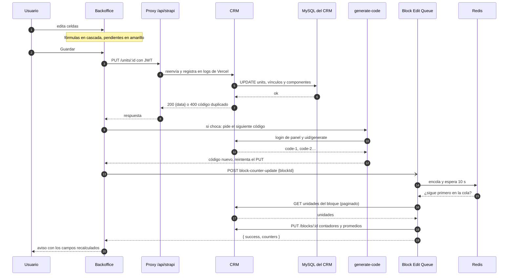

**Cómo probarlo**

1. Cambiar el precio total de una unidad y guardar
2. Esperar unos 15 s y abrir la vista del bloque
3. En Vercel → Logs, buscar el PUT /units con el correo del usuario

**Resultado esperado:** No quedan celdas amarillas y el bloque muestra el nuevo precio promedio.

### Push al warehouse

Una corrida completa: del clic en /sync a la transacción en MySQL.

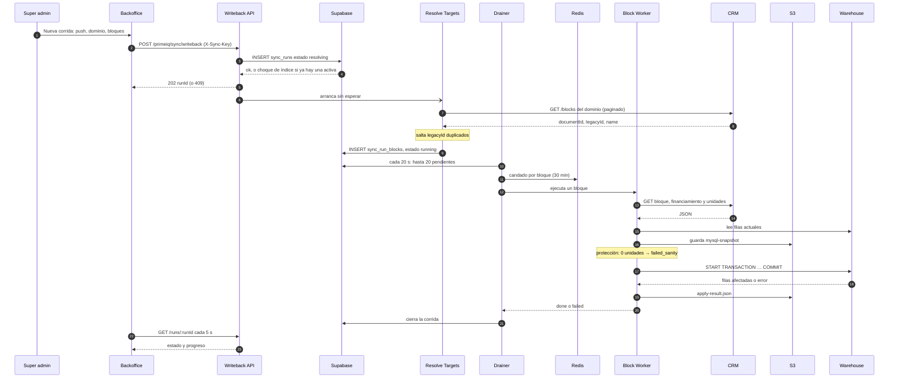

**Cómo probarlo**

1. Lanzar un push de un solo bloque de prueba
2. Confirmar el estado completed en /sync
3. Abrir Archivos de la corrida: mysql-snapshot y apply-result
4. SELECT * FROM housing_universe WHERE cod_proyecto = '<legacyId>'

**Resultado esperado:** La fila del warehouse coincide con el bloque en el CRM. Si algo falla, el respaldo en S3 permite restaurar.

### Pull desde el warehouse

Tres fases ordenadas: catálogos, proyectos y bloques con sus unidades.

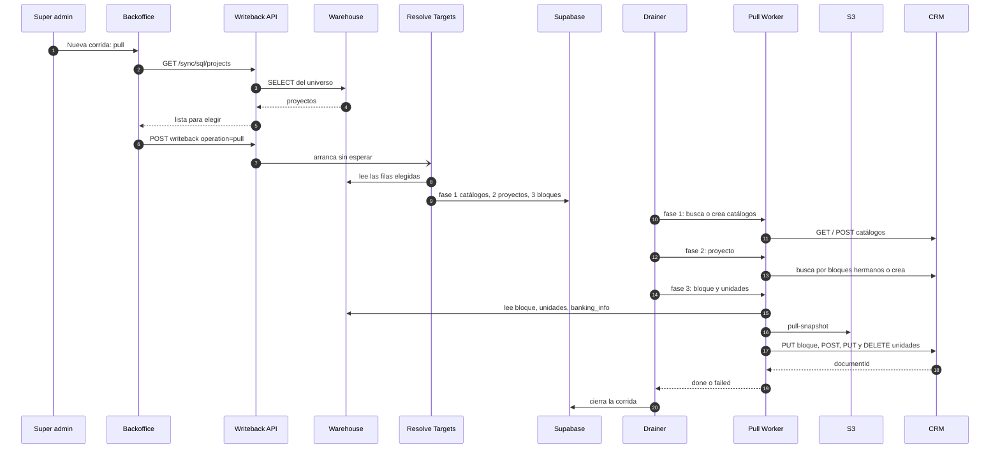

**Cómo probarlo**

1. Elegir un proyecto de prueba del warehouse
2. Correr pull solo de ese proyecto
3. Comparar /units/list con el warehouse
4. Confirmar que no había unidades creadas en el backoffice en ese bloque

**Resultado esperado:** El bloque en el CRM refleja el warehouse. Las unidades que no existen en MySQL se eliminan.

### Copilot

Una pregunta con un PDF adjunto.

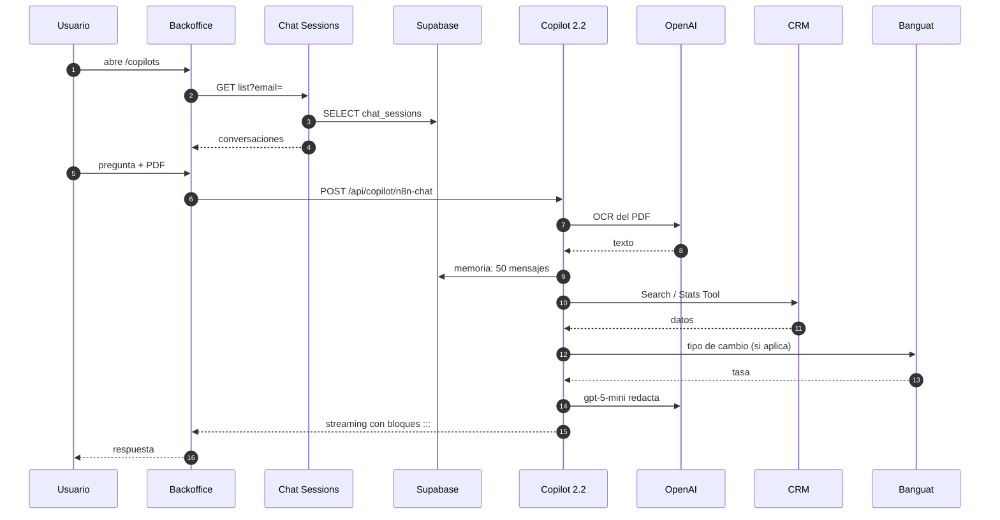

**Cómo probarlo**

1. Preguntar: ¿cuántas unidades disponibles tiene el bloque X?
2. Comparar con el contador del bloque en el backoffice
3. Recargar y confirmar que la conversación sigue en la lista

**Resultado esperado:** La cifra coincide con el CRM y la conversación queda guardada.

### Tipo de cambio

La captura cada 6 horas y la lectura desde el backoffice.

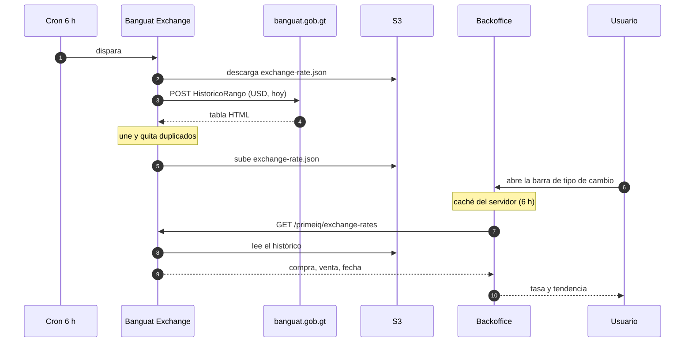

**Cómo probarlo**

1. Abrir la barra de tipo de cambio
2. En DevTools, ver el header x-exchange-rates-cache (hit, miss o stale)
3. Comparar con banguat.gob.gt

**Resultado esperado:** Mismo valor que Banguat. Si n8n falla, el backoffice muestra el último dato guardado.

### Login y permisos

Autenticación contra el CRM y decisión por rol.

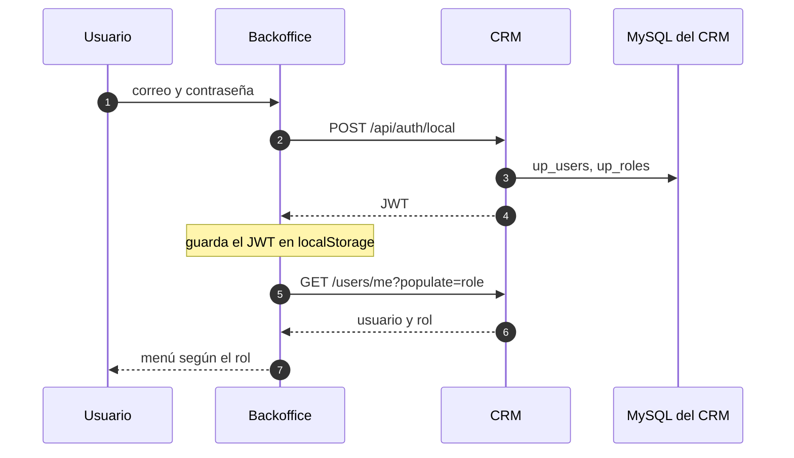

**Cómo probarlo**

1. Entrar con un usuario Operator: edita pero no borra
2. Entrar con Super Administrator: ve Nueva corrida en /sync
3. Bloquear un usuario en el CRM y confirmar que no entra

**Resultado esperado:** Cada rol ve y hace solo lo suyo; el CRM responde 403 a lo no permitido.

### Operar en Coolify

Revisar o reiniciar los contenedores del sistema de integraciones.

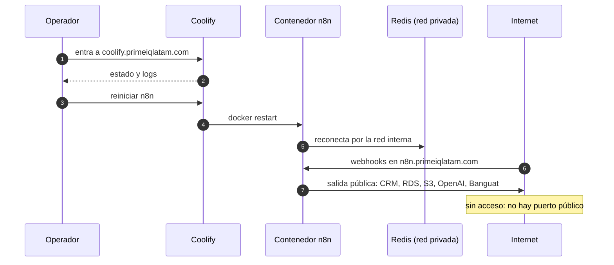

**Cómo probarlo**

1. En Coolify, abrir el contenedor n8n y revisar los logs
2. Desde un navegador, abrir n8n.primeiqlatam.com (responde)
3. Confirmar que Redis no responde desde internet (sin puerto público)

**Resultado esperado:** n8n responde en su dominio público y Redis solo es visible dentro de la red de Docker.

### Publicar una versión del backoffice

Solo la cuenta Admin-PrimeIQ despliega.

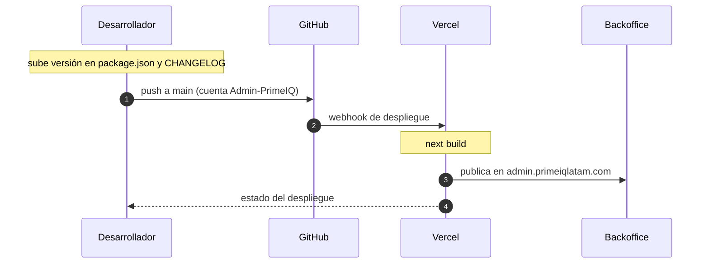

**Cómo probarlo**

1. Revisar el despliegue en Vercel
2. Abrir /settings y confirmar la versión nueva

**Resultado esperado:** La versión en /settings coincide con package.json.

### Estados de una corrida

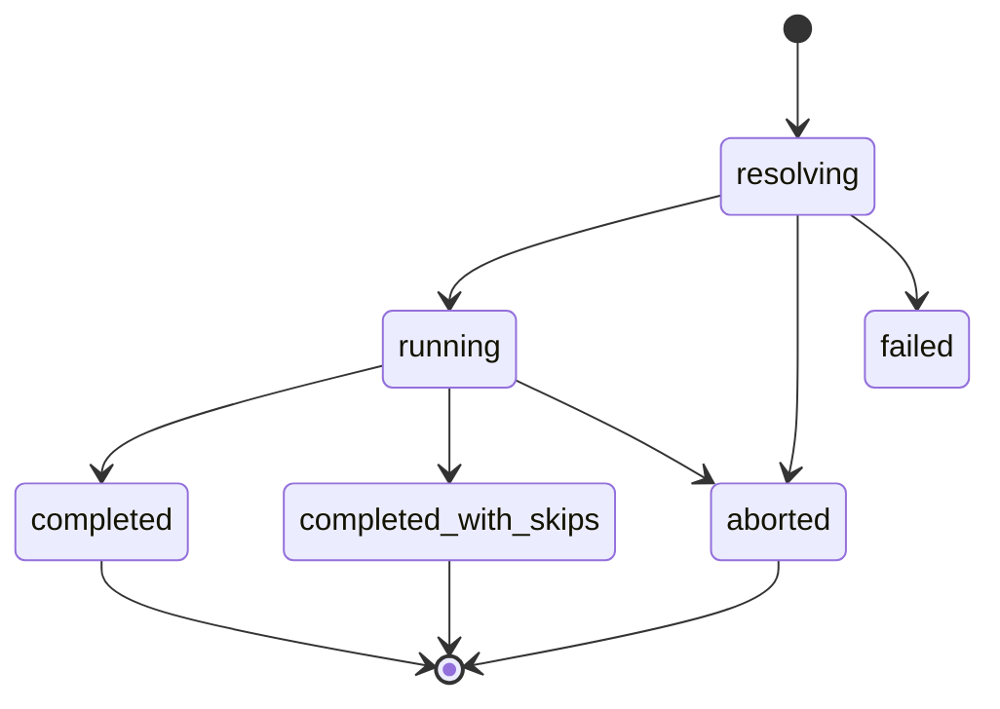

**Protecciones de la sincronización**

- Una sola corrida activa (índice en Postgres)
- Una transacción por bloque
- Respaldo en S3 antes de escribir
- Si el CRM trae 0 unidades y el warehouse tiene, no escribe ( `failed_sanity` )
- Si más del 20% de bloques cae en ese caso, aborta la corrida
- `force: true` desactiva la protección de vaciado

> **El pull no se puede deshacer** El pull borra del CRM las unidades que no estén en el warehouse (incluidas las creadas en el backoffice) y sobrescribe el resto. Guarda un respaldo en S3, pero no hay un comando de reversa. Después del cambio de IVA de mantenimiento (v1.27.2) debe correrse un push completo antes de cualquier pull.

---

## Reglas de negocio

*15 · Técnico*

Las fórmulas que aplica la hoja de unidades. Dependen del país del proyecto (`country.isoCode2`), así que los países en Strapi deben tener GT y SV bien cargados.

| Regla | Guatemala (GT) | El Salvador (SV) |
|---|---|---|
| IVA (divisor del precio) | 1.12 en general; uso "Venta" 0.916; Interior + Lote 1.12 | 1.0 (0%, provisional hasta aprobar la tasa) |
| Cuota mensual | 7.5% anual · 20 años · 90% financiado | 8% anual · 25 años · 85% financiado |
| País desconocido | Se usan los valores de Guatemala |  |

**Tamaños**

- Total = habitable + parqueo (parqueo solo en vertical)
- Habitable = unidad (+ balcón en vertical) o terreno en lotes
- Parqueo = espacios × 12.5 m²

**Varas**

- Admin: área × 1.431, lineal × 1.19
- Warehouse: área × 1.4342, lineal × 1.1976
- La diferencia es intencional; no alinear sin decidir quién manda.

**Región**

- GAM: periodos trimestrales `T1–T4`
- Interior: semestrales `S1/S2`

**Monedas**

- Todo se guarda en USD
- La moneda local sale del perfil de tipo de cambio del proyecto
- En el warehouse solo las columnas `_qtz` llevan tipo de cambio

**Mantenimiento**

Viaja sin factor de IVA en ambas direcciones (desde el 29 sep 2026). Strapi es la fuente y el warehouse copia 1:1.

---

## Variables de entorno

*16 · Técnico*

Inventario completo por sistema. Los valores sensibles muestran solo sus primeros caracteres. Los valores reales de producción están en Vercel, App Runner y n8n; los de esta tabla vienen de los `.env` locales.

| Sistema | Variable | Para qué | Valor |
|---|---|---|---|
| Backoffice | `NEXT_PUBLIC_STRAPI_URL` | URL de Strapi (sin /api) | `https://gep8aekqnp.us-east-1.awsapprunner.com` |
| Backoffice | `STRAPI_USERNAME` | Usuario del panel de Strapi para generar códigos | `eng****` |
| Backoffice | `STRAPI_PASSWORD` | Contraseña de ese usuario | `Str****` |
| Backoffice | `STRAPI_URL` | Override de Strapi del lado servidor | `(no definida)` |
| Backoffice | `NEXT_PUBLIC_N8N_CHAT_WEBHOOK_URL` | Chat Trigger del Copilot (termina en /chat) | `https://n8n.primeiqlatam.com/webhook/506f****/chat` |
| Backoffice | `N8N_CHAT_WEBHOOK_UPSTREAM_URL` | Override del chat solo en servidor | `(no definida)` |
| Backoffice | `NEXT_PUBLIC_N8N_CHAT_STREAMING` | "true" activa respuestas en streaming | `(no definida)` |
| Backoffice | `NEXT_PUBLIC_N8N_CHAT_LOAD_PREVIOUS_SESSION` | "true" recarga el historial | `(no definida → false)` |
| Backoffice | `NEXT_PUBLIC_PRIMEIQ_SESSION_API_BASE` | Base de los webhooks de sesiones | `(def.) https://n8n.primeiqlatam.com/webhook` |
| Backoffice | `NEXT_PUBLIC_BLOCK_COUNTER_WEBHOOK_URL` | Recalcular contadores del bloque | `(def.) …/webhook/block-counter-update` |
| Backoffice | `EXCHANGE_RATES_WEBHOOK_URL` | Fuente del tipo de cambio | `(def.) …/webhook/primeiq/exchange-rates` |
| Backoffice | `EXCHANGE_RATES_CACHE_SECONDS` | Duración del caché | `(def.) 21600` |
| Backoffice | `NEXT_PUBLIC_GTQ_USD_RATE` | Tasa fija heredada (página vieja de proyecto) | `(no definida)` |
| Backoffice | `SYNC_API_URL` | Base de la API de sincronización | `https://n8n.primeiqlatam.com/webhook` |
| Backoffice | `SYNC_API_KEY` | Llave X-Sync-Key | `8e0****` |
| CRM (Strapi) | `HOST / PORT` | Dirección de escucha | `0.0.0.0 / 1337` |
| CRM (Strapi) | `NODE_ENV` | Modo de ejecución | `production en App Runner` |
| CRM (Strapi) | `APP_KEYS` | Llaves de sesión | `AWu****` |
| CRM (Strapi) | `API_TOKEN_SALT` | Sal de tokens de API | `rOw****` |
| CRM (Strapi) | `ADMIN_JWT_SECRET` | Secreto de JWT del panel | `wlO****` |
| CRM (Strapi) | `TRANSFER_TOKEN_SALT` | Sal de tokens de transferencia | `U3h****` |
| CRM (Strapi) | `ENCRYPTION_KEY` | Cifrado de secretos del panel | `WIL****` |
| CRM (Strapi) | `JWT_SECRET` | JWT de usuarios del backoffice | `TV2****` |
| CRM (Strapi) | `DATABASE_CLIENT` | Motor de base | `mysql` |
| CRM (Strapi) | `DATABASE_HOST` | Host RDS | `strapi.cfkk****.us-east-2.rds.amazonaws.com` |
| CRM (Strapi) | `DATABASE_PORT / DATABASE_NAME` | Puerto y base | `3306 / strapi` |
| CRM (Strapi) | `DATABASE_USERNAME` | Usuario de base | `adm****` |
| CRM (Strapi) | `DATABASE_PASSWORD` | Contraseña de base | `Aur****` |
| CRM (Strapi) | `DATABASE_SSL / _REJECT_UNAUTHORIZED` | SSL activo, sin validar certificado | `true / false` |
| CRM (Strapi) | `DATABASE_POOL_MIN / _MAX` | Conexiones | `(def.) 2 / 10` |
| CRM (Strapi) | `SMTP_HOST / SMTP_PORT` | Servidor de correo | `smtp.gmail.com / 587` |
| CRM (Strapi) | `SMTP_USERNAME` | Cuenta de correo SMTP | `kik****` |
| CRM (Strapi) | `SMTP_PASSWORD` | Contraseña de aplicación de Gmail | `xtf****` |
| CRM (Strapi) | `SMTP_DEFAULT_FROM / _REPLY_TO` | Remitente | `no-reply@devroot.studio` |
| CRM (Strapi) | `API_MAX_LIMIT` | Tope de resultados por página | `(def.) -1 = sin tope` |
| CRM (Strapi) | `WEBHOOKS_POPULATE_RELATIONS · FLAG_NPS · FLAG_PROMOTE_EE` | Opciones del panel | `(valores por defecto)` |
| Integraciones (n8n) | `N8N_API_URL` | Instancia de n8n | `https://n8n.primeiqlatam.com` |
| Integraciones (n8n) | `N8N_API_KEY` | Llave de la API pública de n8n | `eyJh****` |
| Integraciones (n8n) | `STRAPI_COPILOT_TOKEN (inyectado)` | Token de solo lectura de las herramientas del Copilot | `600****` |

---

## Lo que sigue para Market Scan

`>_ /dev/root`

Dev Root Studio diseñó y construyó el backoffice, el CRM, las integraciones y el Copilot de este sistema. Estas son otras soluciones que hacemos y que pueden sumar a Prime IQ sobre la misma base.

- **WhatsApp Business:** El Copilot y las consultas de mercado por WhatsApp: agentes con IA, catálogo de proyectos y chat center para el equipo comercial.
- **App móvil de captura:** Levantamiento en campo desde iOS y Android, con fotos, ubicación y trabajo sin conexión que sincroniza con el CRM.
- **Agentes de IA:** Lectura de brochures y listas de precios en PDF directo a la hoja de unidades, y análisis de absorción y tendencias.
- **Portal para clientes de Prime IQ:** Dashboards de mercado, reportes descargables y analítica en tiempo real con acceso por cliente.
- **Suscripciones y pagos:** Venta de reportes y planes de datos con nuestro orquestador de pagos (3DS).
- **Infraestructura y CI/CD:** Despliegues automáticos, monitoreo y entornos de prueba en AWS.
- **Advisor as a Service:** Un socio técnico C-level para el roadmap de producto y datos de Prime IQ.

### Ya conocemos Market Scan

Construimos y documentamos cada pieza de este sistema. Cualquier mejora arranca sin curva de aprendizaje, sobre la misma infraestructura de Prime IQ.

| Cifra | Qué |
|---|---|
| 3 | sistemas en producción |
| 9 | integraciones en n8n |
| 87 | tablas documentadas |
| 238k | unidades en el CRM |

**Primer paso:** Una sesión de prioridades: revisamos juntos qué de esta lista mueve más a Market Scan y armamos el plan.

**Contacto:** [devroot.studio](https://devroot.studio) · kike@devroot.studio · WhatsApp +502 5050 2180

---

## Runbooks

*17 · Operación*

Guías para saber qué revisar cuando algo falla, y los procedimientos más comunes.

> **Una primera revisión, no la solución definitiva** Estas guías sirven para no empezar de cero: dicen qué mirar primero y dónde. Cada problema puede ser un mundo distinto y la causa puede no tener nada que ver con lo que aquí se describe, por ejemplo falta de memoria en un servidor, un cambio de red o una caída del proveedor. Si después de revisar sigue igual, escale con lo que encontró.

**Antes de todo**

- ¿Le pasa a una sola persona o a todos? Si es a una sola, empiece por su sesión, su rol y su navegador.
- ¿Qué cambió recientemente? Un despliegue, una variable de entorno o un workflow editado suelen ser la causa.
- ¿El proveedor está bien? Revise [Vercel](https://www.vercel-status.com) , [AWS](https://health.aws.amazon.com/health/status) , [OpenAI](https://status.openai.com) y [Supabase](https://status.supabase.com) .

### Qué revisar si…

#### Si no se guarda un registro

*Al guardar un proyecto, bloque o unidad aparece un error, o las celdas siguen en amarillo.*

1. Leer el mensaje del aviso: casi siempre dice qué campo o qué regla falló.
2. Si menciona un código duplicado, esperar: el backoffice reintenta solo con el siguiente código libre.
3. Si dice que no hay permiso o la sesión venció, cerrar sesión y volver a entrar. Confirmar en el panel del CRM que el rol del usuario puede editar.
4. Probar guardar otro registro. Si tampoco se guarda, el problema es general: seguir con "El CRM no responde".
5. En Vercel → Logs, buscar la llamada /api/strapi con el correo del usuario y ver el código de respuesta (400 dato inválido, 401/403 sesión o permiso, 500 error del CRM).

**Dónde mirar:** [Vercel · Logs del backoffice](https://vercel.com) · [Panel del CRM · Usuarios](https://gep8aekqnp.us-east-1.awsapprunner.com/admin)

¿Sigue igual? Escriba a kike@devroot.studio con lo que revisó y lo que encontró.

#### Si el CRM no responde

*El backoffice no carga datos, el login falla o el panel /admin no abre.*

1. Abrir /admin y /api/projects?pagination[pageSize]=1 en el navegador. Si alguno responde, el CRM está vivo y el problema es de un dato o de permisos.
2. En AWS → App Runner, revisar el estado del servicio y su último despliegue. Si falló un despliegue reciente, volver a la versión anterior.
3. Revisar en App Runner los logs y las métricas de CPU y memoria: un pico de memoria puede tumbar el servicio aunque el código esté bien.
4. En AWS → RDS, revisar la base del CRM: estado, conexiones activas y espacio libre.
5. Si nada de lo anterior explica la caída, redesplegar el servicio desde App Runner.

**Dónde mirar:** [AWS · App Runner](https://console.aws.amazon.com/apprunner) · [AWS · RDS](https://console.aws.amazon.com/rds) · [Estado de AWS](https://health.aws.amazon.com/health/status)

¿Sigue igual? Escriba a kike@devroot.studio con lo que revisó y lo que encontró.

#### Si n8n se cae o las integraciones no responden

*No avanzan las sincronizaciones, no se actualizan los contadores o n8n.primeiqlatam.com no abre.*

1. Abrir n8n.primeiqlatam.com. Si no carga, entrar a Coolify.
2. En Coolify, revisar que los contenedores de n8n y Redis estén corriendo y leer sus logs.
3. Revisar memoria, CPU y disco del servidor en Coolify: un disco lleno o falta de memoria detiene los contenedores.
4. Reiniciar el contenedor de n8n desde Coolify. Si Redis estaba detenido, iniciarlo primero.
5. Ya dentro de n8n, confirmar que estén activos Sync Writeback API, Sync Drainer, Block Edit Queue y Banguat, y revisar Executions buscando errores recientes.

**Dónde mirar:** [Coolify](https://coolify.primeiqlatam.com) · [n8n](https://n8n.primeiqlatam.com) · [AWS · EC2](https://console.aws.amazon.com/ec2)

¿Sigue igual? Escriba a kike@devroot.studio con lo que revisó y lo que encontró.

#### Si el Copilot deja de responder

*La pregunta queda cargando, llega un error o la respuesta viene vacía.*

1. Probar con una pregunta corta y sin archivos. Si así responde, el problema puede ser el archivo (muy grande o en un formato no soportado).
2. Confirmar que n8n está arriba (ver "n8n se cae").
3. En n8n, revisar que el workflow Orchestrator → AI Agents (2.2) esté activo y ver su última ejecución.
4. Si el error menciona a OpenAI, revisar en su consola el saldo, los límites de uso y que la llave siga vigente.
5. Si falla al cargar el historial, revisar que Supabase esté disponible.

**Dónde mirar:** [n8n · Executions](https://n8n.primeiqlatam.com) · [Estado de OpenAI](https://status.openai.com) · [Estado de Supabase](https://status.supabase.com)

¿Sigue igual? Escriba a kike@devroot.studio con lo que revisó y lo que encontró.

#### Si una sincronización se queda trabada o falla

*Una corrida en /sync no avanza, termina en failed o con bloques saltados.*

1. Abrir la corrida en /sync y ver qué bloques fallaron y su mensaje.
2. Bloques "saltados" suelen ser legacyId repetidos entre dos bloques: corregirlos en el backoffice y volver a correr.
3. "failed_sanity" indica que el bloque llegó sin unidades: revisar el bloque antes de forzar.
4. Si la corrida no se mueve por varios minutos, confirmar que el Drainer esté activo en n8n; si hace falta, usar Liberar en /sync.
5. Revisar los archivos de la corrida (respaldo y resultado) para ver qué se escribió.

**Dónde mirar:** [Backoffice · /sync](https://admin.primeiqlatam.com/sync) · [n8n · Executions](https://n8n.primeiqlatam.com)

¿Sigue igual? Escriba a kike@devroot.studio con lo que revisó y lo que encontró.

#### Si los contadores del bloque no se actualizan

*Después de guardar unidades, los totales o promedios del bloque siguen igual.*

1. Esperar unos 15 segundos y recargar: el recálculo espera 10 s para juntar varios guardados.
2. Guardar de nuevo cualquier unidad del bloque para volver a disparar el recálculo.
3. En n8n, revisar que Block Edit Queue esté activo y ver su última ejecución.
4. Confirmar que Redis está corriendo en Coolify.

**Dónde mirar:** [n8n · Block Edit Queue](https://n8n.primeiqlatam.com) · [Coolify](https://coolify.primeiqlatam.com)

¿Sigue igual? Escriba a kike@devroot.studio con lo que revisó y lo que encontró.

#### Si no aparece o no se actualiza el tipo de cambio

*La barra lateral no muestra el tipo de cambio o muestra un valor viejo.*

1. El backoffice guarda el dato 6 horas y, si n8n no responde, muestra el último que tenía. Revisar la fecha que aparece.
2. En n8n, confirmar que Banguat Exchange Rate esté activo y que su ejecución programada no tenga errores.
3. Abrir banguat.gob.gt: si la página del banco no responde, el dato se actualizará cuando vuelva.

**Dónde mirar:** [n8n · Banguat Exchange Rate](https://n8n.primeiqlatam.com) · [Banguat](https://www.banguat.gob.gt)

¿Sigue igual? Escriba a kike@devroot.studio con lo que revisó y lo que encontró.

#### Si un usuario no puede iniciar sesión

*El login rechaza el correo o la contraseña, o no llega el correo de recuperación.*

1. Confirmar que el CRM responde (ver "El CRM no responde").
2. En el panel del CRM → Usuarios, revisar que el usuario exista, esté confirmado y no esté bloqueado.
3. Usar "Olvidé mi contraseña". Si el correo no llega, revisar spam y la configuración SMTP del CRM.
4. Como alternativa, un administrador puede asignar una contraseña nueva desde el panel.

**Dónde mirar:** [Panel del CRM · Usuarios](https://gep8aekqnp.us-east-1.awsapprunner.com/admin)

¿Sigue igual? Escriba a kike@devroot.studio con lo que revisó y lo que encontró.

#### Si el backoffice no carga o muestra un error en pantalla

*admin.primeiqlatam.com queda en blanco, no termina de cargar o muestra un error.*

1. Probar en una ventana privada para descartar la sesión o la caché del navegador.
2. Revisar el estado de Vercel y el último despliegue del proyecto. Si el problema empezó con un despliegue, volver al anterior desde Vercel.
3. Revisar en Vercel que las variables de entorno sigan configuradas.
4. Si la pantalla carga pero sin datos, el problema está en el CRM o en n8n.

**Dónde mirar:** [Vercel · Deployments](https://vercel.com) · [Estado de Vercel](https://www.vercel-status.com)

¿Sigue igual? Escriba a kike@devroot.studio con lo que revisó y lo que encontró.

#### Si coolify o el servidor no responden

*coolify.primeiqlatam.com y n8n.primeiqlatam.com no abren al mismo tiempo.*

1. En AWS → EC2, revisar el estado de la instancia y sus verificaciones de estado.
2. Revisar el uso de CPU, memoria y disco de la instancia: un disco lleno es una causa frecuente.
3. Reiniciar la instancia desde la consola de AWS. Al volver, Coolify levanta los contenedores.
4. Revisar que el dominio siga apuntando a la IP del servidor.

**Dónde mirar:** [AWS · EC2](https://console.aws.amazon.com/ec2) · [Estado de AWS](https://health.aws.amazon.com/health/status)

¿Sigue igual? Escriba a kike@devroot.studio con lo que revisó y lo que encontró.

### Procedimientos frecuentes

#### Desplegar el backoffice

1. Trabajar en una rama y abrir PR hacia main
2. Subir versión en package.json y anotar en CHANGELOG.md (y lib/changelog.ts para el aviso en la app)
3. Hacer commit con la cuenta Admin-PrimeIQ (engteam@primeiqlatam.com)
4. Merge a main: Vercel despliega solo
5. Revisar los logs de funciones en Vercel

#### Desplegar Strapi

1. Probar localmente contra una copia de la base
2. Si hay migración: snapshot de RDS antes
3. Push a main en Admin-PrimeIQ/dataSystem
4. App Runner recompila y publica
5. Verificar /admin y una llamada a /api/projects

#### Cambiar el modelo de datos

1. Editar el esquema con el Content-Type Builder en una copia local del CRM
2. Revisar que el backoffice (lib/api/strapi.ts) refleje el campo
3. Revisar los mappers de los workflows de sincronización en n8n si el campo viaja al warehouse
4. Exportar permisos con npm run config:dump
5. Desplegar el CRM y luego el backoffice

#### Sincronizar con el warehouse

1. Entrar como super admin a /sync
2. Nueva corrida: elegir push o pull, dominio y bloques
3. Seguir el avance; los bloques con legacyId duplicado se saltan
4. Si algo falla, abrir el detalle: cada bloque tiene su respaldo en S3
5. Si queda trabada, usar "Liberar"

#### Publicar cambios a los workflows de sync

1. Exportar el workflow actual como respaldo (node scripts/n8n-sync.js pull en n8n-manager)
2. Editar el workflow en n8n o su JSON en n8n-manager
3. Probar con un bloque de prueba desde /sync
4. Guardar el JSON en n8n-manager y hacer commit
5. Si se editó el JSON: node scripts/n8n-sync.js push, y activate si hace falta

#### Contadores de bloque desactualizados

1. Abrir la hoja del bloque y guardar cualquier unidad: dispara el recálculo
2. O llamar el webhook directo: POST https://n8n.primeiqlatam.com/webhook/block-counter-update con {"blockId": "<documentId>"}
3. Revisar la ejecución de Block Edit Queue en n8n

#### Celdas amarillas permanentes en unidades

1. Indican que lo guardado no coincide con las fórmulas actuales
2. Abrir el bloque y revisar el diálogo de diferencias
3. Guardar desde la hoja: el backoffice escribe los valores recalculados
4. Si son muchos bloques, coordinar una corrección masiva con el equipo técnico

#### Rotar un secreto

1. Generar el nuevo valor en el proveedor (Strapi, AWS, OpenAI…)
2. Actualizarlo en Vercel, App Runner o la credencial de n8n según corresponda
3. Redesplegar el servicio afectado
4. Verificar y revocar el valor anterior

---

## Glosario

*18 · Operación*

Los términos de negocio y técnicos que aparecen en el backoffice y en este documento.

- **Absorción** (Negocio): Ritmo al que se venden las unidades; se guarda por unidad y por m².
- **Backoffice** (Plataforma): Dashboard administrativo de Market Scan en admin.primeiqlatam.com.
- **Bloque** (Negocio): Fase, torre o sector de un proyecto en un periodo de recolección. Equivale a una fila del universo en el warehouse.
- **Bloques :::** (Backoffice): Formato con el que el Copilot arma tarjetas, tablas, notas y botones en sus respuestas.
- **Cascada** (Backoffice): Al cambiar un campo, la hoja recalcula los que dependen de él y los marca para guardar.
- **Catálogo** (Backoffice): Lista que se mantiene en /catalogs y se elige en los formularios: amenidades, servicios, estados, usos, topografías…
- **Celdas amarillas** (Backoffice): Valores pendientes de guardar o que no coinciden con las fórmulas actuales. Al guardar quedan al día.
- **cod_proyecto** (Datos y sincronización): Llave que une un bloque del CRM con su fila del warehouse.
- **Componente** (Datos y sincronización): Grupo de campos que se guarda en su propia tabla, como el financiamiento del bloque o las monedas del perfil.
- **Contadores del bloque** (Backoffice): Totales, disponibles y promedios del bloque. Se recalculan solos después de guardar unidades.
- **Coolify** (Plataforma): Panel en coolify.primeiqlatam.com que despliega y reinicia los contenedores de n8n y Redis.
- **Copilot** (Backoffice): Asistente de IA del backoffice que responde sobre los datos del CRM.
- **Corrida** (Datos y sincronización): Una ejecución de push o pull, con su bitácora, progreso y respaldos.
- **CRM** (Plataforma): Strapi: donde viven los datos, los usuarios y los permisos.
- **Cuota** (Negocio): Pago mensual estimado del crédito según el país: Guatemala 7.5% anual a 20 años con 90% financiado; El Salvador 8% a 25 años con 85%.
- **Desarrolladora** (Negocio): Empresa que construye el proyecto.
- **Disponibilidad** (Negocio): Si la unidad sigue disponible o ya no. Los contadores del bloque se calculan a partir de ella.
- **documentId** (Datos y sincronización): Identificador estable de cada registro en el CRM. Es el que usa la API.
- **Dominio** (Negocio): Tipo de inmueble del bloque: vivienda, oficinas o industrial. Decide qué campos y columnas se muestran.
- **Enganche** (Negocio): Porcentaje del precio que se paga antes del crédito. Puede ser fraccionado.
- **Fase, torre y sector** (Negocio): Partes en que se divide un proyecto. Arman el nombre del bloque: "Proyecto - Fase X - Sector Y - Torre Z".
- **FHA** (Negocio): Institución de crédito hipotecario de Guatemala. Aparece como opción de financiamiento del proyecto y del bloque.
- **Financiamiento del bloque** (Negocio): Enganche, plazos y tasa anual de 18 bancos y del financiamiento propio del desarrollador.
- **GAM e Interior** (Negocio): Región del bloque según su periodo: trimestral (T1 a T4) es GAM; semestral (S1, S2) es Interior.
- **Hoja de unidades** (Backoffice): Pantalla /units/list/:id donde se editan las unidades de un bloque como en Excel.
- **Ingreso requerido** (Negocio): Ingreso mensual que necesita un comprador para pagar la cuota.
- **legacyId** (Datos y sincronización): Identificador del warehouse guardado en el bloque o la unidad del CRM.
- **Mantenimiento** (Negocio): Cuota de mantenimiento total y por m². Viaja igual entre el CRM y los tableros.
- **Mercado primario y secundario** (Negocio): Primario: venta del desarrollador. Secundario: reventa.
- **Moneda local** (Negocio): Quetzal, colón, peso u otra. Se muestra y edita en la hoja, pero todo se guarda en USD.
- **NSE** (Negocio): Nivel socioeconómico al que apunta el proyecto.
- **Parqueo** (Negocio): Cada espacio cuenta 12.5 m². Suma al tamaño total solo en edificios verticales.
- **Perfil de tipo de cambio** (Negocio): Conjunto de tasas de compra y venta por moneda que usa un proyecto para mostrar precios en moneda local.
- **Periodo** (Negocio): Año y corte de recolección del bloque: trimestral (T1 a T4) o semestral (S1, S2).
- **Precio sin IVA** (Negocio): Precio total dividido entre el factor de IVA del país y la operación (1.12 en Guatemala, 0.916 en Venta; 1.0 en El Salvador).
- **Proyecto** (Negocio): Desarrollo inmobiliario. Agrupa uno o varios bloques y define país, desarrolladora, amenidades, servicios y tipo de cambio.
- **Pull** (Datos y sincronización): Traer al CRM lo que existe en el warehouse. Puede borrar unidades que no estén allí.
- **Push** (Datos y sincronización): Envío de bloques y unidades del CRM al warehouse.
- **Redis** (Plataforma): Memoria rápida que usan las integraciones para progreso, candados y colas.
- **Respaldo de corrida** (Datos y sincronización): Copia en S3 de los datos antes de escribir cada bloque.
- **Sistema de integraciones** (Plataforma): n8n: sincronización, contadores, tipo de cambio y Copilot.
- **Supabase** (Plataforma): Base Postgres con la bitácora de sincronización y las conversaciones del Copilot.
- **Super admin** (Backoffice): Rol Super Administrator del CRM. Es el único que lanza y detiene sincronizaciones.
- **Tabla de vínculo** (Datos y sincronización): Tabla _lnk donde el CRM guarda cada relación entre registros.
- **Tableros** (Datos y sincronización): Herramientas de análisis de Prime IQ que consultan el warehouse.
- **Tamaño total y habitable** (Negocio): Habitable: tamaño de la unidad (más balcón en vertical) o del terreno en lotes. Total: habitable más parqueo en edificios verticales.
- **Tasa de compra y de venta** (Negocio): Los dos valores de cada moneda en un perfil. El precio local se calcula con la tasa de compra.
- **Tipo de unidad** (Datos y sincronización): Campos propios de vivienda, oficinas o industrial dentro de la unidad (zona dinámica del CRM).
- **Unidad** (Negocio): Apartamento, casa, lote, oficina o bodega dentro de un bloque, con sus medidas, precios y disponibilidad.
- **Varas y varas²** (Negocio): Medida local. El backoffice convierte m² a varas² (× 1.431) y metros lineales a varas (× 1.19).
- **Variables de entorno** (Plataforma): Configuración de cada sistema (direcciones, llaves) que vive fuera del código.
- **Warehouse** (Datos y sincronización): Base MySQL histórica que leen los tableros de Prime IQ.
- **Webhook** (Plataforma): Dirección web que dispara un workflow cuando otro sistema la llama.
- **Workflow** (Plataforma): Un flujo automatizado dentro de n8n.

---

with <3 by [Dev Root Studio](https://devroot.studio) · Documento generado el 8 de octubre de 2026 a partir de los repositorios del backoffice, del CRM y de n8n-manager.
