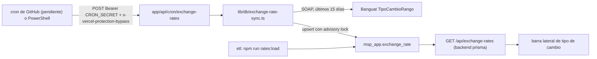

# Tipo de cambio de Banguat en la app nueva: contexto para continuar

Documento de traspaso para que otro agente retome la conversación del **29 oct 2026 (7:00–12:15, UTC-6)** sobre el tipo de cambio USD/GTQ: paso 1 de la §7 de [`N8N_WORKFLOWS.md`](N8N_WORKFLOWS.md), que reemplaza el workflow 7 de n8n (Banguat Exchange Rate). Estado comprobado con git a las 12:15: rama `feat/data-facade`, árbol limpio, al día con `origin/feat/data-facade`, último commit `535ee5f`.

## 0. Antes de hacer cualquier cosa

Esto **no reemplaza** las reglas del repo, solo apunta a ellas:

- Leer y cumplir la sección **"0. Lectura obligatoria"** de [`README.md`](README.md) y de [`ROADMAP.md`](ROADMAP.md), y la skill `.agents/skills/proteger-produccion/SKILL.md`. Producción (Strapi, n8n, Coolify, MySQL `strapi` / `dbo_stage` / `dbo`, el `dbo` de Postgres, Supabase, Redis, S3 y el Vercel de `admin.primeiqlatam.com`) no se toca.
- Leer [`CLAUDE.md`](../../CLAUDE.md) (arquitectura, comandos, convenciones) y usar `graphify query` antes de explorar código; `graphify update .` después de cambiarlo.
- Del GET público de n8n de tipo de cambio solo se permite **leer** (`https://n8n.primeiqlatam.com/webhook/primeiq/exchange-rates`). Ningún webhook de n8n con `POST`.

## 1. Cómo trabaja el usuario

- Responder **en español**.
- Pide "**no supongas nada**": lo que no se pueda comprobar se pregunta (con la herramienta de preguntas), no se inventa.
- **El usuario hace los commits y el push** (cuenta `Admin-PrimeIQ`, que es la única que despliega en Vercel). El agente no hace `git push`.
- Las variables del `.env` las agrega o cambia **el usuario**. El agente no imprime valores del `.env`: lo comprueba con scripts que solo muestran sí/no o largos (ver §7).
- Versión: el agente propone el número (`package.json` + entrada en `CHANGELOG.md`) y el usuario decide.

## 2. Decisiones que tomó el usuario

| Tema | Decisión |
|---|---|
| Fuente | Servicio SOAP oficial de Banguat (`TipoCambio.asmx`, operación `TipoCambioRango`), no n8n. n8n solo como referencia de paridad. |
| Compra y venta | Igual que n8n: si compra = venta se guarda solo `reference_rate` (compra y venta en `null`); si difieren (solo el 30/11/2006 y el 01/12/2006) se guardan compra y venta, sin referencia. |
| Dónde viven los scripts | `etl/src/exchange-rates/` (carga del histórico y paridad). |
| Inicio del histórico | 30/11/2006, el primer día que sirve n8n. |
| Histórico paginado (el GET para el Copilot) | Fuera de este paso: va con el paso 8 de la §7 de `N8N_WORKFLOWS.md`. |
| Tarea periódica | **Una vez al día, 7:17 de Guatemala** (`17 13 * * *` en UTC; el minuto 17 evita la congestión de GitHub al minuto 0). La hace una ruta del **Vercel de staging**, disparada por un **cron de GitHub Actions** (`.github/workflows/exchange-rates.yml`). |
| Por qué no Vercel Cron | `vercel.json` vive en el repo y también se aplicaría al proyecto de producción (mismo repo). Además el plan Hobby solo permite un cron al día. |
| Cuándo entra el workflow de GitHub | **Cuando `feat/data-facade` se fusione a `main`** (fusionada el 29 oct en el [PR #9](https://github.com/Admin-PrimeIQ/marketscanprime/pull/9)). GitHub solo dispara workflows programados desde la rama por defecto, y un push a `main` despliega `admin.primeiqlatam.com`. No se toca el proyecto de producción de Vercel. |
| Primera prueba en Vercel | Manual, desde la máquina del usuario (hecha, ver §4). |

## 3. Qué hay en el código (v1.34.0 y v1.35.0)

Flujo:



| Archivo | Qué hace |
|---|---|
| `lib/domain/exchange-rates/dates.ts` | `DD/MM/AAAA` ↔ `AAAA-MM-DD` sin `new Date(texto)`; `daysInRange`, `todayInGuatemala` (UTC-6), `recentRange(días)`, `rangeCoverage` (días faltantes y fuera de rango). |
| `lib/domain/exchange-rates/banguat.ts` | Sobre SOAP, traducción de la respuesta a filas (`parseTipoCambioRango`), regla de compra/venta (`rowFromBanguat`). Lanza ante `TotalItems` que no cuadra, fechas repetidas, otra moneda o números inválidos. Fixtures reales en `fixtures/`. |
| `lib/domain/exchange-rates/banguat-client.ts` | `fetchTipoCambioRango(from, to, { timeoutMs, attempts, onRetry })`. Una sola copia para `etl/` y la app. |
| `lib/domain/exchange-rates/upsert-sql.ts` | SQL único del upsert (`unnest`, `ON CONFLICT … WHERE … IS DISTINCT FROM`, `RETURNING (xmax = 0)`), `upsertCounts`, `EXCHANGE_RATES_LOCK_KEY = "msp_app_exchange_rates"`. |
| `lib/domain/exchange-rates/compare.ts` | Tendencia de la barra (`compareSnapshots`); `lib/exchange-rates.ts` la reexporta. |
| `lib/db/exchange-rates.ts` + `exchange-rate-mapping.ts` | Lectura de los dos días más recientes para la barra (backend `prisma`). |
| `app/api/exchange-rates/route.ts` | Con backend `prisma` lee la tabla (sesión de Better Auth requerida); con `strapi` sigue con el webhook de n8n, sin cambios. |
| `lib/db/exchange-rate-sync.ts` | `syncRecentExchangeRates()`: Banguat fuera de la transacción (20 s, 2 intentos), luego `$transaction` con `pg_try_advisory_xact_lock`, `statement_timeout` 30 s y el upsert con `$queryRawUnsafe`. Errores tipados: `ExchangeRateSourceError`, `ExchangeRateSyncBusyError`. |
| `app/api/cron/exchange-rates/route.ts` | Solo `POST`, `maxDuration` 60. **404** si el backend no es `prisma`, si `assertPrismaActionsAllowed()` falla (exige `MSP_STAGING_DEPLOY=true` fuera de `next dev`) o si `CRON_SECRET` falta o tiene menos de 32 caracteres. **401** secreto inválido, **409** lock ocupado, **502** Banguat, **503** base, **200** con `{ from, to, received, missingDays, banguatMs, inserted, updated, unchanged, ms }`. Log `cron:POST` con `logApi`. |
| `lib/cron-secret.ts` | Comparación del Bearer en tiempo constante (SHA-256 + `timingSafeEqual`). |
| `etl/src/exchange-rates/` | `index.ts` (comandos `load` y `parity`), `upsert.ts` (envoltorio de `pg` sobre el SQL compartido), `n8n-get.ts` (GET paginado de n8n), `parity.ts`. Reportes en `etl/reports/` (ignorado por git). |

Pruebas: `npm test` en la raíz (169/169 al 29 oct) y `npm test` en `etl/` (57/57).

## 4. Hechos comprobados (no repetir la investigación)

- **Banguat:** `POST https://www.banguat.gob.gt/variables/ws/TipoCambio.asmx`, `SOAPAction: "http://www.banguat.gob.gt/variables/ws/TipoCambioRango"`, `fechainit` / `fechafin` en `dd/mm/aaaa`. Todo el histórico (7,274 días, del 30/11/2006 al 29/10/2026) cabe en una consulta (~0.7 MB). Fines de semana repiten el último día hábil; no hay huecos. Por `GET` la operación da error (solo SOAP). El dato del día ya estaba publicado antes de las 7:00 de Guatemala el 29 oct.
- **GET de n8n:** pagina con `?page=N&size=100` (también `pageNumber`/`pageSize`); ignora `page[number]` / `page[size]` aunque los anuncie en sus `links`. `totalRecords` = 7,274 (el manual dice 2,475: desactualizado).
- **Carga real** (autorizada): 7,274 filas en `msp_app.exchange_rate`; repetida, 0 cambios. **Paridad contra n8n: 7,274 de 7,274 iguales.**
- **Barra lateral** en `pnpm dev:staging` con sesión: 200 desde la tabla (`| db` en el log), 401 sin sesión.
- **Ruta del cron, local:** 404 sin `CRON_SECRET`; con él, 401 sin secreto o con uno falso y 200 con el correcto (15 recibidos, 15 iguales).
- **Ruta del cron en el Vercel de staging (12:05):** 200, 15 recibidos, 15 iguales, Banguat 329 ms. **Banguat responde a las IP de Vercel.** El staging tiene **Vercel Authentication** activa: sin el token de bypass Vercel responde 302 "Protected by Vercel Authentication".
- Un despliegue fijo de Vercel (`marketscanprime-<hash>-prime-iqs-projects.vercel.app`) **no ve variables agregadas después de construirse**: el primer intento dio 404 por eso. Último despliegue probado: `marketscanprime-awcrg2bu1-prime-iqs-projects.vercel.app`. El **dominio estable de la rama** de staging no se conoce todavía (lo da el usuario desde el panel de Vercel).

## 5. Variables (solo nombres; los valores nunca se imprimen)

| Variable | Dónde | Para qué |
|---|---|---|
| `CRON_SECRET` | `.env` local y proyecto de **staging** en Vercel (nunca producción) | Bearer de la ruta del cron. Al menos 32 caracteres. Documentada en `.env.staging.example`. El 29 oct la llamada a staging pasó con el valor del `.env` local, o sea que hoy coinciden. |
| `TOKEN_SECRET_VERCEL` | `.env` local (nombre elegido por el usuario) | Token de "Protection Bypass for Automation" del proyecto de staging; va en el encabezado `x-vercel-protection-bypass`. En Vercel la misma clave existe como `VERCEL_AUTOMATION_BYPASS_SECRET`. |
| `BETTER_AUTH_SECRET` / `BETTER_AUTH_URL` | `.env` local y staging | Sesiones del backend `prisma`. |
| `MSP_STAGING_DEPLOY=true` | solo staging | Habilita Server Actions y la ruta del cron fuera de `next dev`. |
| `DEV_LOGIN_PASSWORD` | `.env` local, línea 30 | Clave de `app-engteam` en texto plano. Ningún código la lee; se le recomendó al usuario borrarla. |

## 6. Comandos

```bash
# en etl/: recarga un rango (o todo sin --from) y prueba sin escribir
npm run rates:load -- --from 15/10/2026 --dry-run
npm run rates:load -- --from 15/10/2026
# en etl/: paridad contra el GET público de n8n (solo lectura)
npm run rates:parity
```

Corrida manual de la ruta en staging, desde PowerShell (pide los secretos para que no queden en el historial):

```powershell
$dominio = Read-Host "Dominio de staging (sin https://)"
$s = Read-Host "CRON_SECRET de staging"
$b = Read-Host "Token de bypass de Vercel"
$h = @{ Authorization = "Bearer $s"; "x-vercel-protection-bypass" = $b }
Invoke-RestMethod -Method Post -Uri "https://$dominio/api/cron/exchange-rates" -Headers $h -TimeoutSec 90 | ConvertTo-Json
```

## 7. Trampas encontradas (para no repetirlas)

- **`util.parseEnv` de Node** (lo usa `pnpm dev:staging`): una línea `CLAVE=` seguida de espacios se traga la línea siguiente como su valor. Así se "perdió" `BETTER_AUTH_SECRET`. Un valor vacío no debe terminar en espacios.
- **El nombre de la variable tiene que ser exacto**: el usuario escribió `Cron Secret` y la ruta respondía 404.
- **PowerShell expande `$`** dentro de `node -e "..."`: los scripts de comprobación van en un archivo `.cjs` en `%TEMP%` (a veces tarda un par de segundos en aparecer en disco; reintentar con `Start-Sleep`). Borrarlos al terminar.
- **El auto-review bloquea** listar nombres de variables del `.env` o leer credenciales de la base. Lo que sí pasa: un script que imprime solo sí/no, largos y números de línea de una variable concreta.
- **La herramienta Grep no lee el `.env`** (está en `.gitignore`): da "No matches" aunque la variable exista.
- **`next dev` crea `AGENTS.md`** en la raíz al arrancar (opción `agentRules` de Next). En esta conversación se borró cada vez que lo generó un servidor levantado por el agente; el usuario no dio una preferencia.
- `pnpm dev` (no `dev:staging`) expande los `$` del `.env`; para el login ya no importa, pero los hashes bcrypt de `DEV_LOGIN_PASSWORD_HASH` solo se leen bien con `dev:staging` o `dotenv` sin expandir.
- Clave nueva de `app-engteam` (29 oct): hash con `bcryptjs` costo 10 en `DEV_LOGIN_PASSWORD_HASH` (entre comillas simples) y `npm run app:local-user -- --apply` en `etl/`.

## 8. Pendiente, en orden

1. **Workflow escrito (29 oct):** [`.github/workflows/exchange-rates.yml`](../../.github/workflows/exchange-rates.yml). Diario a las 13:17 UTC más `workflow_dispatch`, `permissions: {}`, una corrida a la vez, solo en `Admin-PrimeIQ/marketscanprime`. Reintenta hasta 3 veces (60 s entre intentos) ante 409, 5xx o fallo de red; 401, 404 y redirecciones de Vercel fallan con un mensaje que dice qué revisar. Falla también si faltan más de un día en `missingDays`, y deja el resumen de la corrida en la página del job. Falta que el usuario lo haga llegar a `main` (commit + push) y lo dispare a mano una vez desde la pestaña Actions.
2. **Secretos en GitHub** (los crea el usuario en Settings → Secrets and variables → Actions): `MSP_STAGING_URL` (dominio estable de staging, con o sin `https://`, no la URL de un despliegue), `MSP_CRON_SECRET` (el `CRON_SECRET` de staging) y `MSP_VERCEL_BYPASS` (token de bypass).
   - El dominio estable sigue sin confirmarse (§4). Si el proyecto de staging seguía la rama `feat/data-facade`, hay que confirmar que ese dominio siga vivo después de la fusión (o que staging ahora siga otra rama).
3. **Semana en sombra:** `npm run rates:parity` contra n8n durante una semana antes de apagar el workflow 7 de n8n. Apagarlo es un cambio en producción: lo hace una persona, no el agente.
4. Mientras el workflow no esté en `main` con sus secretos, la tabla solo se actualiza a mano (PowerShell de la §6 o `rates:load`).
5. Histórico paginado para el Copilot: paso 8 de la §7 de `N8N_WORKFLOWS.md`.
6. Higiene del `.env`: borrar `DEV_LOGIN_PASSWORD` (texto plano).

## 9. Dónde está el detalle

- Ficha del workflow 7, §7 (paso 1) y bitácora del 29 oct (§8): [`N8N_WORKFLOWS.md`](N8N_WORKFLOWS.md).
- Estado en la §4.10 de [`ROADMAP.md`](ROADMAP.md).
- Entradas v1.34.0 y v1.35.0 de [`CHANGELOG.md`](../../CHANGELOG.md).
- Conversación original: transcript `f8eb3945-ffff-4a42-b315-487b3b1a086f` de Cursor.
